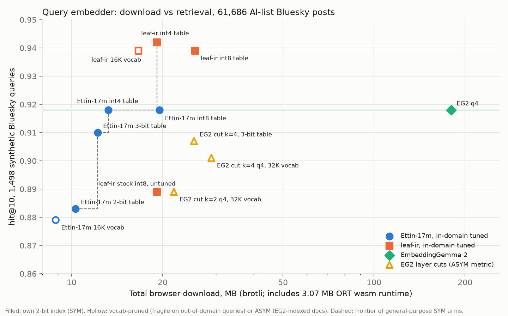

# RESULTS: Ettin as an in-browser query embedder, download vs retrieval

Run 2026-10-20/21 on Oskar's M1 MacBook Air (8 GB; MPS for training, CPU onnxruntime for
scoring, Chrome wasm and WebGPU for timing), as team member `ettin` of the embedding board
(issue #104). Task, split and metric are eg2-native-small's: 61,686 AI-list Bluesky posts,
1,498 held-out Haiku-synthetic queries, hit@10 = the query's source post in the top 10, each
arm scoring its own remex 2-bit index (SYM). EG2 q4 scores 0.918 on the same index.



## Answer

The frontier for general-purpose embedders is Ettin-17m at 7 to 10 MB, then leaf-ir.
Ettin-17m was distilled from Arctic-m-v1.5 and then tuned on in-domain query/post pairs.
On the hand-written WGSL engine (`web/engine.js`), with no onnxruntime, it ties EG2's hit@10 at
10.2 MB total download, EG2's own browser download being about 180 MB. It embeds a query in
about 2.4 ms end to end (1.35 ms of GPU work) and starts in about 0.2 s once the bytes are
cached. Without WebGPU, the same file runs on onnxruntime-web wasm for 3.07 MB more and 8.7 ms
per query. leaf-ir with the same tuning is the next point: 16.1 MB at 0.942, 3.8 ms on WebGPU.

| arm (in-domain tuned unless noted) | download MB, WebGPU engine (ORT fallback) | hit@10 [95% CI] | vs EG2, paired | real-query top-10 overlap with EG2 | real-query cos to fp32, p05 / min | ms per query: WebGPU engine / ORT wasm |
|---|---|---|---|---|---|---|
| Ettin-17m, 2-bit table | 7.3 (10.3) | 0.883 | −0.035 | 0.202 | 0.925 / 0.844 | — / 9.0 |
| Ettin-17m, 3-bit table | 9.2 (12.2) | 0.910 | −0.008 | 0.230 | 0.981 / 0.971 | 2.5 / 8.6 |
| **Ettin-17m, int4 table** | **10.2 (13.3)** | **0.918 [0.903, 0.931]** | **+0.000** | 0.229 | 0.992 / 0.982 | **2.4 / 8.7** |
| Ettin-17m, int8 table | 16.5 (19.5) | 0.918 | +0.000 | 0.231 | 0.999 / 0.999 | — / 9.2 |
| **leaf-ir, int4 table** | **16.1 (19.2)** | **0.942** | **+0.024** | 0.257 | 0.996 / 0.993 | **3.8 / 24.1** |
| leaf-ir, int8 table | 22.6 (25.6) | 0.939 | +0.021 | 0.259 | 1.000 | — / 24.2 |
| leaf-ir, stock int8, untuned (wasm #29) | 21.7 runtime-free (19.2 ORT) | 0.889 | −0.029 | 0.225 | — | 5.0 leaf-gpu, 10.8 leaf-wasm / 24 |
| EG2 q4 | ~180 (WebGPU only) | 0.918 | — | 1 | — | — |

Download = model + tokenizer.json at brotli-11, plus about 31 KB of JS on the engine path
(`engine.js`, `embedder.js`, `@huggingface/tokenizers`). The onnxruntime-web fallback adds its
3.07 MB wasm runtime and never re-downloads the weights. Matmuls in every row are weight-only
int8 per output column, with codes held to ±63. "Paired" is a bootstrap over the 1,498 queries.
Ettin int4 minus leaf-ir int4 is −0.024 [−0.035, −0.013]. Sources:
`results/onnx_{e17c,leafirc}.json`, `results/browser.json`, `results/wgsl.json`,
`results/wgsl_sizes.json`, `results/pareto.json`, per-query arrays in `results/*_perquery.json`.

## WGSL engine: dropping onnxruntime-web

`web/engine.js` runs both architectures in hand-written WGSL, using eight kernels: embed, norm,
matmul, rope, attn, glu, pool and l2. `web/embedder.js` is the page-facing loader. It tries the
engine on WebGPU and falls back to onnxruntime-web wasm on the same `model.onnx`, the pattern of
the Bluesky image search page. `?engine=ort` forces the fallback.

```js
import { loadEmbedder } from "./embedder.js";
const emb = await loadEmbedder("models/e17c-t4-w8L63/");   // emb.backend: "webgpu" | "ort-wasm"
const vecs = await emb.embed(["claude coding agent costs"]); // Float32Array[n * 768], unit rows
```

Each package in `web/models/<pkg>/` holds `model.onnx`, `tokenizer.json`, `meta.json` and
`manifest.json`. `run/webexport.py` builds the manifest, which gives the byte range of every
tensor inside the single-file `model.onnx`. Torch's exporter names matmul weights anonymously,
so the manifest matches each checkpoint parameter to its initializer by value. The engine copies
the tensors into an aligned GPU buffer and transposes the int8 matmuls to [N, K] once at init.

| package | engine path MB | fallback MB | GPU ms / pass | end to end ms | batch of 16 ms | ORT wasm ms | engine cos vs reference |
|---|---|---|---|---|---|---|---|
| Ettin-17m int4 | 10.19 | 13.27 | 1.35 | 2.4–3.4 | 19 | 8.7 | ≥ 0.9999999 |
| Ettin-17m 3-bit | 9.16 | 12.23 | 1.46 | 2.5–4.8 | 20 | 8.6 | ≥ 0.9999999 |
| leaf-ir int4 | 16.10 | 19.18 | 2.68 | 3.8–4.2 | 27 | 24.1 | ≥ 0.9999999 |

Findings:

1. **Exact.** `run/ref.py` is a NumPy forward pass from the manifest alone. It matches
   onnxruntime with graph optimizations off at cosine 1.0. The engine matches it at
   ≥ 0.9999999 on single sequences and packed batches of 11 to 128 tokens. The 128-token case
   exercises Ettin's local 128-token attention window. The JS tokenizer reproduces the Python
   ids on every fixture.
2. **The matmul layout is most of the speed.** The first kernel had each thread walk K one weight
   byte at a time, reading the file's [K, N] layout. It took 5.0 ms (Ettin) and 12.6 ms
   (leaf-ir) per pass. eg2-wgsl-engine's layout fixed that: 32 columns × 8 K-splits, 4 int8
   weights per u32 from a transposed copy. Time fell to 1.35 and 2.68 ms.
3. **Ship the weights inside model.onnx, not as external data.** With an external data file,
   onnxruntime-web ran Ettin in 37–58 ms instead of 8.7 ms. A single-file model, with byte
   offsets for the engine, keeps the fast fallback and still downloads the weights once.
4. **Measuring onnxruntime-web on a page that ran other sessions misleads.** leaf-ir took
   116–178 ms after two Ettin sessions, even after `release()`, and 24.1 ms alone. All fallback
   numbers above are from a fresh page.
5. Not measured: non-Apple GPUs, Safari, and the engine on a real network cold start. Startup
   once cached is 0.15–0.45 s, mostly pipeline compilation and the int8 transpose.

## Demo: the three models side by side, offline

`web/demo/` compares Ettin-17m, leaf-ir and the EG2 4-layer cut on the 61,686 posts. One search
box runs all three: each embeds the query on its WebGPU engine and scans its 2-bit index on the
GPU with RemexTail (embeddinggemma2-webgpu-tail). Ettin and leaf-ir search indexes of the posts
they embedded themselves (`run/build_demo_index.py`, same layout as the EG2 index). The cut
searches the full-EG2 index it was trained against. Result cards show each post's text, author
and date (decoded from the record key), mark posts the other models also found, and report
top-10 overlap. A per-model "Cold launch" button re-reads the model from the offline cache or,
when ticked, from the network. It then times file read, engine start, first embedding and the
scan, and estimates the real first-visit download from the model's brotli size.

**Offline.** "Make available offline" copies all 34 files (page, engines, three models, three
indexes, post texts, tokenizer library, onnxruntime-web fallback) into the Cache API, and
`sw.js` serves them cache first. Tested by stopping the web server: the page reloaded, loaded
all three models and indexes, and answered queries. Cold launches from the cache took
129–215 ms to results. A cold launch from the network fails with a message.

Run it: `python3 -m http.server 8777 --directory experiments`, then open
`http://localhost:8777/ettin-native/web/demo/`. It needs `web/demo/data/corpus.json` and
`web/demo/eg2cut/` from `run/build_demo_data.py`, the two indexes from
`run/build_demo_index.py` (or the release's `demo-index-*.zip`), and the two model packages
(`web-*.zip`). The post texts are not published: they are other people's posts, rebuilt
locally from the hydrated corpus.

## Against the 4-layer EG2 cut (eg2-layer-student, release eg2-layer-onnx-20261021)

Paired on the same 1,498 queries; per-query arrays from both experiments. The cut is ASYM: it
embeds queries into EG2's own index, so the corpus is still encoded by full EG2 offline. Ettin
is SYM, using its own index at the same 200 B/doc.

| | download, WGSL engine (+3.07 MB ORT fallback) | hit@10 | minus k=4 cut, paired | real-query top-10 overlap with EG2 | per query: WGSL engine / ORT wasm |
|---|---|---|---|---|---|
| EG2 k=4 cut, 3-bit table (`model_t3w`, what image search ships) | 22.7 | 0.907 | — | 0.62 | 0.7 ms (eg2-wgsl-engine, Metal) / 38.8 ms |
| EG2 k=4 cut, q4 (`model_q4w`) | 26.4 | 0.907 | — | 0.63 | — |
| Ettin-17m tuned, int4 table | 10.2 | 0.918 | +0.011 [−0.005, +0.025] | 0.23 | 2.4 ms / 8.7 ms |
| Ettin-17m tuned, 3-bit table | 9.2 | 0.910 | +0.003 [−0.013, +0.017] | 0.23 | 2.5 ms / 8.6 ms |
| Ettin-17m tuned, 2-bit table | 7.3 | 0.883 | −0.025 [−0.041, −0.008] | 0.20 | — / 9.0 ms |
| leaf-ir tuned, int4 table | 16.1 | 0.942 | +0.035 [+0.021, +0.048] | 0.26 | 3.8 ms / 24.1 ms |

For text search over these posts, Ettin-17m with an int4 or 3-bit table statistically ties
the cut at under half the download (10.2 vs 22.7 MB), and about 4× faster on wasm
(8.7 vs 38.8 ms). On a GPU the cut's engine is faster: 0.7 against 2.4 ms end to end (the cut's
0.7 ms includes readback; Ettin's 2.4 ms also includes tokenizing). Ettin's
index is also cheap to rebuild: Ettin encodes the 61,686 posts in about 90 s on the M1 CPU.
The cut wins where staying in EG2's space matters. Its real-query rankings overlap EG2's
0.62 against Ettin's 0.23. It can query an EG2 index that is already built, including the
multimodal image index (though text→image hit@10 drops from 0.803 to 0.563, wasm #62).
leaf-ir tuned beats both (+0.035 over the cut) at 16.1 MB.

## Findings

1. **No off-the-shelf Ettin embedder is competitive.** Screened 17M/32M/68M community
   fine-tunes score 0.23 to 0.86. The best 17M, capemox pretrain-50m, scores 0.777, and the
   best overall, much1na 32m distil-gte, scores 0.858. leaf-ir scores 0.893. Source:
   `results/screen.json`.
2. **LEAF-style distillation alone falls short at 17M.** From the MLM base at lr 3e-4,
   epoch 1 reached 0.503. From capemox at lr 1e-3, epochs 1 to 3 reached 0.674, 0.770 and
   0.802, still rising (ASYM-arctic 0.832, doc cosine to the teacher 0.894). The teacher
   itself scores 0.903. This matches the board's fixed-space plateau lesson.
3. **In-domain contrastive tuning does most of the work, for any model.** MNRL on 23,985
   synth_train pairs (posts disjoint from the test pool, asserted) ran 2 epochs at about
   5 min per epoch. It moved Ettin from 0.802 to 0.921, and leaf-ir, the control, from 0.893
   to 0.937. Real-query overlap with EG2 also rose (0.174 to 0.230, 0.225 to 0.258), so the
   gain is not only Haiku style. The Ettin vs leaf-ir gap shrank from −0.091 to −0.016.
4. **Most compression is free.** Weight-only int8 matmuls lose nothing measurable; ORT's
   dynamic int8 does lose (median cos 0.93, batch-dependent). Codes held to ±63 cut brotli
   bytes about 13% at no measured cost (wasm #49). An int4 table also costs nothing measured.
   A 3-bit table costs −0.008 and a 2-bit table −0.035; these use eg2-layer-student's unpack,
   vendored verbatim in `run/lowbit_vendor.py`. Every variant runs on onnxruntime-web wasm with
   standard ops only, and browser vs Python vectors agree at cos ≥ 0.9998.
5. **Vocab pruning is not general-purpose, and is worse on Ettin's byte-level BPE.** The
   16K-token prune still scores 0.879 (Ettin) and 0.939 (leaf-ir) on synthetic queries. But
   real MS MARCO queries fall to cos p05 0.75, min 0.51 (Ettin) and p05 0.81, min 0.33
   (leaf-ir). This held even with general-English counts mixed into the kept set. At similar
   bytes, the 2-bit full-vocab table is far more robust (min 0.84). The hollow points in the
   plot mark the pruned arms.
6. **Ettin-17m's advantage is shape.** It has 3.9M transformer parameters plus a
   12.9M-parameter token table, against leaf-ir's roughly 11M plus 11.7M. The table quantizes
   well and the transformer is small. So it is 6 MB lighter than leaf-ir at equal precision
   and faster per query: 2.4 vs 3.8 ms on the WebGPU engine, 8.7 vs 24 ms on onnxruntime
   wasm. Startup once cached is 0.15 to 0.45 s for both, so on a fresh visit the download
   dominates.

## Caveats

- Training and test queries come from the same Haiku prompt, so hit@10 after tuning likely
  overstates real-query quality. Real-query overlap with EG2 (no labels) is reported beside
  every row. A labelled real-query set remains the missing evaluation.
- The corpus posts are in the distillation texts (transductive, teacher vectors only, no
  labels). The leaf-ir control did not get that distillation step, only the MNRL step.
- The EG2 layer cuts in the plot are ASYM (queries into the EG2 index, eg2-layer-student
  numbers) and are drawn hollow. They are a different metric family from these SYM arms.
- Timing was taken on an M1 Air in Chrome, uncontended, and with files served from localhost.
  Network time is excluded from the cold-start figures.

## Reproduce

`run/screen.py` → `run/teacher.py` → `run/distill.py e17-cap --base capemox/ettin-encoder-17m-pretrain-50m --epochs 3 --lr 1e-3`
→ `run/contrast.py e17-cap-c out/students/e17-cap/epoch3` (and `leafir-c MongoDB/mdbr-leaf-ir`)
→ `run/export.py <ckpt> <name> t4-w8L63 t3-w8L63 ...` → `run/eval_onnx.py <name>` → `web/bench.html`
→ `run/pareto.py`. Browser packages: `run/webexport.py <name> <variant> <ckpt>` → `run/ref.py <pkg>` (writes fixtures) → `web/wgsl.html`. Models stay in `out/` (not committed).

## Context

This was one slice of a multi-session embedding effort coordinated on a shared board.
The whole picture (which session holds what, the SYM vs ASYM metric split, the shared
cpu.lock protocol and every cross-session finding) lives in
[`embed-coord/STATE.md`](../embed-coord/STATE.md) and issue #104.
Sibling slices: `eg2-native-small` (native small-embedder baseline this builds on),
`leaf-wasm` (runtime-free leaf-ir in wasm/WebGPU), `eg2-query-student` and
`eg2-layer-student` (ASYM query encoders into EG2's space), and
`embeddinggemma-vocab-prune` (token-table quantization and pruning).
Large artifacts (student checkpoints, ONNX builds, teacher vectors) are listed in
[`ARTIFACTS.md`](ARTIFACTS.md); they are not in git.
