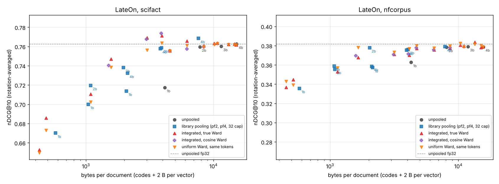

# lateon-pool-remex — token pooling and remex coding on a strong ColBERT that was never trained to be pooled

**Started:** 2026-11-12 · **Status:** done (SciFact, NFCorpus) · **Runtime:** encode 14 min (SciFact) and 32 min (NFCorpus), bench 87 min, 4 vCPU

## Answer

A ColBERT index stores a vector per token and shrinks by **pooling** (merging a document's similar tokens) and by **quantizing** (fewer bits per vector; here remex, a random rotation plus a per-coordinate quantizer, centered). For [LateOn](https://huggingface.co/lightonai/LateOn), a strong ColBERT never trained to be pooled: does pooling plus more bits beat unpooled 1-bit codes at the same bytes, and does letting the quantizer's error set each document's pooling help?

Pooling plus ≥2 bits wins. At about 4 KB per document, sentence-transformers' pooling to a quarter of the tokens at 4 bits beats unpooled 1-bit by +0.040 nDCG@10 on SciFact <!-- @evidence[[summary.json#scifact.iso.st pf4 4-bit vs none 1-bit.delta.0]] --> and +0.0125 on NFCorpus <!-- @evidence[[summary.json#nfcorpus.iso.st pf4 4-bit vs none 1-bit.delta.0]] -->, under all four codec rotations, at 1/30 of the fp32 size.

Letting the quantizer set the pooling depends on the corpus. Against uniform pooling with the same tokens and bits it gains +0.013 on SciFact <!-- @evidence[[summary.json#scifact.contrasts.adapt c1@2 2-bit vs match c1@2 2-bit.delta.0]] --> and −0.002 on NFCorpus <!-- @evidence[[summary.json#nfcorpus.contrasts.adapt c1@2 2-bit vs match c1@2 2-bit.delta.0]] --> at 2 bits, with every rotation agreeing. Only a measurement tells the two apart, so uniform pooling at ≥2 bits is the default.

## Findings

1. **Pooling plus ≥2 bits beats unpooled 1-bit at about the same bytes, on both corpora, in all four rotations** (Round 2, "same or fewer bytes" tables). Pool factor 4 at 4 bits against unpooled 1-bit: +0.040 <!-- @evidence[[summary.json#scifact.iso.st pf4 4-bit vs none 1-bit.delta.0]] --> and +0.0125 <!-- @evidence[[summary.json#nfcorpus.iso.st pf4 4-bit vs none 1-bit.delta.0]] --> (SciFact, NFCorpus); pool factor 2 at 2 bits: +0.041 <!-- @evidence[[summary.json#scifact.iso.st pf2 2-bit vs none 1-bit.delta.0]] --> and +0.0134 <!-- @evidence[[summary.json#nfcorpus.iso.st pf2 2-bit vs none 1-bit.delta.0]] -->; the two splits tie (−0.0007 <!-- @evidence[[summary.json#scifact.iso.st pf4 4-bit vs st pf2 2-bit.delta.0]] -->, −0.0008 <!-- @evidence[[summary.json#nfcorpus.iso.st pf4 4-bit vs st pf2 2-bit.delta.0]] -->). Against the cheapest 1-bit code, which drops the per-vector scalar of finding 5 (3.7–3.8 KB), pool factor 2 at 2 bits still wins by +0.0166 <!-- @evidence[[summary.json#scifact.iso.st pf2 2-bit vs none 1-bit no-side.delta.0]] --> and +0.018 <!-- @evidence[[summary.json#nfcorpus.iso.st pf2 2-bit vs none 1-bit no-side.delta.0]] -->, CIs clear of zero. This is the rule `token-pooling-remex` wrote into METHODS.md (when going from 2 bits to 1 bit costs more than pooling, pool and keep ≥2 bits), now on a strong model that was never trained to be pooled.
2. **Letting the quantizer set the pooling helps on SciFact and hurts slightly on NFCorpus** (Round 2, "adaptive against uniform" tables). The integrated cut (Method) cuts each document's Ward tree where the pooling error reaches c times the quantizer's per-token error, so documents with many near-duplicate tokens pool more. Against uniform Ward pooling with the same total tokens and bits: at 2 bits, c = 1, +0.013 on SciFact (4 of 4 rotations, CI clear) <!-- @evidence[[summary.json#scifact.contrasts.adapt c1@2 2-bit vs match c1@2 2-bit.delta.0]] --> and −0.002 on NFCorpus (0 of 4, CI spans zero) <!-- @evidence[[summary.json#nfcorpus.contrasts.adapt c1@2 2-bit vs match c1@2 2-bit.delta.0]] -->; at 3 bits, c = 4, +0.008 (3 of 4, CI spans zero) <!-- @evidence[[summary.json#scifact.contrasts.adapt c4@3 3-bit vs match c4@3 3-bit.delta.0]] --> and −0.007 (0 of 4, CI clear) <!-- @evidence[[summary.json#nfcorpus.contrasts.adapt c4@3 3-bit vs match c4@3 3-bit.delta.0]] -->. Against library pool factor 4 at 4 bits at the same bytes, the 3-bit cut is +0.013 on SciFact <!-- @evidence[[summary.json#scifact.iso.adapt c4@3 3-bit vs st pf4 4-bit.delta.0]] --> and −0.005 on NFCorpus <!-- @evidence[[summary.json#nfcorpus.iso.adapt c4@3 3-bit vs st pf4 4-bit.delta.0]] -->. The same cut on the library's tree behaves the same way.
3. **Pooling up to the quantizer's error is free at 3 and 4 bits, not below** (Round 2, integrated-cut tables). At c = 1 and 3 bits the cut keeps 73% of tokens and scores +0.0001 <!-- @evidence[[summary.json#scifact.adapt.adapt c1@3.vs_none.0]] --> and −0.0012 <!-- @evidence[[summary.json#nfcorpus.adapt.adapt c1@3.vs_none.0]] --> against unpooled 3-bit; c = 2 keeps 54% at −0.0018 <!-- @evidence[[summary.json#scifact.adapt.adapt c2@3.vs_none.0]] --> and −0.0021 <!-- @evidence[[summary.json#nfcorpus.adapt.adapt c2@3.vs_none.0]] -->. At 1 bit, c = 1 keeps 10% of tokens and loses −0.060 <!-- @evidence[[summary.json#scifact.adapt.adapt c1@1.vs_none.0]] --> and −0.0267 <!-- @evidence[[summary.json#nfcorpus.adapt.adapt c1@1.vs_none.0]] -->: a merge costs retrieval more than random coding noise of the same mean squared size.
4. **Selective pooling with no quantization also splits by corpus, uniform pooling does not** (Round 1). The integrated cut's tokens (34%, threshold from the 3-bit error) scored at fp32: +0.016 on SciFact <!-- @evidence[[summary.json#scifact.contrasts.adapt c4@3 fp32 vs none fp32.delta.0]] --> and −0.011 on NFCorpus <!-- @evidence[[summary.json#nfcorpus.contrasts.adapt c4@3 fp32 vs none fp32.delta.0]] -->, both CIs clear of zero. Library pool factor 4 at fp32: +0.0017 <!-- @evidence[[summary.json#scifact.rows.st pf4 fp32.delta.0]] --> and −0.0044 <!-- @evidence[[summary.json#nfcorpus.rows.st pf4 fp32.delta.0]] -->, both CIs spanning zero. Which tokens the threshold merges is what SciFact rewards and NFCorpus does not, the likely source of finding 2's flip.
5. **Centered remex needs a per-vector scalar; `token-pooling-remex` did not count it** (Round 1, method check). remex 2.1 centered codes store ‖x−μ‖ and μ·(x−μ) per vector. For a unit vector both follow from one number, kept here as fp16 μ·(x−μ): 2 bytes, identical retrieval to remex's float32 fields. At 1 bit and 128 dimensions that adds 12.5% to the 16 code bytes. Decoding with the corpus average instead (codes only) moves 1-bit scores by +0.025 on SciFact (4 of 4) <!-- @evidence[[summary.json#scifact.side.none 1-bit no-side vs none 1-bit.delta.0]] --> and −0.0046 on NFCorpus (0 of 4) <!-- @evidence[[summary.json#nfcorpus.side.none 1-bit no-side vs none 1-bit.delta.0]] -->. So on SciFact the codes-only 1-bit is the stronger baseline, which is why finding 1 also reports the margin against it.
6. **LateOn's tokens sit in a narrow cone and 1 bit is what costs** (Round 1). The corpus mean has norm 0.972 (0.54 for the `token-pooling-remex` models). Unpooled 2-bit costs −0.003 on both corpora <!-- @evidence[[summary.json#scifact.drops.fp32_to_two_bit.0]] -->; 2 bits to 1 bit costs −0.042 on SciFact <!-- @evidence[[summary.json#scifact.drops.two_to_one_bit.0]] --> and −0.016 on NFCorpus <!-- @evidence[[summary.json#nfcorpus.drops.two_to_one_bit.0]] -->. One rotation seed moves a pooled 2-bit arm by up to 0.019 on SciFact, so no single-rotation comparison here is trusted below about 0.02.
7. **For uniform pooling use the library's tree; under the integrated cut the tree does not matter.** The library builds Ward on a 1−cos matrix. At a uniform pool factor 4, true Ward on the unit vectors lost −0.0146 on SciFact at fp32 <!-- @evidence[[summary.json#scifact.contrasts.wu pf4 fp32 vs st pf4 fp32.delta.0]] --> (one run, CI clear) and tied on NFCorpus. Under the integrated cut the two trees score within ±0.004 on both corpora (Round 2).
8. **The encode reproduces the model card**: unpooled fp32 scores 0.7626 on SciFact <!-- @evidence[[summary.json#scifact.rows.none fp32.ndcg]] --> and 0.3817 on NFCorpus <!-- @evidence[[summary.json#nfcorpus.rows.none fp32.ndcg]] --> against 0.766 and 0.378 on the card.

## Method

- **Model:** `lightonai/LateOn` (ModernBERT-base, 149M parameters, 128-d tokens, Apache-2.0), loaded by
  sentence-transformers 6.3 `MultiVectorEncoder` at the card's settings: `[Q]`/`[D]` prefixes, query length
  32 without expansion, document length 300, document-side punctuation skiplist. It has no pooling objective.
  Every token vector is unit-norm.
- **Corpora:** BEIR SciFact (5,183 docs, 300 test queries, 230 tokens/doc after the skiplist) and NFCorpus
  (3,633 docs, 323 queries, graded qrels, 237 tokens/doc).
- **Pooling families,** all protecting the first token:
  - `st`: sentence-transformers `HierarchicalTokenPooling` (pool factor 2 or 4, or a 32-vector cap), Ward on a
    1−cos matrix, cluster means renormalised.
  - `wu`: true Ward (fastcluster on the unit vectors), uniform factor.
  - `adapt` / `cadapt` (the integrated cut), on the true-Ward / cosine-Ward tree. A cluster's pooling error is
    E_pool = 2(1 − ‖mean of its members‖), the members' mean squared distance to the renormalised mean (exact
    for unit vectors). D_b is the measured mean squared coding error of centered remex at b bits on the
    unpooled tokens (SciFact: 0.0199, 0.0063, 0.0018, 0.0005 at 1–4 bits). Each document keeps the largest
    clusters whose E_pool, and every sub-cluster's, is at most c·D_b, for c ∈ {0.5, 1, 2, 4}, then codes them
    at b bits. Token counts vary by document.
  - `match` / `cmatch`: uniform pooling on the same tree with the factor chosen so the corpus has the same total
    tokens as the integrated arm (within 0.1%; at 1 bit with c ≥ 2 the uniform cut cannot go below two vectors per document, and those rows are marked unmatched), coded at the same bits.
- **Codec:** remex 2.1 centered mode (`Quantizer(128, b, mean=corpus_mean(T))`, mean of the coded tokens). Each
  vector carries the fp16 scalar μ·(x−μ), from which the decode rebuilds both stored fields.
  **Bytes per document** = tokens × (128·b/8 + 2); fp32 = tokens × 512. `no-side` arms drop the scalar and
  decode with its corpus average.
- **Rotations:** default (randomized Hadamard, seed 42) plus Haar seeds 1–3 on the arms in the comparison
  tables. remex's Hadamard rotation is seed-invariant at d = 128 (METHODS.md), so seed floors use Haar.
- **Scoring:** sum-of-MaxSim over every document (no candidate stage), queries fp32 and unpooled, nDCG@10.
  Paired differences are averaged over the rotations both arms ran, with a 5,000-resample bootstrap over
  queries (95% CI). The bootstrap covers query sampling, not rotation, so the tables also count the
  rotations in which a beat b.

Reproduce:

```
pip install "sentence-transformers>=6.3" "remex>=2.1" datasets fastcluster matplotlib
python3 encode.py      # .work/<corpus>/ (gitignored); resumes per 1,000-doc chunk
python3 bench.py       # round 1 → results_<corpus>.jsonl, one line per arm, resumable
python3 bench2.py      # round 2: rotations, side check, cosine-Ward tree
python3 report.py      # tables below, summary.json, frontier.png
```



## Log

### Round 1 (2026-11-12): sequential pooling, the integrated cut, and its matched control

**Asked:** Oskar, "investigate a training-unaware hierarchical pooling of a modern ColBERT embedder, with
integrated remex quantization of the vectors." `token-pooling-remex` had pooled then quantized two one-epoch
demonstration checkpoints (SciFact 0.658). Prior-art search (4 queries): fixed-factor pooling (Clavié et al.
2024; PyLate; sentence-transformers), pooling followed by ColBERTv2 residual compression (Clavié 2024),
attention pooling (Jha et al. 2026, arXiv 2603.22434); did not find a pooling threshold derived from the
quantizer's error. Predictions were committed in `PLAN.md` before any number.

**Ran:** encode (one OOM in the merge step, `ERRORS.md` #1), then 75 arms per corpus: unpooled and library
pooling at fp32 and 4/3/2/1 bits, true-Ward uniform, the integrated cut at four c per bit width, a matched
uniform control for each, side-information variants, Haar seed 1 on some arms.

**Reading at the time.** SciFact showed the integrated cut at 2 bits, c = 1, at 3.0 KB/doc above unpooled
fp32 and +0.013 over its matched control under both rotations; NFCorpus reversed it. The rotation spread on
pooled 2-bit arms (0.019) made every single-rotation contrast suspect, and the library's tree beat true Ward by
0.015 at pool factor 4 on SciFact, so the integrated cut might have been handicapped by its tree.

### Round 2 (2026-11-12): rotations, the side scalar across rotations, the library's tree

**Ran:** Haar seeds 1–3 on the frontier arms (unpooled 2/1-bit, library pf4 4-bit and pf2 2-bit, the
integrated cut and its control at c1@2, c1@3, c2@3, c4@3), `no-side` across rotations, and the integrated cut
on the cosine-Ward tree with its own matched control. 69 arms per corpus.

**Reading.** Four rotations confirm finding 1: both splits beat unpooled 1-bit under every rotation on both corpora (16 of 16) and split finding 2 by
corpus. The tree made no difference under the integrated cut, so the SciFact gain does not come from the tree.
The side-scalar effect also splits by corpus.

| # | prediction (PLAN.md) | measured | |
|---|---|---|---|
| P1 | fp32 SciFact 0.766 ± 0.01, NFCorpus 0.378 ± 0.01 | 0.7626, 0.3817 | held |
| P2 | 2→1-bit drop on SciFact −0.02 to −0.05 | −0.042 | held |
| P3 | st pf4 4-bit − none 1-bit on SciFact +0.01 to +0.04, CI clear | +0.040, CI clear | held (at the edge) |
| P4 | integrated c = 1 within ±0.005 of unpooled at every b | 4 and 3 bits yes; 2 bits +0.010 / −0.007; 1 bit −0.060 / −0.027 | failed below 3 bits |
| P5 | c = 1 keeps >90% / 60–85% / 30–60% at 4 / 2 / 1 bits | 96% / 39% / 10% | failed at 2 and 1 bits |
| P6 | integrated − matched uniform 0 to +0.01 | at the four points run with four rotations (c1@2, c1@3, c2@3, c4@3): +0.001 to +0.013 SciFact, −0.002 to −0.007 NFCorpus; single-rotation points elsewhere range −0.003 to +0.006 | failed on NFCorpus |
| P7 | fp16 side scalar = float32 fields | Δ 0.0000 / +0.0003 | held |
| P8 | dropping the side scalar loses ≥ 0.01 at 1 bit | +0.025 SciFact, −0.005 NFCorpus | failed |

Costs: bench 59 min on SciFact and 28 min on NFCorpus (both rounds), mostly brute-force MaxSim; building a
Ward forest over a corpus took 10–20 s.

<!-- tables:start -->
### scifact: every arm (nDCG@10 averaged over the rotations run, n = count, range = lowest to highest single run; Δ = arm − unpooled fp32, 95% paired bootstrap over queries; B/doc counts 2 B of side scalar per coded vector except `no-side` arms)

| arm | tok/doc | B/doc | nDCG@10 | n | range | Δ vs none fp32 |
|---|---:|---:|---:|---:|---|---|
| none fp32 | 229.9 | 117,713 | 0.7626 | 1 |  | +0.0000 [+0.0000, +0.0000] |
| none 4-bit | 229.9 | 15,174 | 0.7626 | 1 |  | -0.0000 [-0.0082, +0.0078] |
| none 3-bit | 229.9 | 11,495 | 0.7602 | 1 |  | -0.0024 [-0.0122, +0.0071] |
| none 2-bit | 229.9 | 7,817 | 0.7596 | 4 | 0.7565–0.7624 | -0.0030 [-0.0122, +0.0054] |
| none 1-bit | 229.9 | 4,138 | 0.7175 | 4 | 0.7020–0.7254 | -0.0451 [-0.0604, -0.0301] |
| none 2-bit exact-side | 229.9 | 7,817 | 0.7586 | 1 |  | -0.0040 [-0.0164, +0.0079] |
| none 2-bit no-side | 229.9 | 7,357 | 0.7641 | 4 | 0.7622–0.7659 | +0.0015 [-0.0090, +0.0120] |
| none 1-bit exact-side | 229.9 | 4,138 | 0.7241 | 1 |  | -0.0385 [-0.0584, -0.0192] |
| none 1-bit no-side | 229.9 | 3,678 | 0.7420 | 4 | 0.7385–0.7451 | -0.0205 [-0.0346, -0.0059] |
| st pf2 fp32 | 115.2 | 58,986 | 0.7648 | 1 |  | +0.0023 [-0.0055, +0.0102] |
| st pf2 4-bit | 115.2 | 7,604 | 0.7685 | 1 |  | +0.0059 [-0.0025, +0.0143] |
| st pf2 2-bit | 115.2 | 3,917 | 0.7586 | 4 | 0.7502–0.7664 | -0.0040 [-0.0144, +0.0062] |
| st pf2 1-bit | 115.2 | 2,074 | 0.7137 | 1 |  | -0.0489 [-0.0711, -0.0267] |
| st pf4 fp32 | 57.9 | 29,619 | 0.7643 | 1 |  | +0.0017 [-0.0140, +0.0170] |
| st pf4 4-bit | 57.9 | 3,818 | 0.7579 | 4 | 0.7553–0.7597 | -0.0047 [-0.0202, +0.0102] |
| st pf4 2-bit | 57.9 | 1,967 | 0.7381 | 1 |  | -0.0245 [-0.0420, -0.0085] |
| st pf4 1-bit | 57.9 | 1,041 | 0.7000 | 1 |  | -0.0626 [-0.0865, -0.0397] |
| st mt32 fp32 | 32.0 | 16,384 | 0.7330 | 1 |  | -0.0296 [-0.0496, -0.0110] |
| st mt32 4-bit | 32.0 | 2,112 | 0.7323 | 1 |  | -0.0303 [-0.0504, -0.0119] |
| st mt32 2-bit | 32.0 | 1,088 | 0.7196 | 1 |  | -0.0430 [-0.0644, -0.0229] |
| st mt32 1-bit | 32.0 | 576 | 0.6701 | 1 |  | -0.0925 [-0.1214, -0.0660] |
| wu pf2 fp32 | 115.5 | 59,116 | 0.7654 | 1 |  | +0.0029 [-0.0042, +0.0099] |
| wu pf2 4-bit | 115.5 | 7,620 | 0.7637 | 1 |  | +0.0011 [-0.0088, +0.0104] |
| wu pf4 fp32 | 58.2 | 29,815 | 0.7497 | 1 |  | -0.0129 [-0.0281, +0.0020] |
| wu pf4 4-bit | 58.2 | 3,843 | 0.7501 | 1 |  | -0.0125 [-0.0286, +0.0031] |
| adapt c0.5@4 4-bit | 228.4 | 15,077 | 0.7618 | 1 |  | -0.0008 [-0.0083, +0.0064] |
| match c0.5@4 4-bit | 228.4 | 15,077 | 0.7619 | 1 |  | -0.0007 [-0.0081, +0.0066] |
| adapt c1@4 4-bit | 220.6 | 14,561 | 0.7626 | 1 |  | +0.0000 [-0.0070, +0.0069] |
| adapt c1@4 fp32 | 220.6 | 112,956 | 0.7624 | 1 |  | -0.0002 [-0.0014, +0.0007] |
| match c1@4 4-bit | 220.6 | 14,560 | 0.7618 | 1 |  | -0.0008 [-0.0080, +0.0064] |
| adapt c2@4 4-bit | 198.9 | 13,131 | 0.7622 | 1 |  | -0.0003 [-0.0067, +0.0061] |
| match c2@4 4-bit | 198.9 | 13,130 | 0.7621 | 1 |  | -0.0005 [-0.0068, +0.0056] |
| adapt c4@4 4-bit | 162.2 | 10,707 | 0.7635 | 1 |  | +0.0009 [-0.0057, +0.0075] |
| adapt c4@4 fp32 | 162.2 | 83,059 | 0.7673 | 1 |  | +0.0047 [+0.0010, +0.0092] |
| match c4@4 4-bit | 162.2 | 10,707 | 0.7628 | 1 |  | +0.0002 [-0.0078, +0.0084] |
| adapt c0.5@3 3-bit | 202.6 | 10,130 | 0.7633 | 1 |  | +0.0007 [-0.0088, +0.0097] |
| match c0.5@3 3-bit | 202.6 | 10,130 | 0.7620 | 1 |  | -0.0006 [-0.0106, +0.0089] |
| adapt c1@3 3-bit | 167.6 | 8,379 | 0.7610 | 4 | 0.7542–0.7654 | -0.0016 [-0.0086, +0.0052] |
| adapt c1@3 fp32 | 167.6 | 85,798 | 0.7642 | 1 |  | +0.0016 [-0.0035, +0.0070] |
| match c1@3 3-bit | 167.6 | 8,379 | 0.7597 | 4 | 0.7557–0.7640 | -0.0029 [-0.0102, +0.0036] |
| adapt c2@3 3-bit | 123.8 | 6,193 | 0.7656 | 4 | 0.7584–0.7714 | +0.0030 [-0.0039, +0.0098] |
| match c2@3 3-bit | 123.9 | 6,193 | 0.7611 | 4 | 0.7579–0.7668 | -0.0015 [-0.0090, +0.0056] |
| adapt c4@3 3-bit | 78.8 | 3,940 | 0.7711 | 4 | 0.7674–0.7787 | +0.0085 [-0.0003, +0.0176] |
| adapt c4@3 fp32 | 78.8 | 40,349 | 0.7785 | 1 |  | +0.0159 [+0.0048, +0.0273] |
| match c4@3 3-bit | 78.8 | 3,940 | 0.7636 | 4 | 0.7579–0.7688 | +0.0010 [-0.0115, +0.0128] |
| adapt c0.5@2 2-bit | 133.6 | 4,542 | 0.7557 | 1 |  | -0.0069 [-0.0198, +0.0047] |
| match c0.5@2 2-bit | 133.6 | 4,542 | 0.7552 | 1 |  | -0.0074 [-0.0197, +0.0039] |
| adapt c1@2 2-bit | 88.5 | 3,007 | 0.7692 | 4 | 0.7603–0.7792 | +0.0066 [-0.0055, +0.0184] |
| adapt c1@2 fp32 | 88.5 | 45,285 | 0.7752 | 1 |  | +0.0126 [+0.0023, +0.0237] |
| match c1@2 2-bit | 88.5 | 3,007 | 0.7561 | 4 | 0.7464–0.7667 | -0.0065 [-0.0188, +0.0051] |
| adapt c2@2 2-bit | 46.3 | 1,574 | 0.7470 | 2 | 0.7380–0.7560 | -0.0156 [-0.0335, +0.0014] |
| match c2@2 2-bit | 46.3 | 1,574 | 0.7384 | 2 | 0.7381–0.7387 | -0.0242 [-0.0423, -0.0071] |
| adapt c4@2 2-bit | 14.3 | 485 | 0.6857 | 1 |  | -0.0769 [-0.1038, -0.0507] |
| adapt c4@2 fp32 | 14.3 | 7,300 | 0.7091 | 1 |  | -0.0535 [-0.0783, -0.0298] |
| match c4@2 2-bit | 14.3 | 485 | 0.6730 | 1 |  | -0.0896 [-0.1179, -0.0621] |
| adapt c0.5@1 1-bit | 60.3 | 1,085 | 0.7106 | 1 |  | -0.0520 [-0.0771, -0.0276] |
| match c0.5@1 1-bit | 60.3 | 1,085 | 0.7024 | 1 |  | -0.0602 [-0.0843, -0.0371] |
| adapt c1@1 1-bit | 23.8 | 429 | 0.6528 | 2 | 0.6448–0.6608 | -0.1098 [-0.1372, -0.0851] |
| adapt c1@1 fp32 | 23.8 | 12,203 | 0.7202 | 1 |  | -0.0424 [-0.0650, -0.0219] |
| match c1@1 1-bit | 23.8 | 429 | 0.6495 | 2 | 0.6396–0.6595 | -0.1130 [-0.1420, -0.0857] |
| adapt c2@1 1-bit | 4.2 | 76 | 0.3861 | 2 | 0.3818–0.3905 | -0.3765 [-0.4199, -0.3349] |
| match c2@1 1-bit | 4.5 | 81 | 0.4689 | 2 | 0.4553–0.4825 | -0.2937 [-0.3340, -0.2527] |
| adapt c4@1 1-bit | 2.0 | 36 | 0.1251 | 1 |  | -0.6375 [-0.6815, -0.5924] |
| adapt c4@1 fp32 | 2.0 | 1,025 | 0.2791 | 1 |  | -0.4834 [-0.5280, -0.4359] |
| match c4@1 1-bit | 4.5 | 81 | 0.4553 | 1 |  | -0.3073 [-0.3507, -0.2638] |
| st pf4 4-bit no-side | 57.9 | 3,702 | 0.7725 | 1 |  | +0.0099 [-0.0057, +0.0254] |
| st pf2 2-bit no-side | 115.2 | 3,687 | 0.7616 | 1 |  | -0.0010 [-0.0152, +0.0129] |
| adapt c1@2 2-bit no-side | 88.5 | 2,830 | 0.7662 | 1 |  | +0.0036 [-0.0127, +0.0197] |
| cu pf2 fp32 | 115.5 | 59,116 | 0.7648 | 1 |  | +0.0023 [-0.0055, +0.0102] |
| cu pf4 fp32 | 58.2 | 29,815 | 0.7641 | 1 |  | +0.0015 [-0.0141, +0.0167] |
| cadapt c1@2 2-bit | 87.6 | 2,977 | 0.7677 | 4 | 0.7607–0.7738 | +0.0051 [-0.0060, +0.0161] |
| cmatch c1@2 2-bit | 87.6 | 2,977 | 0.7561 | 4 | 0.7491–0.7662 | -0.0065 [-0.0192, +0.0057] |
| cadapt c1@2 fp32 | 87.6 | 44,835 | 0.7716 | 1 |  | +0.0090 [-0.0010, +0.0188] |
| cadapt c2@2 2-bit | 44.2 | 1,504 | 0.7403 | 1 |  | -0.0223 [-0.0418, -0.0041] |
| cmatch c2@2 2-bit | 44.2 | 1,504 | 0.7347 | 1 |  | -0.0278 [-0.0489, -0.0085] |
| cadapt c0.5@2 2-bit | 133.3 | 4,531 | 0.7556 | 1 |  | -0.0069 [-0.0205, +0.0051] |
| cmatch c0.5@2 2-bit | 133.3 | 4,531 | 0.7549 | 1 |  | -0.0077 [-0.0206, +0.0042] |
| cadapt c1@3 3-bit | 167.5 | 8,374 | 0.7595 | 1 |  | -0.0031 [-0.0132, +0.0065] |
| cmatch c1@3 3-bit | 167.5 | 8,374 | 0.7565 | 1 |  | -0.0061 [-0.0156, +0.0033] |
| cadapt c2@3 3-bit | 123.5 | 6,174 | 0.7574 | 1 |  | -0.0052 [-0.0139, +0.0031] |
| cmatch c2@3 3-bit | 123.5 | 6,174 | 0.7639 | 1 |  | +0.0013 [-0.0065, +0.0090] |
| cadapt c4@3 3-bit | 77.7 | 3,887 | 0.7736 | 4 | 0.7698–0.7786 | +0.0110 [+0.0015, +0.0206] |
| cmatch c4@3 3-bit | 77.7 | 3,886 | 0.7607 | 4 | 0.7575–0.7624 | -0.0019 [-0.0154, +0.0103] |
| cadapt c4@3 fp32 | 77.7 | 39,801 | 0.7795 | 1 |  | +0.0169 [+0.0054, +0.0284] |

### scifact: about the same or fewer bytes (paired over the rotations both arms ran)

| a | b | B/doc a / b | shared rotations | Δ a − b (mean over shared rotations) | rotations with a > b |
|---|---|---|---|---|---|
| st pf4 4-bit | none 1-bit | 3,818 / 4,138 | 4 | +0.0404 [+0.0250, +0.0570] | 4 of 4 |
| st pf2 2-bit | none 1-bit | 3,917 / 4,138 | 4 | +0.0411 [+0.0290, +0.0541] | 4 of 4 |
| st pf4 4-bit | st pf2 2-bit | 3,818 / 3,917 | 4 | -0.0007 [-0.0150, +0.0137] | 2 of 4 |
| st pf2 4-bit | none 2-bit | 7,604 / 7,817 | 1 | +0.0099 [-0.0031, +0.0233] | 1 of 1 |
| adapt c1@2 2-bit | none 1-bit | 3,007 / 4,138 | 4 | +0.0517 [+0.0380, +0.0663] | 4 of 4 |
| adapt c1@2 2-bit | st pf4 4-bit | 3,007 / 3,818 | 4 | +0.0113 [-0.0028, +0.0255] | 4 of 4 |
| adapt c4@3 3-bit | st pf4 4-bit | 3,940 / 3,818 | 4 | +0.0132 [+0.0003, +0.0261] | 4 of 4 |
| adapt c4@3 3-bit | st pf2 2-bit | 3,940 / 3,917 | 4 | +0.0125 [+0.0042, +0.0212] | 4 of 4 |
| cadapt c1@2 2-bit | st pf4 4-bit | 2,977 / 3,818 | 4 | +0.0098 [-0.0037, +0.0238] | 4 of 4 |
| cadapt c4@3 3-bit | st pf4 4-bit | 3,887 / 3,818 | 4 | +0.0157 [+0.0030, +0.0285] | 4 of 4 |
| st pf4 4-bit | none 1-bit no-side | 3,818 / 3,678 | 4 | +0.0159 [-0.0005, +0.0323] | 4 of 4 |
| st pf2 2-bit | none 1-bit no-side | 3,917 / 3,678 | 4 | +0.0166 [+0.0042, +0.0284] | 4 of 4 |
| st pf4 4-bit no-side | none 1-bit no-side | 3,702 / 3,678 | 1 | +0.0314 [+0.0136, +0.0497] | 1 of 1 |

### scifact: adaptive against uniform allocation, tree against tree, pooling alone

| a | b | B/doc a / b | shared rotations | Δ a − b (mean over shared rotations) | rotations with a > b |
|---|---|---|---|---|---|
| adapt c1@2 2-bit | match c1@2 2-bit | 3,007 / 3,007 | 4 | +0.0131 [+0.0049, +0.0220] | 4 of 4 |
| adapt c1@3 3-bit | match c1@3 3-bit | 8,379 / 8,379 | 4 | +0.0013 [-0.0029, +0.0061] | 3 of 4 |
| adapt c2@3 3-bit | match c2@3 3-bit | 6,193 / 6,193 | 4 | +0.0045 [-0.0001, +0.0093] | 3 of 4 |
| adapt c4@3 3-bit | match c4@3 3-bit | 3,940 / 3,940 | 4 | +0.0076 [-0.0023, +0.0176] | 3 of 4 |
| cadapt c1@2 2-bit | cmatch c1@2 2-bit | 2,977 / 2,977 | 4 | +0.0117 [+0.0029, +0.0214] | 4 of 4 |
| cadapt c4@3 3-bit | cmatch c4@3 3-bit | 3,887 / 3,886 | 4 | +0.0129 [+0.0021, +0.0243] | 4 of 4 |
| cadapt c2@2 2-bit | cmatch c2@2 2-bit | 1,504 / 1,504 | 1 | +0.0055 [-0.0123, +0.0227] | 1 of 1 |
| cadapt c0.5@2 2-bit | cmatch c0.5@2 2-bit | 4,531 / 4,531 | 1 | +0.0008 [-0.0074, +0.0087] | 1 of 1 |
| cadapt c1@3 3-bit | cmatch c1@3 3-bit | 8,374 / 8,374 | 1 | +0.0030 [-0.0020, +0.0087] | 1 of 1 |
| cadapt c2@3 3-bit | cmatch c2@3 3-bit | 6,174 / 6,174 | 1 | -0.0065 [-0.0140, +0.0007] | 0 of 1 |
| cadapt c1@2 2-bit | adapt c1@2 2-bit | 2,977 / 3,007 | 4 | -0.0015 [-0.0054, +0.0025] | 1 of 4 |
| cadapt c4@3 3-bit | adapt c4@3 3-bit | 3,887 / 3,940 | 4 | +0.0025 [-0.0011, +0.0063] | 3 of 4 |
| cadapt c4@3 fp32 | adapt c4@3 fp32 | 39,801 / 40,349 | 1 | +0.0010 [-0.0037, +0.0059] | 1 of 1 |
| cadapt c1@2 fp32 | adapt c1@2 fp32 | 44,835 / 45,285 | 1 | -0.0037 [-0.0106, +0.0030] | 0 of 1 |
| cu pf4 fp32 | st pf4 fp32 | 29,815 / 29,619 | 1 | -0.0002 [-0.0016, +0.0011] | 0 of 1 |
| wu pf4 fp32 | st pf4 fp32 | 29,815 / 29,619 | 1 | -0.0146 [-0.0240, -0.0060] | 0 of 1 |
| adapt c4@3 fp32 | none fp32 | 40,349 / 117,713 | 1 | +0.0159 [+0.0048, +0.0273] | 1 of 1 |
| adapt c1@2 fp32 | none fp32 | 45,285 / 117,713 | 1 | +0.0126 [+0.0023, +0.0237] | 1 of 1 |
| cadapt c4@3 fp32 | none fp32 | 39,801 / 117,713 | 1 | +0.0169 [+0.0054, +0.0284] | 1 of 1 |
| cadapt c1@2 fp32 | none fp32 | 44,835 / 117,713 | 1 | +0.0090 [-0.0010, +0.0188] | 1 of 1 |

### scifact: per-vector side information (`no-side` drops the 2 B scalar and decodes with its corpus average; `exact-side` uses remex's float32 fields)

| a | b | B/doc a / b | shared rotations | Δ a − b (mean over shared rotations) | rotations with a > b |
|---|---|---|---|---|---|
| none 1-bit no-side | none 1-bit | 3,678 / 4,138 | 4 | +0.0246 [+0.0128, +0.0378] | 4 of 4 |
| none 2-bit no-side | none 2-bit | 7,357 / 7,817 | 4 | +0.0045 [-0.0033, +0.0125] | 4 of 4 |
| none 1-bit exact-side | none 1-bit | 4,138 / 4,138 | 1 | +0.0000 [+0.0000, +0.0000] | 0 of 1 |
| none 2-bit exact-side | none 2-bit | 7,817 / 7,817 | 1 | +0.0000 [+0.0000, +0.0000] | 0 of 1 |
| st pf4 4-bit no-side | st pf4 4-bit | 3,702 / 3,818 | 1 | +0.0128 [+0.0009, +0.0256] | 1 of 1 |
| st pf2 2-bit no-side | st pf2 2-bit | 3,687 / 3,917 | 1 | +0.0092 [-0.0018, +0.0207] | 1 of 1 |
| adapt c1@2 2-bit no-side | adapt c1@2 2-bit | 2,830 / 3,007 | 1 | +0.0059 [-0.0055, +0.0177] | 1 of 1 |

### scifact: integrated cut E_pool ≤ c·D_b on each tree, against the unpooled codec at the same bits and uniform pooling at the same tokens and bits (rotation-averaged where run)

| tree | bits | c | tokens kept | B/doc | nDCG@10 | − none at b | − uniform at same tokens | uniform nDCG@10 |
|---|---|---|---:|---:|---:|---|---|---:|
| true Ward | 4 | 0.5 | 99.4% | 15,077 | 0.7618 | -0.0008 [-0.0042, +0.0028] | -0.0001 [-0.0004, +0.0000] | 0.7619 |
| true Ward | 4 | 1 | 96.0% | 14,561 | 0.7626 | +0.0000 [-0.0047, +0.0053] | +0.0008 [-0.0028, +0.0042] | 0.7618 |
| true Ward | 4 | 2 | 86.5% | 13,131 | 0.7622 | -0.0003 [-0.0077, +0.0072] | +0.0001 [-0.0026, +0.0037] | 0.7621 |
| true Ward | 4 | 4 | 70.6% | 10,707 | 0.7635 | +0.0009 [-0.0057, +0.0077] | +0.0006 [-0.0080, +0.0092] | 0.7628 |
| true Ward | 3 | 0.5 | 88.1% | 10,130 | 0.7633 | +0.0031 [-0.0023, +0.0092] | +0.0012 [-0.0011, +0.0045] | 0.7620 |
| true Ward | 3 | 1 | 72.9% | 8,379 | 0.7610 | +0.0001 [-0.0082, +0.0092] | +0.0013 [-0.0029, +0.0061] | 0.7597 |
| true Ward | 3 | 2 | 53.9% | 6,193 | 0.7656 | -0.0018 [-0.0114, +0.0083] | +0.0045 [-0.0001, +0.0093] | 0.7611 |
| true Ward | 3 | 4 | 34.3% | 3,940 | 0.7711 | +0.0103 [-0.0013, +0.0221] | +0.0076 [-0.0023, +0.0176] | 0.7636 |
| true Ward | 2 | 0.5 | 58.1% | 4,542 | 0.7557 | -0.0029 [-0.0135, +0.0068] | +0.0005 [-0.0074, +0.0080] | 0.7552 |
| true Ward | 2 | 1 | 38.5% | 3,007 | 0.7692 | +0.0096 [+0.0018, +0.0183] | +0.0131 [+0.0049, +0.0220] | 0.7561 |
| true Ward | 2 | 2 | 20.1% | 1,574 | 0.7470 | -0.0135 [-0.0282, +0.0001] | +0.0086 [-0.0064, +0.0239] | 0.7384 |
| true Ward | 2 | 4 | 6.2% | 485 | 0.6857 | -0.0729 [-0.0979, -0.0490] | +0.0127 [-0.0097, +0.0352] | 0.6730 |
| true Ward | 1 | 0.5 | 26.2% | 1,085 | 0.7106 | -0.0135 [-0.0349, +0.0074] | +0.0082 [-0.0082, +0.0250] | 0.7024 |
| true Ward | 1 | 1 | 10.4% | 429 | 0.6528 | -0.0603 [-0.0821, -0.0396] | +0.0033 [-0.0164, +0.0238] | 0.6495 |
| true Ward | 1 | 2 | 1.8% | 76 | 0.3861 | -0.3269 [-0.3698, -0.2864] | -0.0828 [-0.1235, -0.0424] (uniform floor 4.5 tok/doc, not matched) | 0.4689 |
| true Ward | 1 | 4 | 0.9% | 36 | 0.1251 | -0.5990 [-0.6446, -0.5521] | -0.3302 [-0.3789, -0.2819] (uniform floor 4.5 tok/doc, not matched) | 0.4553 |
| cosine Ward | 3 | 1 | 72.8% | 8,374 | 0.7595 | -0.0007 [-0.0089, +0.0079] | +0.0030 [-0.0020, +0.0087] | 0.7565 |
| cosine Ward | 3 | 2 | 53.7% | 6,174 | 0.7574 | -0.0028 [-0.0133, +0.0078] | -0.0065 [-0.0140, +0.0007] | 0.7639 |
| cosine Ward | 3 | 4 | 33.8% | 3,887 | 0.7736 | +0.0131 [+0.0005, +0.0262] | +0.0129 [+0.0021, +0.0243] | 0.7607 |
| cosine Ward | 2 | 0.5 | 58.0% | 4,531 | 0.7556 | -0.0030 [-0.0142, +0.0074] | +0.0008 [-0.0074, +0.0087] | 0.7549 |
| cosine Ward | 2 | 1 | 38.1% | 2,977 | 0.7677 | +0.0081 [+0.0007, +0.0158] | +0.0117 [+0.0029, +0.0214] | 0.7561 |
| cosine Ward | 2 | 2 | 19.2% | 1,504 | 0.7403 | -0.0184 [-0.0344, -0.0030] | +0.0055 [-0.0123, +0.0227] | 0.7347 |

scifact: D_b (mean squared error per unit token, centered remex with the fp16 side scalar): 4-bit 0.0005, 3-bit 0.0018, 2-bit 0.0063, 1-bit 0.0199. Norm of the corpus mean 0.972. 300 queries, 229.9 tokens/doc unpooled.

### nfcorpus: every arm (nDCG@10 averaged over the rotations run, n = count, range = lowest to highest single run; Δ = arm − unpooled fp32, 95% paired bootstrap over queries; B/doc counts 2 B of side scalar per coded vector except `no-side` arms)

| arm | tok/doc | B/doc | nDCG@10 | n | range | Δ vs none fp32 |
|---|---:|---:|---:|---:|---|---|
| none fp32 | 237.4 | 121,566 | 0.3817 | 1 |  | +0.0000 [+0.0000, +0.0000] |
| none 4-bit | 237.4 | 15,671 | 0.3788 | 1 |  | -0.0029 [-0.0057, -0.0002] |
| none 3-bit | 237.4 | 11,872 | 0.3790 | 1 |  | -0.0027 [-0.0063, +0.0007] |
| none 2-bit | 237.4 | 8,073 | 0.3783 | 4 | 0.3760–0.3799 | -0.0034 [-0.0071, -0.0000] |
| none 1-bit | 237.4 | 4,274 | 0.3627 | 4 | 0.3613–0.3655 | -0.0190 [-0.0253, -0.0129] |
| none 2-bit exact-side | 237.4 | 8,073 | 0.3787 | 1 |  | -0.0030 [-0.0081, +0.0020] |
| none 2-bit no-side | 237.4 | 7,598 | 0.3707 | 4 | 0.3667–0.3746 | -0.0111 [-0.0178, -0.0044] |
| none 1-bit exact-side | 237.4 | 4,274 | 0.3655 | 1 |  | -0.0162 [-0.0256, -0.0074] |
| none 1-bit no-side | 237.4 | 3,799 | 0.3581 | 4 | 0.3569–0.3596 | -0.0236 [-0.0317, -0.0158] |
| st pf2 fp32 | 119.0 | 60,915 | 0.3806 | 1 |  | -0.0011 [-0.0052, +0.0030] |
| st pf2 4-bit | 119.0 | 7,852 | 0.3790 | 1 |  | -0.0027 [-0.0068, +0.0012] |
| st pf2 2-bit | 119.0 | 4,045 | 0.3760 | 4 | 0.3730–0.3777 | -0.0057 [-0.0103, -0.0010] |
| st pf2 1-bit | 119.0 | 2,142 | 0.3572 | 1 |  | -0.0246 [-0.0338, -0.0157] |
| st pf4 fp32 | 59.7 | 30,582 | 0.3773 | 1 |  | -0.0044 [-0.0112, +0.0025] |
| st pf4 4-bit | 59.7 | 3,942 | 0.3752 | 4 | 0.3748–0.3757 | -0.0065 [-0.0128, -0.0000] |
| st pf4 2-bit | 59.7 | 2,031 | 0.3779 | 1 |  | -0.0038 [-0.0113, +0.0038] |
| st pf4 1-bit | 59.7 | 1,075 | 0.3589 | 1 |  | -0.0228 [-0.0338, -0.0120] |
| st mt32 fp32 | 32.0 | 16,382 | 0.3596 | 1 |  | -0.0221 [-0.0320, -0.0126] |
| st mt32 4-bit | 32.0 | 2,112 | 0.3586 | 1 |  | -0.0231 [-0.0326, -0.0138] |
| st mt32 2-bit | 32.0 | 1,088 | 0.3555 | 1 |  | -0.0263 [-0.0361, -0.0165] |
| st mt32 1-bit | 32.0 | 576 | 0.3356 | 1 |  | -0.0461 [-0.0592, -0.0340] |
| wu pf2 fp32 | 119.2 | 61,044 | 0.3812 | 1 |  | -0.0005 [-0.0047, +0.0036] |
| wu pf2 4-bit | 119.2 | 7,869 | 0.3805 | 1 |  | -0.0012 [-0.0052, +0.0027] |
| wu pf4 fp32 | 60.1 | 30,780 | 0.3779 | 1 |  | -0.0038 [-0.0112, +0.0035] |
| wu pf4 4-bit | 60.1 | 3,968 | 0.3763 | 1 |  | -0.0054 [-0.0124, +0.0018] |
| adapt c0.5@4 4-bit | 235.9 | 15,571 | 0.3790 | 1 |  | -0.0028 [-0.0060, +0.0004] |
| match c0.5@4 4-bit | 235.9 | 15,571 | 0.3788 | 1 |  | -0.0029 [-0.0061, +0.0002] |
| adapt c1@4 4-bit | 227.2 | 14,994 | 0.3782 | 1 |  | -0.0035 [-0.0067, -0.0005] |
| adapt c1@4 fp32 | 227.2 | 116,319 | 0.3801 | 1 |  | -0.0017 [-0.0033, -0.0002] |
| match c1@4 4-bit | 227.2 | 14,994 | 0.3804 | 1 |  | -0.0013 [-0.0040, +0.0014] |
| adapt c2@4 4-bit | 203.8 | 13,454 | 0.3835 | 1 |  | +0.0017 [-0.0013, +0.0049] |
| match c2@4 4-bit | 203.8 | 13,454 | 0.3816 | 1 |  | -0.0001 [-0.0031, +0.0029] |
| adapt c4@4 4-bit | 167.0 | 11,024 | 0.3797 | 1 |  | -0.0021 [-0.0058, +0.0014] |
| adapt c4@4 fp32 | 167.0 | 85,517 | 0.3809 | 1 |  | -0.0009 [-0.0041, +0.0023] |
| match c4@4 4-bit | 167.0 | 11,024 | 0.3786 | 1 |  | -0.0031 [-0.0066, +0.0003] |
| adapt c0.5@3 3-bit | 207.6 | 10,382 | 0.3806 | 1 |  | -0.0011 [-0.0044, +0.0022] |
| match c0.5@3 3-bit | 207.6 | 10,382 | 0.3823 | 1 |  | +0.0005 [-0.0029, +0.0039] |
| adapt c1@3 3-bit | 172.3 | 8,613 | 0.3774 | 4 | 0.3767–0.3780 | -0.0043 [-0.0075, -0.0012] |
| adapt c1@3 fp32 | 172.3 | 88,198 | 0.3803 | 1 |  | -0.0014 [-0.0046, +0.0017] |
| match c1@3 3-bit | 172.3 | 8,614 | 0.3795 | 4 | 0.3773–0.3812 | -0.0022 [-0.0051, +0.0007] |
| adapt c2@3 3-bit | 129.2 | 6,461 | 0.3758 | 4 | 0.3739–0.3769 | -0.0060 [-0.0096, -0.0023] |
| match c2@3 3-bit | 129.2 | 6,461 | 0.3776 | 4 | 0.3767–0.3781 | -0.0041 [-0.0080, -0.0003] |
| adapt c4@3 3-bit | 82.7 | 4,135 | 0.3700 | 4 | 0.3691–0.3706 | -0.0117 [-0.0171, -0.0066] |
| adapt c4@3 fp32 | 82.7 | 42,341 | 0.3704 | 1 |  | -0.0114 [-0.0167, -0.0061] |
| match c4@3 3-bit | 82.7 | 4,135 | 0.3768 | 4 | 0.3736–0.3792 | -0.0049 [-0.0101, +0.0004] |
| adapt c0.5@2 2-bit | 138.9 | 4,723 | 0.3773 | 1 |  | -0.0045 [-0.0102, +0.0015] |
| match c0.5@2 2-bit | 138.9 | 4,723 | 0.3798 | 1 |  | -0.0019 [-0.0083, +0.0048] |
| adapt c1@2 2-bit | 92.8 | 3,154 | 0.3710 | 4 | 0.3702–0.3733 | -0.0107 [-0.0158, -0.0058] |
| adapt c1@2 fp32 | 92.8 | 47,491 | 0.3748 | 1 |  | -0.0069 [-0.0123, -0.0019] |
| match c1@2 2-bit | 92.8 | 3,154 | 0.3731 | 4 | 0.3711–0.3760 | -0.0086 [-0.0138, -0.0035] |
| adapt c2@2 2-bit | 48.5 | 1,650 | 0.3677 | 2 | 0.3640–0.3715 | -0.0140 [-0.0223, -0.0058] |
| match c2@2 2-bit | 48.5 | 1,651 | 0.3782 | 2 | 0.3759–0.3804 | -0.0036 [-0.0107, +0.0035] |
| adapt c4@2 2-bit | 15.1 | 515 | 0.3448 | 1 |  | -0.0370 [-0.0493, -0.0255] |
| adapt c4@2 fp32 | 15.1 | 7,753 | 0.3541 | 1 |  | -0.0277 [-0.0399, -0.0168] |
| match c4@2 2-bit | 15.1 | 514 | 0.3393 | 1 |  | -0.0424 [-0.0567, -0.0296] |
| adapt c0.5@1 1-bit | 63.3 | 1,140 | 0.3529 | 1 |  | -0.0289 [-0.0399, -0.0190] |
| match c0.5@1 1-bit | 63.3 | 1,140 | 0.3570 | 1 |  | -0.0248 [-0.0353, -0.0148] |
| adapt c1@1 1-bit | 25.1 | 452 | 0.3367 | 2 | 0.3361–0.3374 | -0.0450 [-0.0573, -0.0338] |
| adapt c1@1 fp32 | 25.1 | 12,868 | 0.3610 | 1 |  | -0.0207 [-0.0316, -0.0107] |
| match c1@1 1-bit | 25.1 | 452 | 0.3429 | 2 | 0.3389–0.3468 | -0.0388 [-0.0513, -0.0271] |
| adapt c2@1 1-bit | 4.6 | 82 | 0.2644 | 2 | 0.2644–0.2645 | -0.1173 [-0.1380, -0.0983] |
| match c2@1 1-bit | 4.7 | 84 | 0.2584 | 2 | 0.2563–0.2605 | -0.1233 [-0.1445, -0.1024] |
| adapt c4@1 1-bit | 2.0 | 36 | 0.1025 | 1 |  | -0.2792 [-0.3095, -0.2491] |
| adapt c4@1 fp32 | 2.0 | 1,025 | 0.1526 | 1 |  | -0.2291 [-0.2574, -0.2005] |
| match c4@1 1-bit | 4.7 | 84 | 0.2605 | 1 |  | -0.1212 [-0.1432, -0.0999] |
| st pf4 4-bit no-side | 59.7 | 3,823 | 0.3737 | 1 |  | -0.0080 [-0.0162, +0.0004] |
| st pf2 2-bit no-side | 119.0 | 3,807 | 0.3710 | 1 |  | -0.0107 [-0.0194, -0.0013] |
| adapt c1@2 2-bit no-side | 92.8 | 2,968 | 0.3656 | 1 |  | -0.0162 [-0.0247, -0.0074] |
| cu pf2 fp32 | 119.2 | 61,044 | 0.3810 | 1 |  | -0.0007 [-0.0049, +0.0035] |
| cu pf4 fp32 | 60.1 | 30,780 | 0.3774 | 1 |  | -0.0043 [-0.0109, +0.0025] |
| cadapt c1@2 2-bit | 91.8 | 3,122 | 0.3708 | 4 | 0.3686–0.3729 | -0.0110 [-0.0161, -0.0060] |
| cmatch c1@2 2-bit | 91.8 | 3,122 | 0.3732 | 4 | 0.3691–0.3771 | -0.0085 [-0.0134, -0.0034] |
| cadapt c1@2 fp32 | 91.8 | 47,017 | 0.3735 | 1 |  | -0.0082 [-0.0133, -0.0033] |
| cadapt c2@2 2-bit | 46.5 | 1,582 | 0.3695 | 1 |  | -0.0122 [-0.0209, -0.0034] |
| cmatch c2@2 2-bit | 46.5 | 1,582 | 0.3764 | 1 |  | -0.0053 [-0.0147, +0.0044] |
| cadapt c0.5@2 2-bit | 138.6 | 4,713 | 0.3777 | 1 |  | -0.0041 [-0.0100, +0.0021] |
| cmatch c0.5@2 2-bit | 138.6 | 4,712 | 0.3806 | 1 |  | -0.0012 [-0.0078, +0.0060] |
| cadapt c1@3 3-bit | 172.2 | 8,608 | 0.3781 | 1 |  | -0.0036 [-0.0079, +0.0004] |
| cmatch c1@3 3-bit | 172.2 | 8,608 | 0.3808 | 1 |  | -0.0009 [-0.0049, +0.0029] |
| cadapt c2@3 3-bit | 128.8 | 6,441 | 0.3756 | 1 |  | -0.0062 [-0.0111, -0.0013] |
| cmatch c2@3 3-bit | 128.8 | 6,441 | 0.3776 | 1 |  | -0.0042 [-0.0089, +0.0005] |
| cadapt c4@3 3-bit | 81.6 | 4,078 | 0.3715 | 4 | 0.3701–0.3737 | -0.0102 [-0.0156, -0.0048] |
| cmatch c4@3 3-bit | 81.6 | 4,078 | 0.3754 | 4 | 0.3734–0.3776 | -0.0064 [-0.0116, -0.0011] |
| cadapt c4@3 fp32 | 81.6 | 41,760 | 0.3721 | 1 |  | -0.0096 [-0.0152, -0.0040] |

### nfcorpus: about the same or fewer bytes (paired over the rotations both arms ran)

| a | b | B/doc a / b | shared rotations | Δ a − b (mean over shared rotations) | rotations with a > b |
|---|---|---|---|---|---|
| st pf4 4-bit | none 1-bit | 3,942 / 4,274 | 4 | +0.0125 [+0.0053, +0.0204] | 4 of 4 |
| st pf2 2-bit | none 1-bit | 4,045 / 4,274 | 4 | +0.0134 [+0.0075, +0.0195] | 4 of 4 |
| st pf4 4-bit | st pf2 2-bit | 3,942 / 4,045 | 4 | -0.0008 [-0.0076, +0.0059] | 1 of 4 |
| st pf2 4-bit | none 2-bit | 7,852 / 8,073 | 1 | +0.0006 [-0.0052, +0.0062] | 1 of 1 |
| adapt c1@2 2-bit | none 1-bit | 3,154 / 4,274 | 4 | +0.0083 [+0.0024, +0.0142] | 4 of 4 |
| adapt c1@2 2-bit | st pf4 4-bit | 3,154 / 3,942 | 4 | -0.0042 [-0.0108, +0.0024] | 0 of 4 |
| adapt c4@3 3-bit | st pf4 4-bit | 4,135 / 3,942 | 4 | -0.0052 [-0.0118, +0.0015] | 0 of 4 |
| adapt c4@3 3-bit | st pf2 2-bit | 4,135 / 4,045 | 4 | -0.0060 [-0.0113, -0.0010] | 0 of 4 |
| cadapt c1@2 2-bit | st pf4 4-bit | 3,122 / 3,942 | 4 | -0.0045 [-0.0108, +0.0020] | 0 of 4 |
| cadapt c4@3 3-bit | st pf4 4-bit | 4,078 / 3,942 | 4 | -0.0037 [-0.0102, +0.0029] | 0 of 4 |
| st pf4 4-bit | none 1-bit no-side | 3,942 / 3,799 | 4 | +0.0171 [+0.0085, +0.0265] | 4 of 4 |
| st pf2 2-bit | none 1-bit no-side | 4,045 / 3,799 | 4 | +0.0180 [+0.0107, +0.0262] | 4 of 4 |
| st pf4 4-bit no-side | none 1-bit no-side | 3,823 / 3,799 | 1 | +0.0168 [+0.0063, +0.0282] | 1 of 1 |

### nfcorpus: adaptive against uniform allocation, tree against tree, pooling alone

| a | b | B/doc a / b | shared rotations | Δ a − b (mean over shared rotations) | rotations with a > b |
|---|---|---|---|---|---|
| adapt c1@2 2-bit | match c1@2 2-bit | 3,154 / 3,154 | 4 | -0.0021 [-0.0068, +0.0026] | 0 of 4 |
| adapt c1@3 3-bit | match c1@3 3-bit | 8,613 / 8,614 | 4 | -0.0021 [-0.0042, -0.0002] | 0 of 4 |
| adapt c2@3 3-bit | match c2@3 3-bit | 6,461 / 6,461 | 4 | -0.0018 [-0.0048, +0.0012] | 0 of 4 |
| adapt c4@3 3-bit | match c4@3 3-bit | 4,135 / 4,135 | 4 | -0.0068 [-0.0124, -0.0013] | 0 of 4 |
| cadapt c1@2 2-bit | cmatch c1@2 2-bit | 3,122 / 3,122 | 4 | -0.0025 [-0.0072, +0.0022] | 1 of 4 |
| cadapt c4@3 3-bit | cmatch c4@3 3-bit | 4,078 / 4,078 | 4 | -0.0039 [-0.0093, +0.0016] | 0 of 4 |
| cadapt c2@2 2-bit | cmatch c2@2 2-bit | 1,582 / 1,582 | 1 | -0.0069 [-0.0156, +0.0016] | 0 of 1 |
| cadapt c0.5@2 2-bit | cmatch c0.5@2 2-bit | 4,713 / 4,712 | 1 | -0.0029 [-0.0065, +0.0007] | 0 of 1 |
| cadapt c1@3 3-bit | cmatch c1@3 3-bit | 8,608 / 8,608 | 1 | -0.0027 [-0.0054, -0.0001] | 0 of 1 |
| cadapt c2@3 3-bit | cmatch c2@3 3-bit | 6,441 / 6,441 | 1 | -0.0020 [-0.0062, +0.0020] | 0 of 1 |
| cadapt c1@2 2-bit | adapt c1@2 2-bit | 3,122 / 3,154 | 4 | -0.0002 [-0.0028, +0.0024] | 2 of 4 |
| cadapt c4@3 3-bit | adapt c4@3 3-bit | 4,078 / 4,135 | 4 | +0.0014 [-0.0016, +0.0046] | 4 of 4 |
| cadapt c4@3 fp32 | adapt c4@3 fp32 | 41,760 / 42,341 | 1 | +0.0018 [-0.0019, +0.0055] | 1 of 1 |
| cadapt c1@2 fp32 | adapt c1@2 fp32 | 47,017 / 47,491 | 1 | -0.0013 [-0.0046, +0.0019] | 0 of 1 |
| cu pf4 fp32 | st pf4 fp32 | 30,780 / 30,582 | 1 | +0.0001 [-0.0015, +0.0016] | 1 of 1 |
| wu pf4 fp32 | st pf4 fp32 | 30,780 / 30,582 | 1 | +0.0005 [-0.0047, +0.0055] | 1 of 1 |
| adapt c4@3 fp32 | none fp32 | 42,341 / 121,566 | 1 | -0.0114 [-0.0167, -0.0061] | 0 of 1 |
| adapt c1@2 fp32 | none fp32 | 47,491 / 121,566 | 1 | -0.0069 [-0.0123, -0.0019] | 0 of 1 |
| cadapt c4@3 fp32 | none fp32 | 41,760 / 121,566 | 1 | -0.0096 [-0.0152, -0.0040] | 0 of 1 |
| cadapt c1@2 fp32 | none fp32 | 47,017 / 121,566 | 1 | -0.0082 [-0.0133, -0.0033] | 0 of 1 |

### nfcorpus: per-vector side information (`no-side` drops the 2 B scalar and decodes with its corpus average; `exact-side` uses remex's float32 fields)

| a | b | B/doc a / b | shared rotations | Δ a − b (mean over shared rotations) | rotations with a > b |
|---|---|---|---|---|---|
| none 1-bit no-side | none 1-bit | 3,799 / 4,274 | 4 | -0.0046 [-0.0097, +0.0002] | 0 of 4 |
| none 2-bit no-side | none 2-bit | 7,598 / 8,073 | 4 | -0.0076 [-0.0134, -0.0021] | 0 of 4 |
| none 1-bit exact-side | none 1-bit | 4,274 / 4,274 | 1 | +0.0000 [+0.0000, +0.0000] | 0 of 1 |
| none 2-bit exact-side | none 2-bit | 8,073 / 8,073 | 1 | +0.0003 [+0.0000, +0.0008] | 1 of 1 |
| st pf4 4-bit no-side | st pf4 4-bit | 3,823 / 3,942 | 1 | -0.0010 [-0.0089, +0.0069] | 0 of 1 |
| st pf2 2-bit no-side | st pf2 2-bit | 3,807 / 4,045 | 1 | -0.0067 [-0.0145, +0.0005] | 0 of 1 |
| adapt c1@2 2-bit no-side | adapt c1@2 2-bit | 2,968 / 3,154 | 1 | -0.0047 [-0.0117, +0.0023] | 0 of 1 |

### nfcorpus: integrated cut E_pool ≤ c·D_b on each tree, against the unpooled codec at the same bits and uniform pooling at the same tokens and bits (rotation-averaged where run)

| tree | bits | c | tokens kept | B/doc | nDCG@10 | − none at b | − uniform at same tokens | uniform nDCG@10 |
|---|---|---|---:|---:|---:|---|---|---:|
| true Ward | 4 | 0.5 | 99.4% | 15,571 | 0.3790 | +0.0001 [-0.0015, +0.0016] | +0.0001 [-0.0007, +0.0010] | 0.3788 |
| true Ward | 4 | 1 | 95.7% | 14,994 | 0.3782 | -0.0006 [-0.0032, +0.0019] | -0.0022 [-0.0043, -0.0004] | 0.3804 |
| true Ward | 4 | 2 | 85.9% | 13,454 | 0.3835 | +0.0046 [+0.0014, +0.0082] | +0.0019 [-0.0002, +0.0040] | 0.3816 |
| true Ward | 4 | 4 | 70.3% | 11,024 | 0.3797 | +0.0008 [-0.0024, +0.0041] | +0.0010 [-0.0011, +0.0032] | 0.3786 |
| true Ward | 3 | 0.5 | 87.4% | 10,382 | 0.3806 | +0.0016 [-0.0015, +0.0049] | -0.0016 [-0.0039, +0.0005] | 0.3823 |
| true Ward | 3 | 1 | 72.6% | 8,613 | 0.3774 | -0.0012 [-0.0051, +0.0027] | -0.0021 [-0.0042, -0.0002] | 0.3795 |
| true Ward | 3 | 2 | 54.4% | 6,461 | 0.3758 | -0.0021 [-0.0067, +0.0025] | -0.0018 [-0.0048, +0.0012] | 0.3776 |
| true Ward | 3 | 4 | 34.8% | 4,135 | 0.3700 | -0.0090 [-0.0148, -0.0031] | -0.0068 [-0.0124, -0.0013] | 0.3768 |
| true Ward | 2 | 0.5 | 58.5% | 4,723 | 0.3773 | -0.0012 [-0.0062, +0.0041] | -0.0026 [-0.0064, +0.0011] | 0.3798 |
| true Ward | 2 | 1 | 39.1% | 3,154 | 0.3710 | -0.0073 [-0.0115, -0.0032] | -0.0021 [-0.0068, +0.0026] | 0.3731 |
| true Ward | 2 | 2 | 20.4% | 1,650 | 0.3677 | -0.0114 [-0.0188, -0.0042] | -0.0104 [-0.0182, -0.0026] | 0.3782 |
| true Ward | 2 | 4 | 6.4% | 515 | 0.3448 | -0.0337 [-0.0461, -0.0218] | +0.0055 [-0.0058, +0.0175] | 0.3393 |
| true Ward | 1 | 0.5 | 26.7% | 1,140 | 0.3529 | -0.0127 [-0.0218, -0.0036] | -0.0041 [-0.0120, +0.0038] | 0.3570 |
| true Ward | 1 | 1 | 10.6% | 452 | 0.3367 | -0.0267 [-0.0363, -0.0176] | -0.0061 [-0.0156, +0.0030] | 0.3429 |
| true Ward | 1 | 2 | 1.9% | 82 | 0.2644 | -0.0990 [-0.1184, -0.0814] | +0.0060 [-0.0079, +0.0201] | 0.2584 |
| true Ward | 1 | 4 | 0.8% | 36 | 0.1025 | -0.2630 [-0.2930, -0.2328] | -0.1580 [-0.1844, -0.1324] (uniform floor 4.7 tok/doc, not matched) | 0.2605 |
| cosine Ward | 3 | 1 | 72.5% | 8,608 | 0.3781 | -0.0009 [-0.0048, +0.0028] | -0.0027 [-0.0054, -0.0001] | 0.3808 |
| cosine Ward | 3 | 2 | 54.3% | 6,441 | 0.3756 | -0.0035 [-0.0079, +0.0011] | -0.0020 [-0.0062, +0.0020] | 0.3776 |
| cosine Ward | 3 | 4 | 34.4% | 4,078 | 0.3715 | -0.0089 [-0.0149, -0.0028] | -0.0039 [-0.0093, +0.0016] | 0.3754 |
| cosine Ward | 2 | 0.5 | 58.4% | 4,713 | 0.3777 | -0.0008 [-0.0061, +0.0048] | -0.0029 [-0.0065, +0.0007] | 0.3806 |
| cosine Ward | 2 | 1 | 38.7% | 3,122 | 0.3708 | -0.0075 [-0.0118, -0.0034] | -0.0025 [-0.0072, +0.0022] | 0.3732 |
| cosine Ward | 2 | 2 | 19.6% | 1,582 | 0.3695 | -0.0090 [-0.0178, -0.0006] | -0.0069 [-0.0156, +0.0016] | 0.3764 |

nfcorpus: D_b (mean squared error per unit token, centered remex with the fp16 side scalar): 4-bit 0.0005, 3-bit 0.0017, 2-bit 0.0059, 1-bit 0.0185. Norm of the corpus mean 0.974. 323 queries, 237.4 tokens/doc unpooled.

<!-- tables:end -->
