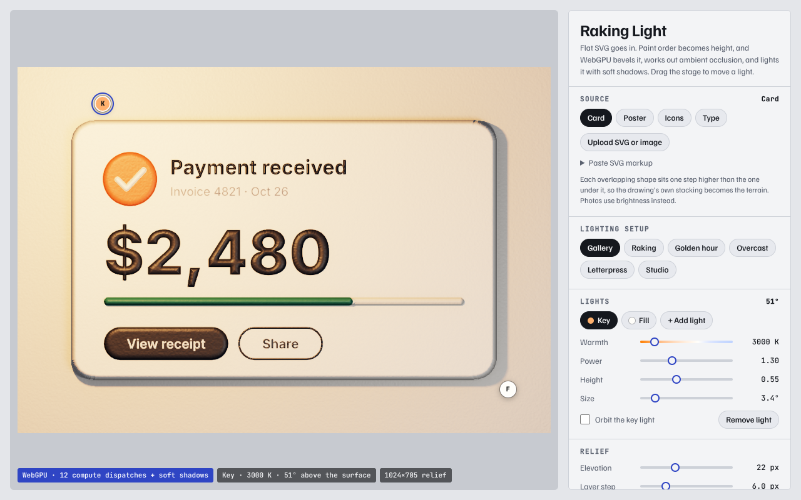
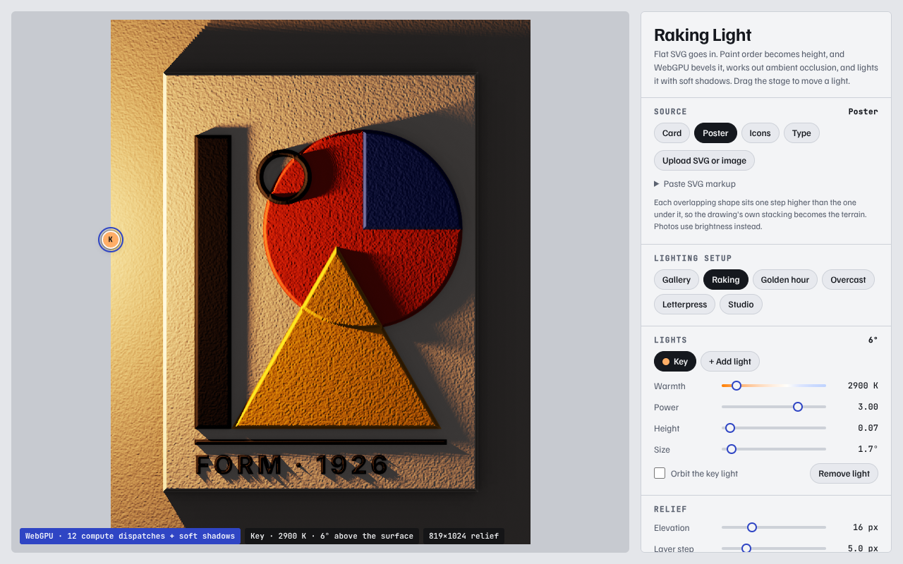
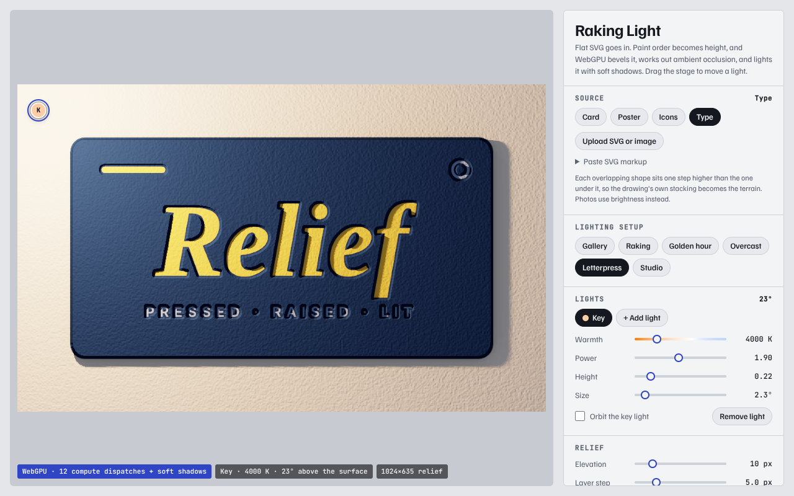

# Raking Light

A page that takes flat, evenly lit SVG (a UI card, a poster, an icon sheet, a wordmark) and
relights it as a physical object, with raised shapes, bevelled edges, darkening in corners and crevices,
and soft shadows from lights you can drag. It was prompted by [Lumen](https://lumen.renderg.host), a
card-shadow designer that turns Kelvin-temperature lights into stacked CSS `box-shadow` layers around a
card. This page lights the content inside the card, per pixel, with WebGPU.



Live at [austegard.com/fun-and-games/raking-light.html](https://austegard.com/fun-and-games/raking-light.html). That is a copy in the site repo (`oaustegard.github.io`, `fun-and-games/raking-light.html`); edit [`web/index.html`](web/index.html) and [`web/raking-light.js`](web/raking-light.js) here and copy them there as `raking-light.html` and `raking-light.js`. Open it in a browser with WebGPU. Without it the page falls back to SVG
filter lighting (`feDiffuseLighting` + `feSpecularLighting`) driven by the first light only. In that mode
there are no cast shadows or occlusion, and the compare divider, bevel profile, grain, metalness and
extra lights do nothing.

## How it works

**Paint order becomes height.** The page puts the SVG in a hidden DOM node, reads each shape's computed
fill and stroke, and redraws every painted shape as white at 20% opacity over black. Each layer covers
20% of the darkness left under it, so a pixel's grey value after k overlapping shapes is
`v = 1 − 0.8^k`, and `k = log(1 − v) / log(0.8)` gives the stack depth back. At 8 bits per channel that
recovers k to within 0.1 of a layer up to about 14 layers. Anti-aliased edges give fractional k, which
the bevel pass smooths. The browser resolves classes, gradients and inherited styles. Not handled:
`<image>` elements become plain rectangles, shapes inside `clipPath`, `mask` or `pattern` are skipped,
and opacity, filters and blend modes are ignored. Raster images use brightness for height instead.

**Five compute stages (twelve dispatches) build the relief**, each reading the previous one's texture:

1. Layers: grey value → height in pixels (an elevation for the first layer, a fixed step per layer above).
2. Edge seeds: pixels on the high side of a height step, storing the height of the low side.
3. Jump flood, eight dispatches at strides 64, 32 … 1, 1: for every pixel, the nearest edge seed.
4. Bevel: blends from the low height to the full height over the bevel width, shaped round, chamfer,
   pillow (S-curve) or cove (concave). Deboss reverses the steps so shapes press into the surface.
5. Normals and occlusion: surface normals from a 3×3 Sobel filter, plus optional value-noise grain; and
   ambient occlusion from 12 directions, 7 samples each at radii growing from 2 px to about 80 px,
   counting how much of the sky the surrounding terrain blocks.

**One fragment pass lights it**: up to four point lights whose colour comes from their Kelvin temperature
(Tanner Helland's curve fit, the one Lumen uses), GGX specular highlights controlled by roughness and
metalness, ambient light scaled by the occlusion, and soft shadows. A shadow ray steps from each pixel
toward each light through the height texture, at most 80 steps and 0.8 of the image width, and the
light's angular size sets how wide the soft edge is. Very long shadows from near-horizontal lights get cut
off at that length. Output goes through ACES tone mapping, then sRGB.

The page has six lighting setups (Gallery, Raking, Golden hour, Overcast, Letterpress, Studio), five
materials, a before/after divider and an orbiting key light. "Raking light" is the conservator's term for
lighting a surface from a low angle to show its relief; the light readout gives that angle.

| | |
|---|---|
|  |  |

## Embedding it

`web/raking-light.js` is a self-contained ES module (no dependencies). Importing it defines a
`<raking-light>` element, and the page's **Copy embed code** button writes one out with the current settings:

```html
<script type="module" src="https://austegard.com/fun-and-games/raking-light.js"></script>
<raking-light preset="gallery" light="pointer" style="width: 480px">
  <svg viewBox="0 0 200 200">…</svg>
</raking-light>
```

The SVG goes inside as a child, or by URL with `src` (an SVG, or an image that uses brightness for height).
Attributes: `preset` (gallery, raking, golden hour, overcast, letterpress, studio) and `material` (paper,
satin, enamel, metal, clay) set the starting point. `elevation`, `step`, `bevel`, `profile`, `grain`,
`grain-size`, `deboss`, `roughness`, `metal`, `specular`, `ambient`, `sky`, `exposure` and a `lights` JSON
array override it. `wall` defaults to `transparent`, which keeps only the shadows so the element sits on any
background; give it a colour for a solid wall. `light` is `pointer` (the key light follows the cursor
anywhere on the page), `tilt` (phone orientation), `orbit` or `fixed`. `margin` sets the room left for
shadows, as a fraction of the picture's long side (default 0.1).

All elements on a page share one GPU device and set of pipelines. Each one keeps two textures (about
9 MB at full size), redraws only when its light moves, and stops drawing when scrolled offscreen.
Without WebGPU it shows the original SVG unchanged. With `prefers-reduced-motion` the light stays put.
`element.toBlob()` returns a PNG of the current lighting. The page's **Save PNG** and **Copy image**
export the same render at 1024 px on the long side, with a transparent background when "No wall" is on.

For a transparent wall, the shader lights the wall twice, once with shadows and occlusion and once
without. The ratio of their brightness sets the alpha of a black shadow layer, and content pixels keep
their own alpha.

## Verification

`test/render.js` loads the page in headless Chromium on SwiftShader (a software GPU) and renders each
sample under one setup through the real canvas path. It fails on any console error or if the page falls
back from WebGPU. `test/embed.js` loads `test/embed.html`, with three elements: inline SVG on a
transparent wall, `src=` with a fixed light, and a solid wall with an orbiting light. It moves the pointer,
checks that all three draw, and checks that `toBlob()` returns a PNG (`test/embed.png`). Run both from a server rooted at
`raking-light/`. It makes no pixel assertions; the four screenshots in `test/` were checked by eye. No
real GPU has run the page yet, so browser support (Chrome, Edge and Safari 26 ship WebGPU) and frame rate
are untested.

Two problems came up, both specific to headless testing. Without `--use-vulkan=swiftshader` the first
canvas present loses the device; METHODS.md already records this. In that same setup
`copyExternalImageToTexture` from a 2D canvas failed on every source after the first, so the page uploads
textures with `getImageData` + `writeTexture` instead.
