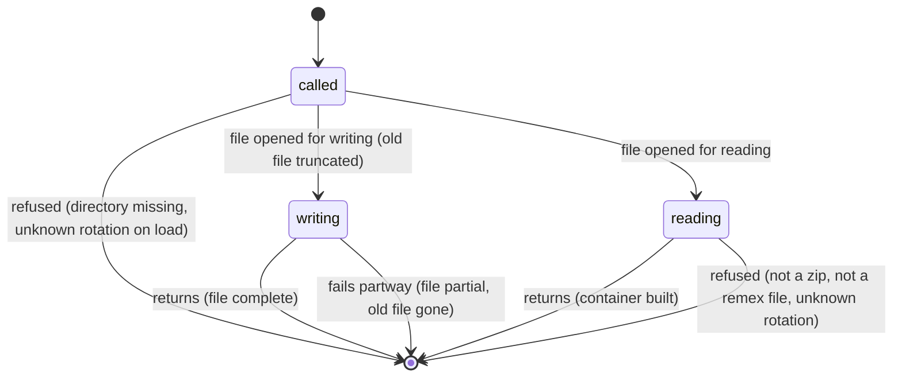

# Saving and loading `.npz` files

## Summary

A container can be written to a single file and read back in another process, so that a corpus is encoded once and searched many times. The file holds the packed codes, the per-row floats the container's mode needs, and the container's recorded parameters; it does not hold the quantizer. Reading a file back gives a container that must still be paired with a compatible quantizer before it can be decoded or searched.

`CompressedVectors.save(path)` writes the file and `CompressedVectors.load(path)` reads it. Both accept a string, a `pathlib.Path` or an open binary file object. They are available in every mode: normalizing, scalar and centred containers all round-trip. Neither call needs the quantizer, and neither checks the file against one.

## The simple case

The caller encodes a corpus, saves the container, and later loads it and searches with a quantizer built from the same arguments:

```python
q = Quantizer(d=384, bits=4)
q.encode(X).save("index.npz")
# later, in another process
c = CompressedVectors.load("index.npz")
ids, scores = Quantizer(d=384, bits=4).search(c, query, k=10)
```

The loaded container holds exactly the codes and per-row floats that were saved, and search returns the same rows and scores as it did on the original container. The file is a NumPy `.npz` archive and can be opened with `np.load` for inspection.

What the file does not carry is what the caller has to remember: the `seed` and, in scalar mode, the `scale`. A container loaded and paired with a quantizer built from a different seed decodes and searches without complaint and returns results unrelated to the corpus (see [Open questions](#open-questions-and-verification) and [the encoding contract](../foundations/the-encoding-contract.md#what-a-container-does-not-record)).

## The call, phase by phase



### The call is made

`save` takes the container as it is at that instant: its codes, `norms` if it has them, `mean` and `mean_dots` if it is centred, and its `d`, `bits`, `n` and `rotation`. Nothing is checked against a quantizer, because none is involved. The in-memory decode cache that a previous `search` may have built is not part of what is saved.

`save` decides the file name before opening anything. A string path that does not end in `.npz` gets `.npz` appended: `save("index")` writes `index.npz`, and `save("INDEX.NPZ")` writes `INDEX.NPZ.npz`, because the check is case-sensitive. A file object is written to as given.

`load` takes a path or file object and decides nothing up front. It does not append `.npz`, so `load("index")` after `save("index")` fails with `FileNotFoundError` for `index`.

### Refused at once

`save` to a path whose directory does not exist raises `FileNotFoundError` and writes nothing; an existing file elsewhere is untouched. A container whose `rotation` attribute was reassigned to a name remex does not know is *not* refused here (see [Edge cases](#edge-cases)).

`load` refuses, before building a container, a file it cannot read as an archive, with an error that depends on what is there: a zero-byte file raises `EOFError: No data left in file`, a truncated archive `BadZipFile`, and any other bytes `ValueError: This file contains pickled (object) data`, which does not say the file is damaged; an archive with no `d` entry (`KeyError: 'd is not a file in the archive'`, which does not say the file is not a remex container), and a file whose recorded rotation is not one of `"haar"`, `"rht"`, `"none"` (`ValueError: unknown rotation ...`).

### The first effect

For `save`, the first effect is opening the path for writing, and that truncates any existing file at that path to zero bytes. From this moment the previous contents are gone, whether or not this save completes. There is no confirmation and no warning when a file is overwritten.

For `load`, there is no effect on disk. The first observable effect is the returned container.

### While it runs

`save` writes the archive entry by entry: the packed codes, then `d`, `bits`, `n`, `rotation`, then `norms`, `mean` and `mean_dots` where present, each deflate-compressed. Until the archive's central directory is written at the end, the file on disk is not a readable zip. Another process that opens the path meanwhile sees a partial file.

`load` reads every entry fully into memory and unpacks the codes to one byte per coordinate. A loaded container's resident size is `n × d` bytes of codes plus its floats, regardless of how small the file was.

### It returns

After `save` returns, the file holds everything listed under [The call is made](#the-call-is-made), and nothing else. In particular it does not hold `seed`, `scale`, `normalize` (inferred from whether `norms` is present), `renorm`, or the decode cache.

After `load` returns, the caller has a container with the saved codes and floats and these recorded parameters, read as follows:

- no `rotation` entry: `"haar"`, the value every file written before the rotation was recorded used (never the current default, which is `"rht"` for even `d`)
- no `norms` entry: scalar mode
- `mean` without `mean_dots`: a centred file written by remex before 2.0; it loads, and the first decode or search refuses it with a message to re-encode
- an unpacked `indices` entry instead of `packed_indices`: a file from before bit-packing; it loads

Entries `load` does not know are ignored, which is how `RemexIndex` stores its own fields in the same file.

The loaded container has no decode cache, so the first `search` on it rebuilds one; see [Memory and caches](#interactions-with-other-systems).

## Variants

| Variant | Set when the call begins | Changed while it runs |
| --- | --- | --- |
| Container mode | Normalizing writes `norms`; scalar writes none, and the absence is what marks the file as scalar on load. The caller's `scale` is not written in either mode. | Cannot change: `save` and `load` take no mode argument. |
| Centred | Writes `mean` and `mean_dots` as well; both round-trip exactly. | Cannot change mid-call. |
| Rotation | The container's `rotation` is written as a string and read back; a missing entry reads as `"haar"`. | Reassigning `container.rotation` from another thread during `save` may or may not be reflected; not determined. |
| Bit width and precision | Codes are packed at the container's `bits`; `precision` is a read-time argument and has no effect on what is saved. | No effect. |
| Environment variables | No effect: `REMEX_NO_NATIVE`, `REMEX_NUM_THREADS`, `REMEX_PARALLEL_MIN` and `REMEX_ENCODE_BLOCK` are not read by `save` or `load`. | No effect. |

Every variant is fixed by the container or the file; neither call takes an argument that changes what is written or read.

## Cancel and interrupt

| Event | Before the first effect | After the first effect |
| --- | --- | --- |
| An exception or KeyboardInterrupt inside the call | `save`: nothing written, existing file untouched. `load`: nothing to undo. | `save`: the file is left partial and unreadable; the file that was at that path before is already gone. `load`: no container is returned; the file is unchanged. |
| Another thread uses the same object during the call | No effect: `save` holds no lock and reads the container's arrays. | Not determined from the code: a thread that mutates `indices` or `norms` in place during `save` would make the file a mix of old and new values. `load` builds a new container and shares nothing. |
| A later call reuses what this one cached | No effect: neither call builds a cache. | `load` returns a container with no decode cache; the first `search` on it builds one. |
| Resources fail: MemoryError, disk full, no C compiler | `load` of a large file can raise `MemoryError` while unpacking; nothing on disk changes. The C compiler is irrelevant. | `save` on a full disk raises `OSError` with the file partial and the previous file gone. |
| The process dies: SIGKILL, power loss, OOM killer | No effect on disk. | `save`: the file is left truncated, often at zero bytes, and the previous file is gone (verified: a 109 MB container file killed 150 ms into its own overwrite was 0 bytes afterwards). `load`: no effect on disk. |
| The target changes underneath: file replaced or deleted, container fields reassigned | `load` reads whatever file is at the path when it opens it. `save` writes the container's fields as they are; a `rotation` reassigned to an unknown name is written and the file then refuses to load. | A file replaced while `load` is reading it gives either the old or the new contents or one of the unreadable-file errors under [Refused at once](#refused-at-once), depending on the platform and timing; not determined. |
| Input in an unexpected form: dtype, layout, NaN or inf, wrong dimension, a path object or file handle | `str`, `pathlib.Path` and binary file objects all work. A string path without `.npz` is saved with `.npz` appended and must be loaded with it. NaN norms are saved as NaN. | No effect. |

After any interrupt to `save`, the caller is left with no valid file at that path. The caller's container is unchanged and can be saved again. There is no temporary file to clean up, because none is used.

> Technical note: `save` calls `np.savez_compressed(path, ...)` directly (`remex/core.py` lines 263–271), which opens the destination with `zipfile` in write mode. Writing to a temporary file in the same directory and renaming it over the destination would make an overwrite all-or-nothing.

## Interactions with other systems

**The encoding contract.** The file carries `d`, `bits`, `rotation`, the mode and `mean`, and the quantizer refuses a container whose recorded values differ from its own at the first decode or search ([the encoding contract](../foundations/the-encoding-contract.md)). It does not carry `seed` or `scale`, so a mismatch in either is not caught.

**Matryoshka precision.** A file saved at 8 bits can be loaded and read at any lower precision with `precision=`, from a quantizer built at 8 bits. There is no way to save a lower precision on its own with `CompressedVectors.save`; `PackedVectors.at_precision` is the route for that.

**Determinism across machines.** The file contains no floating-point results of the rotation, only codes and the caller's own norms and mean, so a file written on one machine loads identically on another. Whether it decodes identically depends on the rotation ([determinism](../cross-cutting/determinism.md)).

**Memory and caches.** A loaded container has no decode cache. The first `search` builds one of `n × d × 4` bytes. `load` itself holds the whole file and the unpacked codes in memory at once.

**Thread safety.** Neither call takes a lock. Concurrent `load`s of one file are safe. Concurrent `save`s to one path produce a file from whichever finishes last, or a corrupt one.

**Other formats.** `save_arrow` writes the same fields to an Arrow IPC file and can also record the seed ([Arrow files](arrow-files.md)); `.pq` files refuse centred containers ([`.pq` files](pq-files.md)). `RemexIndex.save` writes a `.npz` that this `load` can read, and it does record the seed ([RemexIndex](../integration/remex-index.md)).

**Version compatibility.** Files from every earlier remex version load: no rotation entry reads as `"haar"`, unpacked indices are accepted, and pre-2.0 centred files load and are refused at decode with a message to re-encode.

## Edge cases

- An empty container (`n = 0`) saves and loads, and has 0 rows after loading.
- A small container's file can be larger than its `nbytes`: 50 vectors of `d = 64` at 4 bits report 1,800 bytes and write a 2,938-byte file, from zip headers and the recorded-parameter entries. Deflate shrinks packed codes very little, so on large containers file size is close to `nbytes`.
- `n` is stored as a 32-bit integer.
- A container whose `rotation` attribute was set to an unknown string after encoding is saved without complaint and produces a file that `load` refuses.
- Saving twice to the same path overwrites without notice. Saving to a path that `load` cannot be given verbatim (`"index"`) succeeds.
- A file written by `RemexIndex.save` loads here as a plain container; its extra entries, including the seed, are ignored.

## Open questions and verification

- A container loaded from `.npz` and paired with a quantizer whose `seed` differs from the one that encoded it decodes to vectors with no relation to the originals (mean cosine −0.02 against 0.995 with the right seed) and raises nothing. The README says the quantizer is fully determined by its parameters including `seed`, and the rotation check exists because a mismatch "is noise that still looks like an answer"; the seed has the same property and no check. May be worth treating as a bug rather than documenting ([B-01](../bug-triage.md#b-01-a-different-seed-decodes-without-error-to-unrelated-vectors)).
- Overwriting a file with `save` destroys the previous file at the first byte, so an interrupted save leaves no valid file ([B-02](../bug-triage.md#b-02-an-interrupted-save-destroys-the-file-it-was-overwriting)).
- In scalar mode, `scale` is not recorded; a quantizer with a different `scale` decodes every coordinate off by the ratio of the two ([B-03](../bug-triage.md#b-03-scalar-mode-files-do-not-record-scale)).
- `save("index")` writes `index.npz` and `load("index")` cannot read it ([B-04](../bug-triage.md#b-04-save-and-load-disagree-on-the-npz-suffix)).
- Loading a `.npz` that is not a remex container raises `KeyError: 'd is not a file in the archive'`, and loading bytes that are not an archive at all raises a `ValueError` about pickled data; neither says what is wrong with the file. The second was found by the verification pass (NPZ-07), which contradicted this document's first draft ([B-05](../bug-triage.md#b-05-small-error-message-and-validation-slips)).
- Concurrent mutation of a container during `save`, and a file replaced during `load`, were read from code only and not exercised.

Verified against oaustegard/remex commit `b3a0ed9`.
