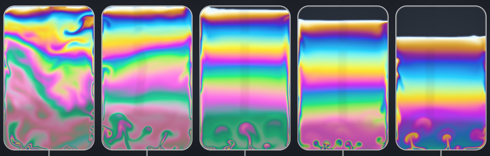

# Soap film

A soap film in a wire frame, simulated and drawn on the GPU in a browser tab. Tilt the phone and the film
pours toward the low side. Drag across it and it swirls as if you blew on it. Leave it alone and it drains,
turns black from the top (film thinner than about 30 nm reflects almost nothing) and pops. The colours are not painted: each pixel's colour is computed from the
film's thickness at that point, by the same interference that colours a real film.

Live: <https://austegard.com/fun-and-games/soap-film.html>. The page is one file,
[`oaustegard.github.io/fun-and-games/soap-film.html`](https://github.com/oaustegard/oaustegard.github.io/blob/main/fun-and-games/soap-film.html);
this directory holds the write-up, the checks and the colour reference.



The strip shows one film 4, 12, 30, 60 and 100 seconds after dipping, rendered by the page's own shaders
on a 192 × 304 grid, smaller than the page's own so that it renders quickly. Thick film sinks and the colours sort into bands, thin plumes rise from the bottom
edge, and black film spreads down from the top.

**Not yet run on a real GPU or a phone.** Everything here was checked in headless Chromium on SwiftShader,
a software GPU. Frame rate, the shaders under Safari's compiler and the tilt sensors on a real device are
untested, so the tilt and shake behaviour described here is what the code is written to do.

## Controls

| input | effect |
|---|---|
| drag | blows on the film along the stroke, and shows the thickness under the pointer in nanometres |
| tap or click | pops the film at that point; on an empty frame it dips a new one |
| tilt, shake | gravity in the film follows the phone, so the film pours and sloshes. iOS asks for motion access when you press **Tilt** |
| the round dial beside the buttons | sets gravity by hand: drag it, or focus it and use the arrow keys. Double-click resets it |
| **Dip** | draws a new film |
| **Loop** / **Frame** | switches to the round wand, or back to the rectangular frame; the button names the shape you would get |
| **Tilt** | turns the motion sensors on or off. It appears on phones; Android needs no permission |
| **Full** | hides the title and controls and lets the frame fill the window (and the screen, where the browser allows it). ✕ or `F` leaves |
| **About** | drainage speed, whether the film pops by itself, sound |
| keyboard | `D` dips; the space bar pops, or dips when the frame is empty |

The bar under the film shows the colour the film reflects at each thickness from 0 to 1,500 nm, seen head-on. `?shape=loop` starts with
the round wand and `?n=256` sets the number of grid cells on the short side (320 by default).

## The film as a fluid

A soap film is a few hundred nanometres of water between two layers of soap, so thin that the flow in it
is two-dimensional. Couder, Chomaz and Rabaud reported in 1989
([Physica D 37, 384](https://researchportal.ip-paris.fr/en/publications/on-the-hydrodynamics-of-soap-films/))
that a vertical film behaves as a two-dimensional stratified fluid, with thickness in the role of density:
thick film is heavy and sinks, thin film is light and rises. The page simulates that reduced model. It does
not model the soap's chemistry.

The state is two numbers per grid cell, the vorticity ω of the flow and the thickness h in nanometres:

```
∂ω/∂t + u·∇ω = G (∇ ln(h + 30 nm) × ĝ) − α ω + D ∇²ω + breath
∂h/∂t + u·∇h = D ∇²h − suction − E          (and the black-film rule below)
∇²ψ = −ω,   u = (∂ψ/∂y, −∂ψ/∂x)
```

- **Buoyancy.** The torque is the gradient of ln h crossed with gravity ĝ, which is the form the density
  term takes when density varies by a large factor, as thickness does here (6 to 1,500 nm). G is 0.30 film
  widths per second squared; the 30 nm offset bounds the gradient at black film. A film layered thin over
  thick has no thickness gradient across gravity, so buoyancy puts no torque on it. Diffusion still moves
  it slowly at the frame's rounded corners (item 3 under Checks).
- **Stream function.** Solving for ψ and taking its curl gives a flow with no divergence by construction,
  so the flow itself neither creates nor compresses film. ψ comes from an iterative solver (red-black
  successive over-relaxation), 14 sweeps per step, started from the previous step's solution.
- **Drag** α is 0.45 per second. It stands in for the air that the film drags along. **Diffusion** D is
  3.8 cells² per second on a 320-cell grid and keeps filaments wider than a cell. Vorticity is limited to
  ±60 per second.
- G, α and D were set by eye, so that a fresh film sorts into bands in ten to fifteen seconds. They are not
  derived from the size of a real film.
- **Breath** is the curl of a Gaussian push that follows a dragged pointer.
- **Border suction.** A real film drains mostly at its edges: the meniscus on the wire pulls liquid out of
  the film beside it and leaves thin patches, which rise as plumes. This is called marginal regeneration
  (described for bubbles in [*Marginal regeneration-induced drainage of surface bubbles*](https://ar5iv.labs.arxiv.org/html/2109.07966)). Here
  film within about two cells of the wire loses thickness at a rate of up to 1.1 per second (it would halve
  in 0.6 s), in patches that come and go.
- **Evaporation** E is 0.9 nm per second everywhere.
- **Black film.** Below 42 nm a cell relaxes to 6 nm, and black film converts neighbouring film thinner
  than 115 nm. This is a rule, not physics: it reproduces the sharp edge between black film and the
  silvery-white film next to it. Sources put Newton black film near 4 nm and common black film anywhere
  from 7 to 50 nm.
- **Popping.** Once a film is 15 s old and more than 30 % of it is black, the page may pop it each time it
  reads the film's statistics (every 12 frames). The probability is 2 % when 30 % of the film is black, and
  0.25 percentage points more for each further percent. How long a film lasts was not timed.

Gravity ĝ is the phone's `accelerationIncludingGravity`, projected onto the screen. That vector is gravity
minus the phone's own acceleration, which is the force a fluid in the phone's frame feels, so a shake
sloshes the film without any extra code. Browsers disagree about its sign; the page takes whichever sign
agrees with the orientation event.

Each step is 31 compute dispatches: one to move ω and h along the flow (a clamped cubic lookup at the point
the flow came from), one for the forces, 28 half-sweeps for ψ (each sweep updates the grid in two halves) and one for the velocity. The grid is 320
cells on the short side and up to 2.2 times that on the long side (`?n=` changes it). A step covers one
frame, between 1/240 and 1/30 s; the checks use 1/60 s.

The cubic lookup that moves thickness is the one place, drainage aside, where thickness is not conserved exactly. The flow has no divergence, but a clamped
cubic interpolation does not preserve the total, and the checks measure a loss of 0.175 % over 25 s.

## Colour

Light reflects off the front and the back of the film, and the two reflections interfere. For a film of
thickness d and refractive index n, the reflectance at wavelength λ is the Airy formula

```
R = 2r²(1 − cos δ) / (1 + r⁴ − 2r² cos δ),   δ = 4π n d cos θ / λ
```

with r the Fresnel coefficient of one surface and θ the angle inside the film. The page sums R every 2.5 nm
from 380 to 780 nm, for both polarisations, against the CIE 1931 standard observer (the measured colour
response of the eye) under D65 (standard daylight). Both are published as tables every 5 nm; the page
carries them, 2 KB of numbers, and interpolates. The result is stored as linear sRGB in a 1,024 × 16
table: thickness from 0 to 3,072 nm by cosine of incidence from 0.5 to 1. Water's index follows a two-term
fit, n = 1.324 + 3046/λ² (1.343 at 400 nm, 1.333 at 589 nm). Colours outside sRGB are pulled in at
constant luminance. Seen head-on the film reflects just under 8 % of the light, and more at a slant, so
the page multiplies the colour by ten before showing it.

`run/ref_lut.py` computes the same colours by another route: the characteristic-matrix method (the general
matrix calculation for layered optics) and the 1 nm tables in the colour-science package. The comparison
is in ΔE76, the distance between two colours in CIELAB space, where a difference near 1 is about the
smallest the eye sees between patches side by side. Over 567 colours (0 to 3,000 nm, three angles) the
page's table differs from the reference by 0.07 on average and 0.22 at worst.

The reference uses the page's own formula for water's index, so this agreement covers the sum over the
spectrum, the tables and the colour conversion, and not the index. Giving the reference a constant index
of 1.333 moves its colours by 2.09 on average and 7.80 at worst, which is how much the variation of the
index with wavelength matters.

The first version of the table used an analytic fit to the observer (Wyman, Sloan and Shirley, 2013) and a
6,504 K blackbody for daylight. Against the same reference it was off by 1.92 on average and 8.60 at
worst, at the dark purple near 220 nm, which is why the page carries the tables.

## Drawing

The film is a mirror. Each pixel traces the ray from an eye in front of the film, reflects it and looks up
a small procedural room: warm walls, a pale ceiling and two daylight windows with glazing bars. The film's
colour multiplies what the room sends back. With motion access the room stays fixed in the world while the
phone turns, so the windows slide across the film; on a desktop the room follows the pointer a little.
Thickness is read with a cubic B-spline, since any kink in it would show as a kink in the colour bands.
The wire is a tube around the frame's outline, shaded by the same room.

A pop opens a hole that crosses the frame in about a third of a second. A real one is far faster: the rim
of a 100 nm film retracts at √(2σ/ρh), about 24 m/s for a surface tension of 0.03 N/m (an assumed figure
for soapy water), which clears a 10 cm frame in 4 ms.

## Checks

`node run/check.mjs` opens the page headless, steps the simulation through the page's `?test=1` hooks and
writes `data/check.json`. All 17 pass on SwiftShader. Three rows of the table cover two checks each. A
step is 1/60 s, and heights run from 0 at the top of the grid to 1 at the bottom.

| check | measured |
|---|---|
| colour table against the reference | mean ΔE76 0.07, worst 0.22, 567 colours |
| no film is black; 6 nm film nearly so; 100 nm film is bright and nearly white | luminance 0, 0.0007, 0.0775 |
| film layered thin over thick, diffusion off, 300 steps | peak speed exactly 0 |
| gravity turned sideways under that film | thickness-weighted centre moves 0.495 → 0.562 of the width |
| film layered thick over thin, 25 s | overturns: the thickness-weighted height moves down, 0.410 → 0.536 |
| thickness with drainage off, 1,500 steps | −0.175 % |
| no gravity, 2 s | vorticity falls to 0.370 of its start (drag alone: 0.407), layers do not sort |
| a breath moving right | a vortex pair, −24.3 and +23.4 per second, flow at the breath (85.8, −1.3) cells/s |
| a hard breath across layered film, drainage off | thickness stays inside its starting range, 210..972 nm → 226..964 nm |
| drainage, 15 s on a thin film | mean 180 → 120 nm; 2,102 black cells in the top half, none in the bottom |
| black film against no film | rgb 39,45,54 against 33,37,44; thicker film 150,64,105 |
| pop, then dip | 57 % gone after 0.1 s, all gone when next read at 0.77 s; a new film of 537 nm mean |
| round wand | 5,808 cells for a disc of 5,809; still sorts by thickness |
| the page loads in test mode and as served | a GPU device, canvas on screen, buttons and dialog work, no console errors |

Three things the checks caught or explained:

1. **Layered film rang until it blew up.** The first version of the step computed buoyancy from the
   thickness before moving it. After one fast drag across the round wand, 192 cells wide, grid-scale waves grew for 70 steps
   until thickness ran from 6 to 3,180 nm (it had been 59 to 939) and vorticity sat at its ±60 limit. Updating vorticity and
   thickness each from the other's old value is forward Euler on an oscillator, which gains energy every
   step. The step is now two passes, and the second computes buoyancy from the thickness the first has
   just moved.
2. **Diffusion taken before the move broke the range.** That version also added the diffusion of the
   old field to the moved value, which can push a cell past the largest thickness anywhere when the flow is
   fast. Diffusion now runs in the second pass on the moved field, where it only averages.
3. **A resting film creeps at the rounded corners.** With diffusion on, a film layered thin over thick
   moves at 0.21 cells/s. The wire lets no thickness through, so layers must meet it at right angles; where
   the wire is neither level nor upright the layers bend, and bent layers drive a flow. This is a real
   effect of diffusion in a stratified fluid, here exaggerated because the diffusion is larger than a real
   film's. The rest check turns diffusion off for that reason.

## Prior work

Three web searches found no soap film simulated in a browser with thickness-driven colour. They found the
offline work whose model of the film this follows: Huang et al.,
[*Chemomechanical simulation of soap film flow on spherical bubbles*](https://cg.cs.uni-bonn.de/backend/v1/files/publications/HuangEtAl-SoapBubbles-SIGGRAPH2020.pdf)
(SIGGRAPH 2020), who advect thickness over a spherical bubble, and Ishida et al.,
[*A model for soap film dynamics with evolving thickness*](https://cs.uwaterloo.ca/~thachisu/spthick.pdf)
(SIGGRAPH 2020), who add thickness to the equations of motion of a deforming film. Three searches is not a
survey.

## Files

| | |
|---|---|
| `run/check.mjs` | the 17 checks; `SITE_DIR` points at a checkout of `oaustegard.github.io` (default `../../oaustegard.github.io`) |
| `run/ref_lut.py` | the colour reference; needs `colour-science`; writes `data/ref_lut.json` |
| `run/shots.mjs`, `run/og.mjs` | render frames offscreen to `out/` (the strip above, the link preview) |
| `run/lib.mjs` | serves the site checkout and launches Chromium on SwiftShader |
| `data/check.json` | the last check run |
