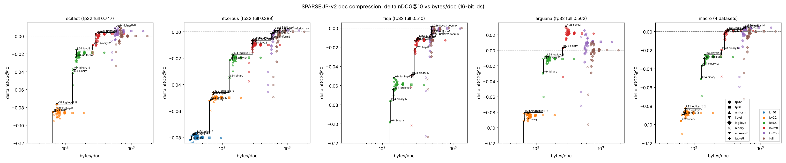

# REPORT: how small can SPARSEUP-v2's document vectors get?

SPARSEUP-v2 (`Linkup-Platform/linkup-sparseup-embed-v2`) turns a document into a
sparse vector over its 50,370-token vocabulary, about 280 nonzero weights per
document. Stored naively (16-bit term id + fp32 weight) that is ~1.7 KB per
document. This study asks how far that index can shrink before retrieval quality
drops. remex (oaustegard/remex) quantizes dense vectors with an exact fp32 norm,
a random rotation and a Lloyd-Max scalar codebook; a rotation would make a
sparse vector dense, so this study uses the other two parts plus top-k pruning.

## Answer

"Delta" is nDCG@10 change vs unpruned fp32, averaged over SciFact, NFCorpus, FiQA
and ArguAna; brackets are 95% bootstrap CIs. Top-k keeps a document's k largest
weights; Lloyd-Max levels are fitted to the values. 16-bit term ids. fp32 is 1,672 B/doc. <!-- @evidence[[results/summary.json#by_key.None_fp32_32_none_fp32.bytes_fixed]] -->

- **8 bits per value is exactly lossless.** bf16 output has under 256
  distinct values, so an 8-bit table holds them all: 836 B/doc, delta 0.0000. <!-- @evidence[[results/summary.json#by_key.None_table8_8_none_fp32.bytes_fixed]] -->
- **Top-256 at 3-bit Lloyd-Max: 565 B/doc,** <!-- @evidence[[results/summary.json#by_key.256_lloyd_3_none_fp32.bytes_fixed]] -->
  **delta +0.0043 [+0.0011, +0.0073].** <!-- @evidence[[results/summary.json#by_key.256_lloyd_3_none_fp32.d]] --> The gain comes from
  ArguAna; FiQA is −0.006. <!-- @evidence[[results/summary.json#by_key.256_lloyd_3_none_fp32.d_fiqa]] -->
- **Top-128 at 2 bits: 287 B/doc, 5.8x smaller,** <!-- @evidence[[results/summary.json#by_key.128_lloyd_2_none_fp32.bytes_fixed]] -->
  **delta −0.0016 [−0.0067, +0.0035]**, <!-- @evidence[[results/summary.json#by_key.128_lloyd_2_none_fp32.d]] --> but per dataset FiQA
  −0.022 and ArguAna +0.031. <!-- @evidence[[results/summary.json#by_key.128_lloyd_2_none_fp32.d_arguana]] -->

Spending bytes on terms beats spending them on bits: at ~256 B, top-128 at 2 bits
beats top-64 at fp16 by 0.026 [0.019, 0.032]. <!-- @evidence[[results/paired.json#k128_lloyd2_minus_k64_fp16.d]] --> remex's exact
per-document norm hurts here (−0.006 at 2 bits). Corpora like FiQA, where top-128
is already lossy, would change the answer.

## Findings

1. **8-bit values are lossless by construction; fp16 is exact.** (Round 1, `results/summary.json`) The activation
   `log1p(relu(logit − 18))` is computed in bf16; 171 to 177 distinct values occur
   per corpus. An 8-bit index into that table reproduces fp32 rankings exactly.
   8-bit uniform on [0, max] is within ±0.0002; Anserini-style 8-bit impacts
   (prior art) are −0.0002 [−0.0006, +0.0002] and drop no terms. <!-- @evidence[[results/summary.json#by_key.None_anserini8_8_none_fp32.d]] -->
2. **Pruning to the top 256 terms raises macro nDCG@10** (Round 1): +0.0042 [+0.0024, +0.0061] <!-- @evidence[[results/summary.json#by_key.256_fp32_32_none_fp32.d]] -->
   (the model was trained with a Matryoshka top-256 level), driven by ArguAna
   (+0.011) and SciFact; FiQA is −0.0005. Top-128 is flat on
   average, +0.0002, <!-- @evidence[[results/summary.json#by_key.128_fp32_32_none_fp32.d]] --> but FiQA −0.013 and ArguAna +0.022.
   Top-64 −0.027, <!-- @evidence[[results/summary.json#by_key.64_fp32_32_none_fp32.d]] --> top-32 −0.088, <!-- @evidence[[results/summary.json#by_key.32_fp32_32_none_fp32.d]] --> top-16 −0.146. <!-- @evidence[[results/summary.json#by_key.16_fp32_32_none_fp32.d]] -->
3. **The macro frontier above 100 B uses 1 to 4 bits per value at k = 64 to 256,
   never 8 or 16.** Every fp16 or 8-bit arm is dominated by a lower-bit arm with
   more terms. The frontier ranks point estimates; most deltas near zero sit inside
   their CIs. Frontier points: k64 2-bit L2-scaled −0.025; <!-- @evidence[[results/summary.json#by_key.64_lloyd_2_l2_fp32.d]] -->
   k128 3-bit 303 B, +0.0003; <!-- @evidence[[results/summary.json#by_key.128_lloyd_3_none_fp32.bytes_fixed]] --> k256 2-bit 536 B, +0.0024. <!-- @evidence[[results/summary.json#by_key.256_lloyd_2_none_fp32.d]] -->
4. **At matched bytes, more terms at fewer bits wins.** (Round 1, `results/paired.json`) At ~256 to 287 B,
   k128 at 2 bits beats k64 at fp16 by +0.026 [+0.019, +0.032] paired. <!-- @evidence[[results/paired.json#k128_lloyd2_minus_k64_fp16.d]] -->
   k128 binary (L2 scale) vs k64 fp16, both ~256 B: +0.007 [−0.002, +0.016], not resolved. <!-- @evidence[[results/paired.json#k128_binary_l2_minus_k64_fp16.d]] -->
5. **A per-document scale (remex's exact-norm idea) does not help.** (Round 1) At full k and
   2 bits, paired against no scale, an fp16 doc max costs −0.0072 [−0.0112, −0.0030]{P("full_lloyd2_docmax_minus_none.d")}
   and the exact L2 norm with remex-style renormalisation −0.0061 [−0.0104, −0.0020].{P("full_lloyd2_l2_minus_none.d")}
   Against fp32: no scale +0.0009; <!-- @evidence[[results/summary.json#by_key.None_lloyd_2_none_fp32.d]] -->
   with an fp16 doc max −0.0062; <!-- @evidence[[results/summary.json#by_key.None_lloyd_2_docmax_fp32.d]] -->
   with the exact L2 norm and remex-style renormalisation −0.0052. <!-- @evidence[[results/summary.json#by_key.None_lloyd_2_l2_fp32.d]] -->
   The values already share one scale (logits through a fixed activation), and
   normalising each document moves its values off the shared grid.
6. **Binary presence (score = sum of query weights over the doc's terms) costs
   0.030 at full k**, −0.0296 [−0.0374, −0.0227]; <!-- @evidence[[results/summary.json#by_key.None_binary_1_none_fp32.d]] --> SciFact −0.010, FiQA −0.054. <!-- @evidence[[results/summary.json#by_key.None_binary_1_none_fp32.d_fiqa]] -->
   It reaches the frontier only at the low end (k ≤ 64, and k128 with an L2 scale).
7. **Delta-varint term ids cost 1.41 B per term at full k** (Round 1) <!-- @evidence[[results/summary.json#by_key.None_binary_1_none_fp32.varint_bytes_per_term]] -->
   (30% under 2 B fixed), 1.63 B at k=128 <!-- @evidence[[results/summary.json#by_key.128_binary_1_none_fp32.varint_bytes_per_term]] -->
   and 1.96 B at k=16, <!-- @evidence[[results/summary.json#by_key.16_binary_1_none_fp32.varint_bytes_per_term]] --> where sparser rows mean larger gaps.
8. **Query precision does not matter:** (Round 1) 8-bit queries cost −0.0003 [−0.0007, −0.0000]. <!-- @evidence[[results/summary.json#by_key.None_fp32_32_none_8bit.d]] -->
9. **Weight quantization (step 3).** (Round 1, `results/weightquant.json`) int8 per-row weights, against the fp32 vectors: doc
   cosine 0.999, <!-- @evidence[[results/weightquant.json#datasets.scifact.int8.doc_cos_mean]] --> top-32 overlap 0.985, <!-- @evidence[[results/weightquant.json#datasets.scifact.int8.doc_top32_overlap]] -->
   nDCG@10 −0.0027 on SciFact <!-- @evidence[[results/weightquant.json#datasets.scifact.int8.d_ndcg10]] --> and +0.0009 on NFCorpus. <!-- @evidence[[results/weightquant.json#datasets.nfcorpus.int8.d_ndcg10]] -->
   int4 group-32: cosine 0.957, <!-- @evidence[[results/weightquant.json#datasets.scifact.int4g32.doc_cos_mean]] --> overlap 0.89, <!-- @evidence[[results/weightquant.json#datasets.nfcorpus.int4g32.doc_top32_overlap]] -->
   SciFact −0.0009 (CI ±0.011), <!-- @evidence[[results/weightquant.json#datasets.scifact.int4g32.d_ndcg10]] --> NFCorpus −0.0100 [−0.0157, −0.0046], <!-- @evidence[[results/weightquant.json#datasets.nfcorpus.int4g32.d_ndcg10]] -->
   and 11 to 12% fewer active terms per doc.
10. **The baseline reproduces the paper** (Round 1) (exact scoring, docs at 512 tokens) against
    Table 1's 75.1 / 38.9 / 50.9 / 56.1: SciFact 0.7474, <!-- @evidence[[results/summary.json#baseline.scifact.ndcg10]] -->
    NFCorpus 0.3895, <!-- @evidence[[results/summary.json#baseline.nfcorpus.ndcg10]] -->
    FiQA 0.5095, <!-- @evidence[[results/summary.json#baseline.fiqa.ndcg10]] -->
    ArguAna 0.5622. <!-- @evidence[[results/summary.json#baseline.arguana.ndcg10]] -->

## Method

- **Fixture.** `mteb/{scifact,nfcorpus,fiqa,arguana}` test splits, every query with
  a positive judgment: 300 / 323 / 648 / 1,406 queries; 5,183 / 3,633 / 57,638 /
  8,674 docs. Full corpora, no subsampling. Docs `title + " " + text`.
- **Encoding.** The card's Sentence Transformers snippet (`SparseEncoder`,
  `trust_remote_code`), `encode_document` / `encode_query` (adds `[D]` / `[Q]`),
  no `max_active_dims`, bf16 weights (the card's precision), fp32 output, docs
  truncated to 512 tokens (config default is 8,192; 2 to 5% of docs are longer).
  SciFact, NFCorpus and ArguAna on this container's 4 CPUs (AMX bf16, 41 min total);
  FiQA on a Kaggle T4 in bf16 (29 min). GPU bf16 vs CPU bf16 on 400 SciFact docs:
  cosine 0.9995.
- **Scoring.** Exact dot product over the whole corpus (scipy sparse), top 100.
  Ties broken by doc id descending and BEIR's `ignore_identical_ids`, as pytrec_eval
  and BEIR do; ideal DCG and the recall denominator use every judged doc. Matches
  `ir_measures`/pytrec_eval to 5 decimals on all four baselines.
- **Arms** (`compress.py`), docs only, queries fp32: top-k per doc, k ∈ {16, 32,
  64, 128, 256, full}; values at fp32, fp16, an 8-bit table of distinct values,
  Anserini-style 8-bit (`round(w/max·255)`, zeros dropped), or a codebook at
  b ∈ {8, 4, 3, 2} bits: uniform on [0, corpus max] (midpoint decode), Lloyd-Max
  fitted on the kept values of 5,000 random docs (quantile init, ≤100 iterations),
  or Lloyd-Max in the log domain; each with scale none, fp16 doc max (quantize
  `v / max`), or remex-style L2 (quantize `v / ‖v‖`, decode, rescale to the fp16
  norm); and binary presence (value 1, doc max, or `‖v‖/√nnz`). Plus four arms with
  8-bit per-query uniform queries. 262 arms per dataset.
- **Bytes.** (i) fixed: `2·nnz + ceil(nnz·b/8) + 2` (scale) per doc; (ii) sorted ids
  delta-coded as LEB128 varints, measured per doc. Codebooks are per corpus and
  ignored (≤ 1 KB). Means over all docs.
- **Uncertainty.** Paired bootstrap over queries, 1,000 resamples, seed 0, vs fp32
  full k. Macro = unweighted mean of the four dataset means, resampled per dataset.
- **Weight quantization** (`kaggle_encode.py` mode `wq`, `weightquant.py`).
  Fake quantization in fp32 on a T4 of all 89 `nn.Linear` weights, the token
  embedding, and the MLM decoder, which is tied to the embedding (checked; re-quantizing it is idempotent). int8: per output row, symmetric,
  scale `max|w|/127`. int4: per row in groups of 32, symmetric, levels −7..7.
  Reference: fp32 weights on the same GPU. Re-encoded SciFact and NFCorpus.
- **Tests.** `test_compress.py`, 11 black-box tests written by a second model from
  the spec (DELEGATION.md).

What the paper (arXiv 2611.09680 v2) already reports, so nothing here is claimed
as missing from it: Matryoshka top-k training with levels (q, d) =
(16, 64), (32, 128), (64, 256), reported as "improves nDCG@10 by 1.5 points at 64
entries per document and by 0.7 points at 128" and "without pruning Matryoshka
costs at most 0.4 points" (Sec. 4.3); document non-zeros as its storage proxy. It
does not report value quantization, bytes per document, posting-list compression
or encoder weight quantization (checked against the full v2 text).

## Log

### Round 1, 2026-11-25: baseline, value grid, weight quantization

Asked by the coordinating session for Oskar ("give this hot new model both the
remex and the packing treatment"). Predictions in `PLAN.md` were written and
pushed (`643e9ffe`) before any step-2 arm ran.

**Predictions vs measured** (macro unless stated):

| # | prediction | measured | |
|---|---|---|---|
| P1 | fp16 exact at full k | 0.0000 [0, 0] | right |
| P2 | 8-bit uniform within ±0.002 | −0.0000 [−0.0002, +0.0002] | right |
| P3 | Anserini 8-bit within ±0.002, no terms dropped | −0.0002, nnz unchanged | right |
| P4 | 4-bit Lloyd ≥ −0.005, any scale | +0.0024 / −0.0010 / −0.0002 | right |
| P5 | best scaled 2-bit Lloyd ≥ −0.015; 2-bit uniform no scale < −0.02 | −0.0052; −0.0045 | half: uniform 2-bit lost far less than predicted |
| P6 | binary full k −0.02 to −0.08 | −0.0296 | right |
| P7 | k256 ±0.002; k128 −0.005 to −0.015; k64 −0.02 to −0.04; k32 −0.05 to −0.08; k16 < −0.10 | +0.0042; +0.0002; −0.027; −0.088; −0.146 | 2 of 5: k256 and k128 better, k32 worse |
| P8 | frontier above 100 B all at 3-4 bits; no 8/16-bit; no 1-bit | 1, 2, 3, 4 bits on it; no 8/16-bit; binary at k64/k128 | wrong except the 8/16-bit part |
| P9 | varint ids 1.5-1.8 B/term at full k, toward 2 at k16 | 1.41; 1.96 | half: cheaper at full k |
| P10 | 8-bit queries within ±0.001 | −0.0003 | right |
| P11 | doc scale beats none at 2 bits by ≥ 0.003 | scale is worse by 0.006 to 0.007 | wrong |
| P12 | `max_active_dims` = top-k truncation | same values in 300/300 rows; differs only in which tied term is kept | right, with ties |
| P13 | baseline within 1.0 of Table 1 | −0.36, +0.05, +0.05, +0.12 points | right |
| P14 | int8: cos ≥ 0.995, overlap ≥ 0.95, nDCG within ±0.005 | 0.999, 0.985, −0.0027 / +0.0009 | right |
| P15 | int4: cos 0.95-0.99, overlap 0.75-0.90, nDCG −0.005 to −0.03 | 0.957, 0.89, −0.0009 / −0.0100 | right on parity; SciFact delta inside noise (CI ±0.011) |

The predictions that failed shared one wrong assumption: that per-value precision
is the scarce resource. On this model values are already coarse (bf16) and share
one scale, so 2 to 3 bits keep almost everything and the scale only adds noise.
What spends bytes is term count, and the model's own top-256 training makes the
tail removable.

**Dead ends and surprises.**
- `max_active_dims` check: comparing to the cached vectors first showed only 1%
  of rows identical. A bf16 CPU encode depends on batch composition (padding): the
  same 300 docs encoded at batch 4 in corpus order vs length-sorted batches give
  cosine 0.9995 (min 0.9953). Against a same-batch full encode, values match
  exactly; the remaining differences are which tied term survives at the k-th
  value, and 70 to 99% of rows have a tie there (`results/max_active_dims_check.json`).
- First metric pass disagreed with pytrec_eval on NFCorpus (0.0004) and ArguAna
  (0.0012): ArguAna holds duplicate documents with identical scores, and trec_eval
  breaks ties by doc id descending. Adopted that rule; quantized arms create ties,
  so an arbitrary tie order would have added noise to every delta.
- ArguAna has a query whose only relevant doc is not in the corpus; ideal DCG and
  recall now count judged docs as trec_eval does.
- fp32 on CPU is 2.2x slower than bf16 (AMX), so the encode stayed bf16;
  GPU bf16 on a T4 is no faster than fp32 (emulated).
- Not run: query-side top-k (the card's q-64), docs longer than 512 tokens, other
  BEIR sets, a search engine (Seismic, Lucene) end to end, latency.

**Reader review.** A fresh Sonnet reader spot-checked five numbers (all matched)
and flagged overstatements: "improves" for a gain carried by ArguAna, a matched-bytes
claim whose CIs overlapped, an unmatched 146 B vs 96 B comparison, and a varint
percentage that mixed id and value bytes. Fixed with paired CIs (`results/paired.json`).

**Cost.** CPU: 41 min encode, ~12 min arm grid. Kaggle T4: 2 min smoke, 29 min
FiQA, ~16 min weight-quant re-encodes. Delegation in `DELEGATION.md`: Gemini 4
Hydrogen wrote the test suite and plot script (~$0.07 total), a web-fetch subagent
read the paper.

