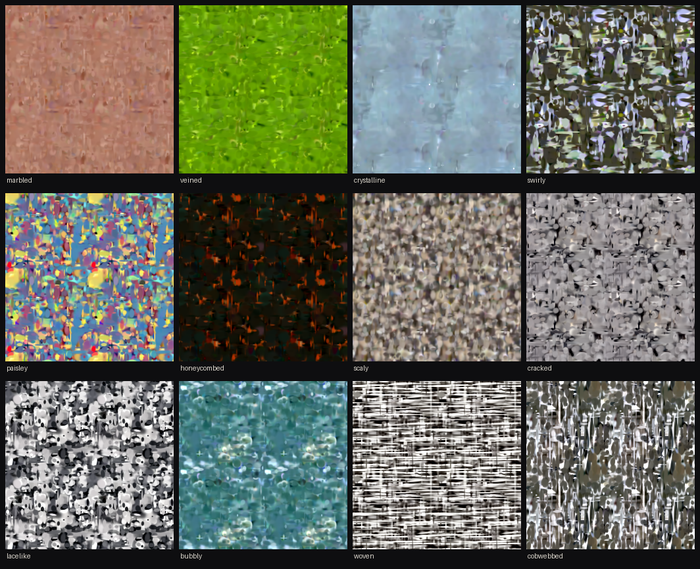

# splat-diffusion — a diffusion model that generates textures as splats

A texture here is not a grid of pixels but a list of 1,024 (or 512) opaque, layered ellipses ("splats"),
each with a colour, an opacity, an edge sharpness and a depth. A diffusion model written by hand in WGSL
(WebGPU's shader language) generates that list directly, in the browser, and one fragment shader paints
it front to back. The tile repeats seamlessly, stays sharp at any zoom, and the page exports the result
as a standalone WGSL function. It is the splat counterpart to
[`wgsl-diffusion/`](../wgsl-diffusion/RESULTS.md), which generates pixels, in the spirit of
[`image-to-wgsl/`](../image-to-wgsl/RESULTS.md), which stores one photo as splats.

Live page: [austegard.com/experiments/splat-diffusion/web/](https://austegard.com/experiments/splat-diffusion/web/)
(`web/index.html`). It needs WebGPU: Chrome or Edge 113+, Safari 26+ or Firefox 141+.
- **Generate:** pick one of the 47 texture classes of the Describable Textures Dataset (DTD) and press Generate. The splats are drawn at every
  denoising step.
- **Navigate:** drag to pan; scroll or pinch to zoom.
- **Splat count:** the Splats menu picks 1,024 or 512. Phones default to 512.
- **Hiding the repeat:** "Hide the repeat" blends randomly offset copies of the tile so no grid shows.
- **Export WGSL:** downloads the texture as a shader function.



## Answer

Can diffusion generate splats instead of pixels, in WGSL, and look good? Yes, once the splats are opaque
and layered rather than soft and additive. A 9.7M-parameter transformer that treats the splats as an
unordered set was trained on 11,280 splat lists fitted to crops of the Describable Textures Dataset (DTD).
Generating one 512-splat texture (24 denoising steps with classifier-free guidance) takes 137 ms <!-- @evidence[[results/bench_mac_v2_512.json#sample.s24_cfg3.total_ms]] -->
on a Mac's GPU (WebGPU reports only "apple metal-3"); the 1,024-splat model was not timed.
The generated splat features match PyTorch running the same weights to within 4.1e-5 (largest absolute difference). <!-- @evidence[[results/bench_mac_v2_512.json#correctness.state_max_abs]] -->

The first version used soft additive Gaussians. Its textures were blurry, because a median fit of 1,024
such splats reproduced its training crop at only 25.2 dB PSNR (peak signal-to-noise ratio; higher is closer). Giving each splat an
opacity, an edge sharpness and a depth, and compositing front to back, raised that to 30.4 dB, <!-- @evidence[[results/fit_summary_v2.json#1024.batch_median_psnr.median]] -->
with hard edges. Capping splat length removed the "needle" lines (long thin splats drawn as straight streaks across a tile), and removing the lighting from the
training crops took away the light patches that made the repeat obvious. The textures are still made of
visible blobs at close range. More splats per tile is the next change that would move the answer.

## Findings

Rounds are the four build stages recorded in the Log: the first additive model, needles and timing, phones and the repeat, and the opaque splats. PSNR figures are medians over fitting batches of 32 or 64 crops.

1. Opaque layered splats fit DTD crops far better than additive ones: the median batch reaches 30.4 dB with 1,024 splats and 28.1 dB with 512, against 25.2 and 23.5 dB for additive splats (Round 4, `results/fit_summary_v2.json`). <!-- @evidence[[results/fit_summary_v2.json#512.batch_median_psnr.median]] -->
2. The generated textures have hard edges and recognisable class structure, such as pebbles for scaly and a black-and-white weave for woven, with no needle lines (Round 4, `results/gallery_v2_1024.png`, `results/gallery_v2_512.png`).
3. Sampling is fast: 24 guided steps over 512 splats take 137 ms on the Mac, and a 2048×2048 paint takes 22 ms (Round 4, `results/bench_mac_v2_512.json`). <!-- @evidence[[results/bench_mac_v2_512.json#paint.px2048.ms_incl_readback]] -->
4. The WGSL runtime matches PyTorch on the Mac: the final state is within 4.1e-5, and the painted tile within 0.63 of an 8-bit level. That covers decode, the GPU depth sort and front-to-back paint (Round 4, `results/bench_mac_v2_512.json`). <!-- @evidence[[results/bench_mac_v2_512.json#correctness.paint_max_levels]] -->
5. Needle splats came from the fitter, not the model. A penalty on any long axis beyond 0.2 of the tile removed them. In the additive version, 0.21% of fitted splats had a long axis over a quarter of the tile and the model drew 0.37%, so the model copied the fits' needles and slightly exaggerated them (Round 2, `results/fit_summary.json`). <!-- @evidence[[results/fit_summary.json#needles_sigma_max_gt_0p25.data_frac]] -->
6. Stochastic tiling hides the repeat: each screen point blends three randomly offset copies of the tile, keeping the tile's average colour and contrast. The separate experiment `texture-collage/`, which adopted it, measured its repeat correlation falling from 0.931 to −0.006 (Round 3, `results/stochastic_tiling_cmp.png`).
7. On an iPhone the GPU work is correct: there was no NaN at any step, and per-step paint statistics equal PyTorch's at 96, 1024 and 1600 px. Oskar saw the texture vanish around step 15 on the iPhone page; no test job on the phone (through the GPU bridge, see Method) reproduced it, and whether the later drawing change fixed it is still open (Round 3).
8. `torch.compile` made fitting about ten times faster on an A100: the first full fit of 11,280 crops took 36 minutes instead of about six hours (Round 1, `results/fit_summary.json`). <!-- @evidence[[results/fit_summary.json#fit_minutes]] -->

## Method

**Representation** (`train/splats.py`).
- **Splat parameters:** a position on the unit torus, a lower-triangular precision factor
  [[eᵃ, 0], [b, eᶜ]], an RGB colour, an opacity logit o, an edge sharpness s and a depth z.
- **Footprint:** 0.99·sigmoid(o)·exp(−½ q^p), where q = |A d|² and p = 1 + softplus(s). With p = 1 it
  is a Gaussian; larger p gives a flat top with a crisp edge.
- **Compositing:** splats composite front to back in order of z. Distances wrap around the tile, so
  every texture tiles seamlessly.
- **Diffusion features:** each splat is 13 numbers: cos and sin of each coordinate, a, b, c, the colour,
  o, s and z, standardised per feature. The depth is an ordinary feature, so the model sees an
  unordered set and only the renderer sorts.

**Data** (`train/fit_dataset.py`).
- **Crops:** each DTD image (5,640) is resized so its short side is 192 or 288, and has its lighting
  removed (image − Gaussian blur at 24 px + mean). One random 128×128 crop is taken at each scale.
- **Fitting:** K splats are fitted per crop with Adam for 1,000 steps on 4,096 random pixels per step.
  Splats start back to front with sizes shrinking toward the front.
- **Length cap:** a penalty applies to any long axis beyond 0.2 of the tile.
- **Run times:** fitting took 87 minutes for 1,024 splats on an A100, <!-- @evidence[[results/fit_summary_v2.json#1024.fit_minutes]] -->
  and 30 minutes for 512 on an RTX PRO 6000 Blackwell (the GPU Colab calls "G4").

**Model** (`train/model.py`). A transformer of 8 blocks, width 256 and 4 heads, with no positional
encoding. Each block uses DiT-style adaLN-Zero: shift, scale and gate come from a timestep embedding plus
a class embedding (with a null class for guidance).

**Training** (`train/train.py`). Rectified flow on the normalised features, with logit-normal t and 10%
class dropout. Each example gets a random torus translation and random x/y flips, which are exact
symmetries of the representation. Each run was 40,000 steps at batch 64, AdamW at 2e-4 with cosine decay
and EMA 0.9995: about 50 minutes on either GPU.

**Runtime** (`web/splatdiff.js`).
- **Transformer:** a strided batched matmul for every linear layer and both attention products, with
  row softmax, LayerNorm with adaLN modulation, and the Euler step with guidance.
- **Decode and sort:** a decoder turns features into splats, and a GPU depth sort ranks each splat by
  counting the splats behind it.
- **Painter:** composites front to back and stops once a pixel is covered. It paints one tile of at most
  1024 px into a texture, which the screen repeats on a grid or with stochastic tiling. All drawing
  happens in `requestAnimationFrame`.
- **Export:** `bakeShader` writes three arrays of K elements each, which stays under WebKit's limit of
  2,047 elements per const array.

**Checks.**
- **SwiftShader** (Chromium's software GPU): `run/test_gpu.mjs` runs `web/_test.html` on SwiftShader against fixtures from
  `train/export.py fixture` (64 splats, random weights). It checks a forward pass, a 3-step guided
  sample, decode + sort and the painter.
- **Mac and iPhone:** `bridge/*.js` jobs run on Oskar's Mac and iPhone through the GPU bridge, a page on
  each device that runs WebGPU jobs pushed to a repo and commits the results back. They report timings
  and a fixed-noise sample, which `run/ref_from_bin.py` compares with PyTorch.

**Prior art.**
- **Searches:** one search found no diffusion model over sets of 2D splats.
- **Nearest work, 3D:** [DiffSplat](https://arxiv.org/html/2501.16764v1) lays 3D splat attributes out as
  images; Henderson et al., cited in [arXiv 2508.21542](https://arxiv.org/pdf/2508.21542), denoise 3D
  splats directly.
- **Set denoising:** a transformer over an unordered set is the point-cloud diffusion recipe.
- **Opaque layered splats:** ordered alpha compositing is what `image-to-wgsl/` does for one photo.

**Not done.**
- **More detail:** no splat counts above 1,024 and no crops smaller than 128 px, either of which would
  put more splats per pixel.
- **iPhone page:** not confirmed fixed after the `requestAnimationFrame` change.
- **Mac timing for the 1,024 model:** not measured; the 1,024 additive model took 223 ms.

**Reproducing.**

```bash
python3 train/fit_dataset.py --out run1 --K 1024 --bs 32 --steps 1000   # downloads DTD itself; CUDA GPU, ~87 min on an A100
python3 train/train.py --out run1 --steps 40000                          # ~50 min; writes run1/ema.pt and run1/stats.json
python3 train/export.py weights run1/ema.pt run1/stats.json web/model     # web/model512 for --K 512
python3 train/export.py fixture web/test 64 && node run/test_gpu.mjs     # WGSL against PyTorch
```

## Log

### Round 1 — representation, fitting and training (2026-11-07)

Oskar, after the pixel model went live: "Hmmm, this is still generating PIXELS. I was expecting
splats". He was offered three designs (pixel diffusion followed by a splat fit, a splat decoder trained through a differentiable renderer, or diffusing splat lists directly) and chose the last.

- **CPU probes** (8 crops, 400 steps): 256 splats gave a median 20.3 dB and 512 gave 21.0. 512 splats
  at 1,500 steps added 1 to 2 dB. The limit was detail per splat, so K went to 1,024.
- **First GPU batch:** 28.1 dB, but 61 s per 32 crops, which is six hours for the dataset.
- **`torch.compile`:** brought the batch to 6.1 s, and the full fit to 36 minutes at a median 25.3 dB.
- **Training:** 7.3 s per 100 steps. Samples at 20k steps showed class palettes and structure, plus
  occasional straight lines across a tile.

### Round 2 — needles, correctness and timing (2026-11-07)

- **Needles:** an elongation check on the Colab VM found them in the fitted data, at 0.21% of splats with a
  long axis over 0.25 tile, against 0.37% in generated splats. A decode-time filter for long, thin
  splats removed one line in crystalline, but hit 41 thread splats in woven and missed bubbly's line,
  so it was not shipped.
- **Mac** (`results/bench_mac.json`): 24 guided steps in 223 ms, 24 unguided in 147 ms, 12 guided in
  112 ms. Painting takes 2.7 ms at 512², 6.2 ms at 1024² and 24 ms at 2048². The state matches PyTorch
  to 1.2e-5, and the paint to 0.5 levels.
- **SwiftShader:** it painted the full page with real weights as flat grey, after 480 s for 8 steps.
  The cause was not found; the likely one is SwiftShader giving up on 1,024 splats per pixel.
  The same canvas path painted the 64-splat fixture correctly, and the Mac's offscreen paint of the
  real model matches PyTorch.

### Round 3 — phones, the 512-splat model and the visible repeat (2026-11-07)

Oskar: "It seems to fail on an iPhone once it gets 2/3 through generation. Maybe add a 512 splat option for phone?",
then "There's no error, the diffusing image just disappears at around step 15, depending on the texture", and
"The pixel-based diffusion model was able to avoid a tiling effect; here it is QUITE obvious?"

- **iPhone diagnostics** through the GPU bridge (iOS 27.2 Safari, in a worker): 24 guided steps of the
  1,024-splat model in 4.2 s (175 ms a step); the old page loop with a real `OffscreenCanvas` repaint per step
  and the new cached-tile loop both finished without device loss; zero non-finite values in the x₀ estimate at
  every step for four classes; the per-step mean and spread of painted tiles equal PyTorch's to the printed
  precision at 96, 1024 and 1600 px. None of this reproduced the vanishing texture, which leaves presenting the
  visible canvas from the main thread. The page now draws only inside `requestAnimationFrame` through a
  cached tile (at most 1024 px, painted when the splats change, repeated with a sampler), and clamps the GELU's
  tanh argument to ±15 (exact to 1e-13). Whether that fixes the iPhone is not yet confirmed.
- **512 splats**: fitted in 19 minutes (median batch 23.5 dB) and trained for 40,000 steps. On the Mac it
  samples in 139 ms (24 guided steps), paints 2048² in 16 ms and matches PyTorch to 9.1e-6
  (`results/bench_mac_512.json`). Phones default to it; `?k=` picks either.
- **The repeat**: a tile is one 128 px crop's worth of content and carries that crop's low-frequency lighting,
  so a grid of repeats is obvious. The display now uses stochastic tiling (Heitz and Neyret 2018) by default:
  three randomly offset copies blended per point on a triangle grid around the tile's mean colour, which the
  splats give analytically (colour × 2π / det A). `results/stochastic_tiling_cmp.png` shows grid against
  stochastic for crystalline and woven. The sibling `texture-collage/` adopted it and measured its repeat
  correlation falling from 0.931 to −0.006.

### Round 4 — opaque layered splats, length cap and lighting removal (2026-11-07)

Oskar: "Yeah not so sure about the end results here; so very diffused and 'unfocused'", then "Make the
changes".

- **Probe:** on four CPU probe crops (512 splats, 400 steps), opaque layered splats fitted 20.8 to
  24.3 dB against 17.6 to 21.7 dB for additive ones. The chain links, fibres and paisley outline came out
  crisp. The length cap held: the longest fitted splat was 0.25 of the tile.
- **Runs:** two full fits and trainings ran in parallel. Colab refused a second A100, so the 512 run used
  a G4 (RTX PRO 6000 Blackwell). The 512 fit took 30 minutes at a median batch of 28.1 dB; the 1,024 fit
  took 87 minutes at 30.4 dB.
- **WGSL:** the new runtime (13 features, GPU depth sort, front-to-back painter, three-array baked
  shader) matched PyTorch on SwiftShader the first time: forward 4.4e-6, sample 3.5e-6, decode + sort
  3.5e-5, paint within 0.5 of an 8-bit level. On the Mac, the 512 model sampled in 137 ms and matched
  PyTorch to 4.1e-5.
- **Rollout:** the page shipped the 512 model first and skipped the old-format 1,024 model until the new
  one landed.
- **Machines:** both VMs were stopped when their runs finished.

