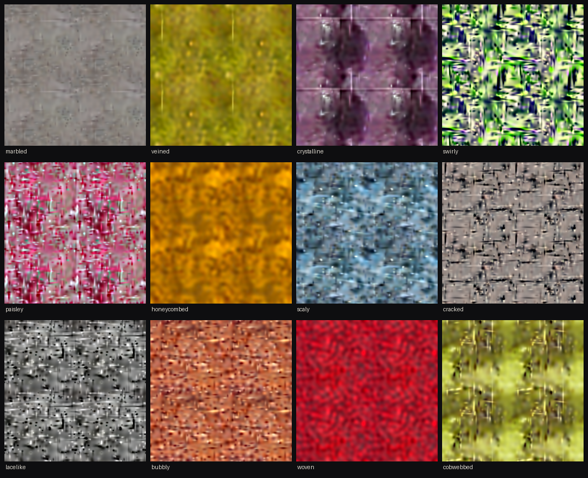

# splat-diffusion — a diffusion model that generates textures as Gaussian splats

A texture here is not a grid of pixels but a list of 1,024 soft, coloured Gaussian splats, and a
diffusion model written by hand in WGSL (WebGPU's shader language) generates that list directly, in
the browser. One fragment
shader paints the splats, so the tile repeats seamlessly and stays smooth at any zoom, and the page
exports the result as a standalone WGSL function. It is the splat counterpart to
[`wgsl-diffusion/`](../wgsl-diffusion/RESULTS.md), which generates pixels, in the spirit of
[`image-to-wgsl/`](../image-to-wgsl/RESULTS.md), which stores one photo as splats.

Live page: [austegard.com/experiments/splat-diffusion/web/](https://austegard.com/experiments/splat-diffusion/web/)
(`web/index.html`); WebGPU required (Chrome or Edge 113+, Safari 26+, Firefox 141+). Pick one of the 47 DTD
texture classes and press Generate; the splats are drawn at every denoising step. Drag to pan, scroll or pinch to
zoom; Export WGSL downloads the texture as a shader function.



## Answer

Can diffusion generate splats instead of pixels, in WGSL? Yes. A 9.7M-parameter transformer that treats the splats as an unordered set,
trained on 11,280 splat lists fitted to crops of the Describable Textures Dataset (DTD), denoises
1,024 splats in 24 steps with classifier-free guidance in 223 ms on a Mac's GPU (WebGPU reports only "apple metal-3"). <!-- @evidence[[results/bench_mac.json#sample.s24_cfg3.total_ms]] -->
Painting a 2048×2048 frame of them takes 24 ms. <!-- @evidence[[results/bench_mac.json#paint.px2048.ms_incl_readback]] -->
The GPU's final splat features match PyTorch running the same weights to within 1.2e-5. <!-- @evidence[[results/bench_mac.json#correctness.state_max_abs]] -->

By eye, the textures are softer and less class-specific than those of the pixel model in
`wgsl-diffusion/`. Two limits come from the training data rather than the model. First, the fits
themselves are soft: 1,024 splats reproduce a 128×128 crop at a median 25.3 dB PSNR, a visibly blurred copy. <!-- @evidence[[results/fit_summary.json#fit_psnr_db.median]] -->
Second, the fits contain long, thin "needle" splats, which the model learned and draws as straight
lines across some tiles (veined, crystalline and cracked in the gallery). A fitter that caps splat length, then more splats per tile, are the next changes
that would move the answer.

## Findings

1. Twenty-four guided denoising steps over 1,024 splats take 223 ms on the Mac's GPU, against 3.6 s for PyTorch on 4 CPU cores (Round 2, `results/bench_mac.json`). <!-- @evidence[[results/bench_mac.json#sample.s24_cfg3.total_ms]] -->
2. The WGSL runtime matches PyTorch: on the Mac the final state of a 24-step guided sample is within 1.2e-5, and the painted 128×128 tile within 0.50 of an 8-bit level (Round 2, `results/bench_mac.json`). <!-- @evidence[[results/bench_mac.json#correctness.paint_max_levels]] --> <!-- @evidence[[results/bench_mac.json#correctness.state_max_abs]] -->
3. Fit quality bounds the output: 1,024 additive splats reach a median 25.3 dB on a 128×128 DTD crop, with 10th and 90th percentiles of 19.1 and 32.2 dB (Round 1, `results/fit_summary.json`). <!-- @evidence[[results/fit_summary.json#fit_psnr_db.p10]] --> <!-- @evidence[[results/fit_summary.json#fit_psnr_db.p90]] -->
4. Needle splats come from the fits, and the model draws them more often: 0.21% of fitted splats have a long axis over a quarter of the tile, against 0.37% of generated splats (Round 2, `results/fit_summary.json`). <!-- @evidence[[results/fit_summary.json#needles_sigma_max_gt_0p25.data_frac]] -->
5. Removing thin, long splats at decode time is not a fix. A woven texture (a DTD class) used 41 of its 1,024 splats that way, as threads, and a straight line in bubbly survived the filter (Round 2, `results/needle_filter_cmp.png`).
6. On the training side, compiling the fitting render with `torch.compile` made it about ten times faster on an A100 (61 s to 6.1 s per 32 crops at 1,000 steps), which turned a six-hour dataset into 36 minutes (Round 1, `results/fit_log.jsonl`). <!-- @evidence[[results/fit_summary.json#fit_minutes]] -->

## Method

**Representation** (`train/splats.py`). A splat is a position on the unit torus, a lower-triangular
precision factor [[eᵃ, 0], [b, eᶜ]] and an RGB colour of either sign. The image is a mid-grey
background plus the sum of every splat's colour times its Gaussian. Blending is additive, so the
order of the splats does not matter. Distances wrap around the tile, so every texture tiles without a
seam. For diffusion each splat becomes 10 numbers: cos and sin of each coordinate (no discontinuity
where the torus wraps), a, b, c, and the colour, standardised per feature.

**Data** (`train/fit_dataset.py`). Every DTD image (5,640) is resized so its short side is 192 or 288,
and one random 128×128 crop is taken at each scale. 1,024 splats are fitted to each crop by Adam over
1,000 steps on 4,096 random pixels per step, from random positions with colours sampled from the crop.

**Model** (`train/model.py`). A transformer of 8 blocks, width 256 and 4 heads, with no positional
encoding, so it does not depend on the order of the splats. Each block uses DiT-style adaLN-Zero:
LayerNorm without affine, plus shift, scale and gate from a vector that sums a timestep embedding and
a class embedding (with a null class for guidance).

**Training** (`train/train.py`). Rectified flow on the normalised features with logit-normal t and
10% class dropout. Every example gets a random torus translation and random x/y flips. These are
exact symmetries of the representation, checked to 0.0 against rolled and flipped renders. The run
was 40,000 steps at batch 64, AdamW at 2e-4 with cosine decay and EMA 0.9995, on a Colab A100 in 49
minutes.

**Runtime** (`web/splatdiff.js`).
- **Matmul:** a strided batched matmul (64×64 tiles, 4×4 outputs per thread) serves every linear layer
  and both attention products, with GELU and gated-residual epilogues.
- **Other kernels:** a row softmax, LayerNorm with adaLN modulation, the Euler step with guidance, and
  a decoder from features to splats.
- **Painter:** a fragment shader loops over all splats per pixel, with the torus wrap.
- **Shader export:** `bakeShader` writes the splat list into a standalone WGSL function as a `vec4f`
  array, which keeps it under WebKit's limit of 2,047 elements per const array.

**Checks.**
- **SwiftShader:** `run/test_gpu.mjs` runs `web/_test.html` in headless Chromium against fixtures from
  `train/export.py fixture` (64 splats, random weights). It checks a forward pass, a 3-step guided
  sample, the decoder and the painter.
- **Mac:** `bridge/bench_job.js` runs on Oskar's Mac through the GPU bridge (a page there that runs WebGPU jobs pushed to a repo and commits the results back). It reports timings plus
  a 24-step sample from fixed noise, which `run/ref_from_bin.py` compares with PyTorch on the exported
  weights.

**Prior art.**
- **Searches:** one search found no diffusion model over sets of 2D splats.
- **Nearest work, 3D:** [DiffSplat](https://arxiv.org/html/2501.16764v1) lays 3D splat attributes out as
  images for a pretrained image model. Henderson et al., cited in
  [arXiv 2508.21542](https://arxiv.org/pdf/2508.21542), denoise 3D splats directly.
- **Set denoising:** denoising an unordered set with a transformer is the point-cloud diffusion recipe.
- **Representation:** additive 2D Gaussians as an image representation is GaussianImage's.

**Not done.**
- **Fitting:** no fitter that caps splat length, and no counts above 1,024.
- **Phones:** none was tested.
- **Painter speed:** no faster painter, such as caching the tile in a texture.

**Reproducing.**

```bash
python3 train/fit_dataset.py --out run1 --K 1024 --bs 32 --steps 1000   # CUDA GPU, ~36 min on an A100
python3 train/train.py --out run1 --steps 40000                          # ~49 min on an A100
python3 train/export.py weights run1/ema.pt run1/stats.json web/model
python3 train/export.py fixture web/test 64 && node run/test_gpu.mjs     # WGSL against PyTorch
```

## Log

### Round 1 — representation, fitting and training (2026-11-07)

Oskar, after the pixel model went live: "Hmmm, this is still generating PIXELS. I was expecting
splats". He was offered three designs (pixel diffusion followed by a splat fit, a splat decoder trained through a differentiable renderer, or diffusing splat lists directly) and chose the last.

- **CPU probes** (8 crops, 400 steps): 256 splats gave a median 20.3 dB and 512 gave 21.0. 512 splats
  at 1,500 steps added 1 to 2 dB. The limit was detail per splat, so K went to 1,024.
- **First GPU batch:** 28.1 dB, but 61 s per 32 crops, which is six hours for the dataset.
- **`torch.compile`:** brought the batch to 6.1 s, and the full fit to 36 minutes at a median 25.3 dB.
- **Training:** 7.3 s per 100 steps. Samples at 20k steps showed class palettes and structure, plus
  occasional straight lines across a tile.

### Round 2 — needles, correctness and timing (2026-11-07)

- **Needles:** an elongation check on the Colab VM found them in the fitted data, at 0.21% of splats with a
  long axis over 0.25 tile, against 0.37% in generated splats. A decode-time filter for long, thin
  splats removed one line in crystalline, but hit 41 thread splats in woven and missed bubbly's line,
  so it was not shipped.
- **Mac** (`results/bench_mac.json`): 24 guided steps in 223 ms, 24 unguided in 147 ms, 12 guided in
  112 ms. Painting takes 2.7 ms at 512², 6.2 ms at 1024² and 24 ms at 2048². The state matches PyTorch
  to 1.2e-5, and the paint to 0.5 levels.
- **SwiftShader:** it painted the full page with real weights as flat grey, after 480 s for 8 steps.
  The cause was not found; the likely one is SwiftShader giving up on 1,024 splats per pixel.
  The same canvas path painted the 64-splat fixture correctly, and the Mac's offscreen paint of the
  real model matches PyTorch.
