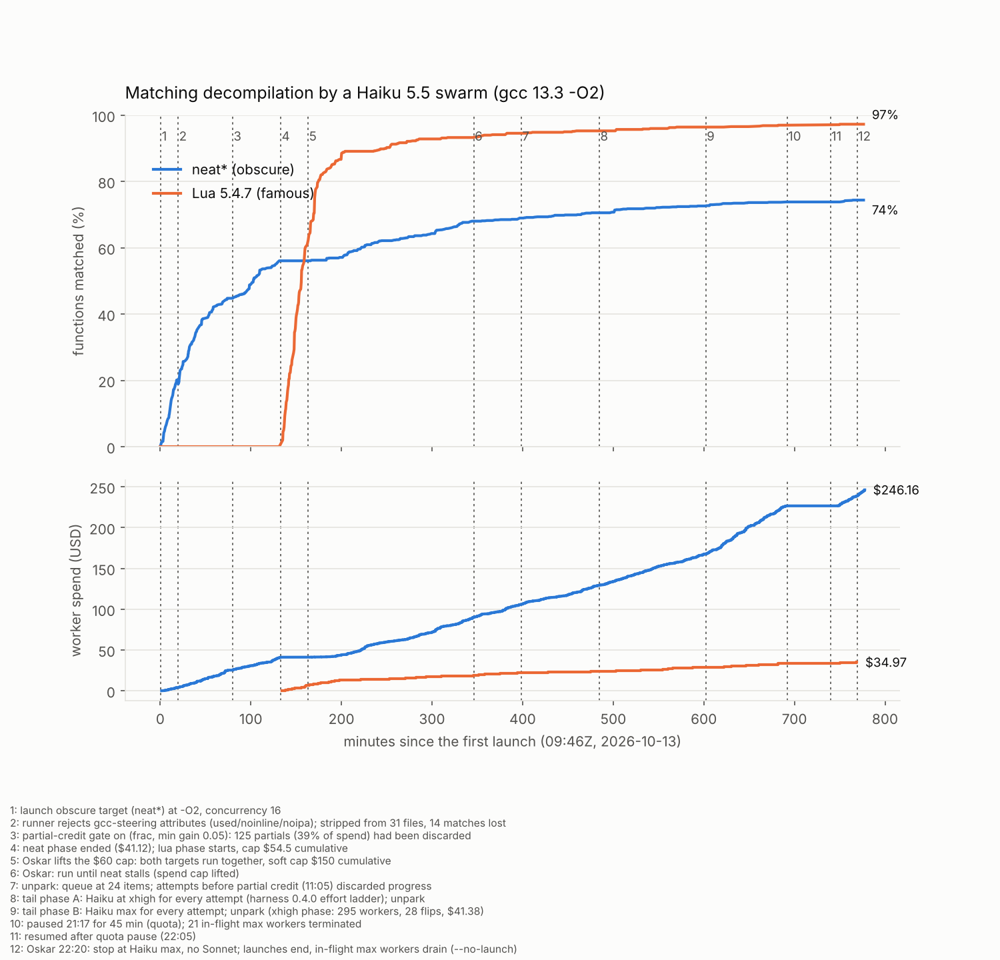
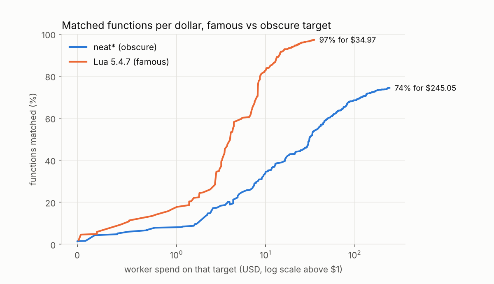
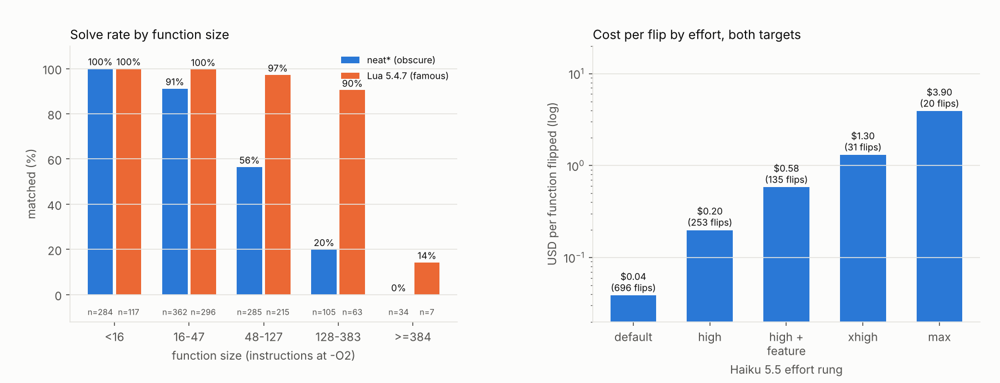

# swarm-decomp: matching decompilation with a Haiku 5.5 swarm

## Answer

Can a swarm of Haiku 5.5 workers turn stripped x86-64 objects back into C that gcc 13.3 at `-O2` compiles to the same bytes, and what can it not do? On 1,070 functions of an obscure target (Ali Rudi's neat* troff suite and C compiler) it matched 796 (74.4%) for $246.16 of worker spend. On 698 functions of a famous target (Lua 5.4.7) it matched 679 (97.3%) for $34.97.

Size and loops decide what Haiku solves. Every neat* function under 16 instructions matched, 91% under 48, 56% at 48–127, 20% at 128–383 and none of 34 at 384 or more. Functions without a loop matched 99% of the time and functions with one 58%; 268 of the 274 unsolved neat* functions contain a loop. Raising effort bought little at the tail: a flip cost $0.039 at default effort, $0.20 at `high`, $1.30 at `xhigh` and $3.90 at `max`.

Lua was cheap because Haiku remembers it. 249 of 673 matched Lua functions reproduce upstream source nearly verbatim, 44 of them with upstream comments a binary cannot contain; on neat* 5 functions trip the same test, all of them dictated by the binary. With copied functions not counted, Lua stands at 430 of 698 (61.6%).

Sonnet was not run. A Sonnet arm on the 274-function neat* tail would show whether the size and loop ceiling belongs to Haiku or to the task.

## Findings

1. **Function size sets the ceiling on the obscure target.** neat* solve rate by instruction count at `-O2`: <16 100% (284/284), 16–47 91% (330/362), 48–127 56% (161/285), 128–383 20% (21/105), ≥384 0% (0/34). Lua holds 90% up to 383 instructions and falls to 1 of 7 above. (`runs/report/features.json`, `haiku_limits.png`)
2. **Loops are where Haiku fails.** neat* functions with no backward branch: 426/432 matched (99%); with one: 370/638 (58%). 268 of the 274 unsolved neat* functions contain a loop. Switches compiled to jump tables matched 3 of 19, gcc clones (`.part`, `.isra`, `.constprop`) 16 of 47. (`features.json`)
3. **Effort past `high` costs a lot for each extra function.** Dollars per function flipped, by the rung of the worker that flipped it: default $0.039 (696 flips), `high` $0.198 (253), `high` in feature mode $0.579 (135), `xhigh` $1.30 (31), `max` $3.90 (20). The higher rungs only ever saw the tail the lower ones left, so this is the price of the marginal function, not the same task at different effort. Median size of what each rung solved on neat*: 60, 130, 132 and 280 bytes; the unsolved median is 415. (`rungs.json`, `levels.json`)
4. **Haiku recalls Lua.** Of 673 matched Lua functions that could be compared, 249 are flagged as copied (verbatim informative lines ≥ 60% over ≥ 5 lines, or ≥ 80% of upstream's free identifiers with token similarity ≥ 0.9, or an upstream comment); 44 reproduce upstream comments verbatim. Means over matched functions, Lua against neat*: verbatim informative lines 0.590 vs 0.106, free-identifier recall 0.689 vs 0.303. neat* has 5 flags, all inspected and all dictated by the binary (format strings from `.rodata`, symbol names). With copies excluded, Lua stands at 430/698 (61.6%) and neat* at 791/1,070 (73.9%). (`runs/report/contamination.json`)
5. **The famous target is ten times cheaper per function.** At equal spend per target: $4.31 bought 18.9% of neat* and 54.6% of Lua; $10 bought 34.4% and 82.7%; $34.97 bought 53.9% and 97.3%. neat* paid for harness fixes Lua inherited (finding 7), so part of the gap at low spend is the harness, not memory. (`per_dollar.png`)
6. **The pilot put `-O2` within reach.** 20 functions, 5 Agent-tool Haiku workers, three levels: `-O0` 11/20, `-O1` 14/20, `-O2` 12/20. `-O0` was not easier than `-O2` on these 20. (`pilot/pilot.json`)
7. **The harness assumed tests are independent, but in decompilation they depend on each other.** A caller matches only once its static callees are written, and a static function is emitted only once something calls it. The strict gate threw away 125 `partial` workers, 39% of spend at the time, 103 of them blocked on a missing callee. A partial-credit gate (merge when the targets' summed byte-match fraction rises with no regression) took 326 neat* merges after it was turned on. Eleven such assumptions and their fixes are in `oaustegard/claude-skills` `swarming-to-green/references/run-2026-10-13.md`. (`runs/assumptions.md`)
8. **Workers reach for compiler steering when a test depends on another.** 17 minutes into the first launch, 31 files carried `__attribute__((used))`, `noinline` or `noipa` to force a static function into the object before its caller existed. The runner now fails any TU that uses them; stripping them cost 14 of 216 matches. (event 2 in `timeline.png`)

## Method

**Targets.** Obscure: Ali Rudi's neat* suite at the commits in `pipeline/targets.json` (neatroff, neatpost, neatmkfn, neateqn, neatrefer, neatcc, neatld, neatmail; ISC; 13–180 GitHub stars on 2026-10-13; neatroff's last commit is 2026-08-04, after the model's training cutoff; neatvi left out at 400 stars). Famous: Lua 5.4.7 (MIT, lua.org tarball, sha256 `9fbf5e28…cfbf1e30`, built with `-DLUA_COMPAT_5_3 -DLUA_USE_LINUX`). Sources were compiled only inside claude-workspace `scripts/jail.sh`, never linked or run, deleted before any worker ran, and re-downloaded and hash-checked for the contamination check after the last worker stopped.

**Pin.** gcc 13.3.0-6ubuntu2~24.04.1, `-O2 -g0 -fno-pie -fno-stack-protector -fno-stack-clash-protection -fcf-protection=none -U_FORTIFY_SOURCE -fno-asynchronous-unwind-tables -fno-unwind-tables -ffunction-sections -fdata-sections -fno-ident` (`tests/flags.json`), enforced at the gate by `tests/bin/pin-check`. 101 translation units, 1,768 function symbols (1,070 neat*, 698 Lua).

**What workers saw.** Each TU's object (symbol table kept, DWARF stripped), a per-function AT&T listing with every relocation resolved to a name, string or variable, an `_info.txt` with definition order, data objects and their bytes, Lua's four installed headers, and `CONTRACT.md`. Never the source.

**Runner.** `tests/run.py` generates each TU from `src/<proj>/types/*.h` (one type per file), `src/<proj>/<tu>/*.h` and one `.c` per function, compiles it with the pin, and compares every function symbol: code bytes with relocation fields zeroed, relocations compared by target (named symbol, string contents, constant bytes, variable name), never by address. Stages are `compile`, `missing` and `match`; the reason carries the diff category (`regalloc`, `offset` keyed on the displacement pattern, `frame`, `imm`, `call:<symbol>`, `ref`, `cfg-layout`, `insn-delta` near/mid/far); `frac` is the share of matching instructions. Fed the original sources, the runner matches 2,699/2,699 functions at `-O0`, 2,003/2,003 at `-O1` and 1,768/1,768 at `-O2`; `-O1` source against `-O2` targets matches 139/1,768.

**Swarm.** `oaustegard/claude-skills` `swarming-to-green` 0.1.6 → 0.4.1, `swarm/swarm.toml`, `swarm/worker_prompt.md`. Every function starts as a stub. Clusters are per TU and size bucket for stubs, per diff category after. Every suite runs at every gate, so no regression rides a sample. Workers: `claude -p` Haiku 5.5, Bash allowed, network tools refused through `worker.deny`, told never to look for the source. Effort phases: default with `high` retries and feature mode (09:46–17:50), every attempt at `xhigh` (17:50–19:47), every attempt at `max` (19:47–22:34, paused 21:17–22:05 for quota). Sonnet was not run.

**Contamination.** `pipeline/contamination.py` compares each matched function with its upstream definition on what the binary does not fix: free identifiers (not a symbol of any target object, not a keyword, not a public-header name), informative lines with string literals collapsed to `""` (their contents are in `.rodata`), and comments. neat* is the control.

**Measures.** `runs/final.json` (final runner pass, which agrees with the gate's known state on every function), `runs/report/` (`report.py`, `levels.py`, `features.py`, `contamination.py`), `runs/stats/` (harness stats). Rung credit goes to the first merged worker whose gate flips list the function; a function that passed as a side effect is "collateral".

**Totals.** 2,489 Haiku workers (1,979 neat*, 510 Lua), 862 merges, $281.13 of worker spend, 09:46–22:43 UTC on 2026-10-13 with a 48-minute pause. The pilot cost under $0.10. Orchestration ran on Opus 5.5 and is not counted.

## Log

### Pilot (before 09:45)

Five Agent-tool Haiku workers, one TU each, four functions each, written and checked at `-O0`, `-O1` and `-O2` in three copies of the project. Runner-graded: 11, 14 and 12 of 20. `-O2` pinned as the highest level over 30%. One worker copied its `-O0` sources over the shared `-O1` and `-O2` trees, so those two figures are a slight undercount (`mbox_get` passed at `-O2` before the overwrite). The workers also received about 20K tokens of this session's context through a delegation hook; it held no target source.

### Obscure target (09:46–11:58)

Launched at concurrency 16. At 10:04 31 files carried gcc-steering attributes; the loop was stopped, the runner taught to reject them, the attributes stripped (216 matches to 202), and the loop relaunched. At 10:58 neat* stood at 474/1,070 for $24.56, and 125 `partial` workers had been discarded; the partial-credit gate went in (claude-skills 1722149) and the budget was re-split at equal dollars per function. The phase ended at 600/1,070 for $41.12, $5 over its $36 cap because in-flight workers kept spending; the cap now counts them (0.3.1).

### Famous target (11:58–12:28)

Lua started with every fix in place. It reached 332/698 in 22 minutes for $3.98; neat* had needed $41 to reach 56%. Sampled diffs used upstream's own identifiers and spacing (`l_strton`, `MAXTAGLOOP`, `tsvalue`, `name (args) {`), none of which the binary contains.

### Both targets until neat* stalled (12:28–17:50)

Oskar lifted the $60 cap; both targets ran together at concurrency 20. neat* went from 600 to 755 and Lua from about 373 to 665, while the price of a new neat* match rose from $0.28 to $1.35 an hour. The queue ran down to 24 dispatchable items at 16:23 because most failing functions had been parked on attempts the partial-credit gate would have merged; one unpark refilled it to 145.

### Effort ladder (17:50–22:43)

The harness ladder stopped at `high`. Oskar asked to climb it before considering Sonnet, to learn what Haiku cannot do and at what level. Version 0.4.0 made the ladder configurable; the tail ran in phases so each level had its own window. `xhigh`: 295 workers, 28 flips, 52 partial merges, $41.38, neat* 755 → 777. `max`: neat* 777 → 790 before a quota pause at 21:17 and 796 by the end of the drain, $3.90 per flip. Oskar stopped the run at `max` at 22:20: no Sonnet. In-flight workers drained under `--no-launch` by 22:43.

| | neat* | Lua |
|---|---|---|
| functions | 1,070 | 698 |
| matched | 796 (74.4%) | 679 (97.3%) |
| matched, copies not counted | 791 (73.9%) | 430 (61.6%) |
| mean frac | 0.919 | 0.995 |
| unsolved with frac ≥ 0.9 | 55 of 274 | 9 of 19 |
| workers | 1,979 | 510 |
| merges (partial credit) | 630 (326) | 232 (48) |
| spend | $246.16 | $34.97 |
| $ per matched function | $0.309 | $0.052 |

Diff categories of the clusters that merged, neat*: `insn-delta` 294, `stub` 205, `call` 68, `absent` 41, `cfg-layout` 11, `regalloc` 6. Of the final neat* tail: `insn-delta` 239, `call` 15, `cfg-layout` 9, `absent` 6, `regalloc` 4, `imm` 1. Struct layout errors (`offset`) almost never survived as a final mismatch: one merged cluster in Lua, none in neat*. A wrong field offset probably breaks every function that touches the struct, which the full-suite gate sees at once.

