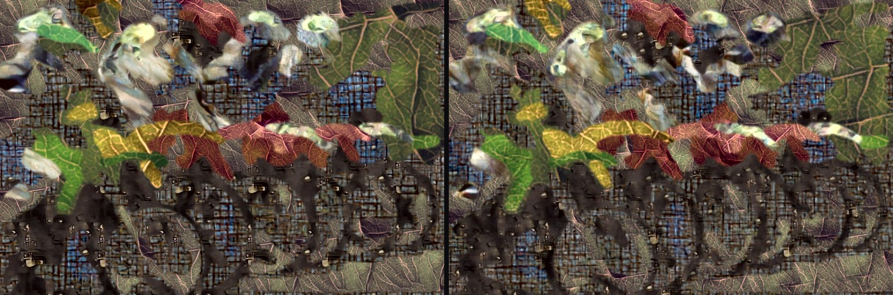

# texture-collage: a picture cut into regions, each filled with a texture from a diffusion model

Tracking issue: [experiments#109](https://github.com/oaustegard/experiments/issues/109). Live pages:
<https://austegard.com/experiments/texture-collage/web/> (pixels) and
<https://austegard.com/experiments/texture-collage/splat/> (one WGSL shader, no pixels).

A vectoriser such as the image-to-svg skill cuts a picture into regions and paints each one a flat
colour. This experiment paints each region with a texture instead: one of the 47 classes of the
Describable Textures Dataset (marbled, woven, cracked, scaly…), generated on the GPU by the
[`wgsl-diffusion`](../wgsl-diffusion/RESULTS.md) model and recoloured to the region. The question is
which choices make such a collage still read as the picture: how a region picks its texture class, how
the texture is recoloured, how neighbouring textures meet, and whether the texture's grain should follow
the picture's.

The page takes an uploaded, dropped or pasted picture, shows a collage at once from one stored tile
per class, and lets you set the number of regions, how classes are picked and how textures are
recoloured, change any region's class from a menu, generate fresh tiles on your GPU, and export a PNG.

A second version, in `splat/`, fills each region with a texture from
[`splat-diffusion`](../splat-diffusion/RESULTS.md) instead: 512 soft-edged splats on a repeating square.
Everything, the region map included, then lives in one WGSL shader with no pixels in it, so the collage
renders sharp at any zoom and exports as a single file. Its question is what that costs in likeness,
size and speed, and how to store region edges so they stay smooth when zoomed.

Likeness is measured three ways: SSIM (structural similarity, 1 is identical), GMSD (gradient
difference, 0 is identical) and ΔE (CIE colour difference; about 2 is just visible).

## Answer

Pick each region's class by matching its pattern, recolour the texture to the region's mean colour and
turn it to follow the region's grain. Over six Kodak pictures at 6 and 12 regions, picking by pattern
kept SSIM at 0.357, <!-- @evidence[[results/eval_pooled.json#structure.ssim]] -->
against 0.288 <!-- @evidence[[results/eval_pooled.json#colour.ssim]] --> by colour and 0.227 <!-- @evidence[[results/eval_pooled.json#random.ssim]] -->
at random. Stochastic tiling removes the visible repeat (self-correlation one tile away 0.931 <!-- @evidence[[results/eval_pooled.json#/repeat:plain/repeatCorr]] -->
to nearly zero) at a small cost to each pattern, so it is a toggle.

The splat version makes the whole collage one WGSL shader: on a Mac a 1024² frame takes 3.1 ms <!-- @evidence[[splat/results/summary.json#mac.R12.storage_1024]] -->
at 12 regions, the exported file is 226 kB gzipped, <!-- @evidence[[splat/results/summary.json#/shader_kB/distance LW192 K12/gzip]] -->
and its likeness is close to the pixel collage's (SSIM 0.343). <!-- @evidence[[splat/results/eval.json#/arms/distance LW192/ssim]] -->
Storing each map cell's distance to its region's edge, not just its label, keeps zoomed edges smooth
and mislabels 0.72% of pixels at 192 cells, <!-- @evidence[[splat/results/eval.json#/geometry/distance LW192/wrongFrac]] -->
against 3.50% <!-- @evidence[[splat/results/eval.json#/geometry/nearest LW192/wrongFrac]] --> for labels alone.

What would change this: people judging which collages look good; every metric here measures likeness
to the photo.

## Findings

1. **Picking by pattern beats picking by colour, at random, or one class for all.** SSIM 0.357 against
   0.288, 0.227 and 0.258 (`marbled` everywhere). It beat random on SSIM in 12/12 cells <!-- @evidence[[results/structure_wins.json#/random.ssim]] -->
   and colour in 8/12; <!-- @evidence[[results/structure_wins.json#/colour.ssim]] --> on GMSD it beat colour in 12/12 <!-- @evidence[[results/structure_wins.json#/colour.gmsd]] -->
   and `marbled` everywhere in only 6/12: <!-- @evidence[[results/structure_wins.json#/fixed:marbled.gmsd]] -->
   one mild texture everywhere is a strong default. (`results/eval_pooled.json`)
2. **Stochastic tiling removes the repeat grid at a small cost to the pattern.** Correlation of the fill
   with itself one tile period away: 0.931 with a plain repeat, −0.006 stochastic, lower in 12/12 cells. <!-- @evidence[[results/structure_wins.json#/repeat:plain.repeatCorr]] -->
   GMSD improved in 12/12 (0.244 to 0.237); SSIM moved from 0.360 to 0.357. The descriptor distance
   between region and fill rose from 1.53 to 1.93, <!-- @evidence[[results/eval_pooled.json#structure.dist]] -->
   and the region-colour error from 1.32 to 1.72: blending three shifted copies softens lines and
   spots, and the variance-preserving weights push more pixels out of gamut. Hence the toggle. Port of
   `splat-diffusion`'s stochastic blit (Heitz and Neyret 2018) to the CPU fill.
3. **The whole collage runs as one shader, fast.** Mac, 12 regions of 512 splats: 3.1 ms <!-- @evidence[[splat/results/summary.json#mac.R12.storage_1024]] -->
   for a 1024² frame and 8.8 ms <!-- @evidence[[splat/results/summary.json#mac.R12.storage_2048]] --> at 2048², with 6 or 24 regions
   within 0.3 ms of that; the baked file of 798 kB <!-- @evidence[[splat/results/summary.json#mac.R12.baked_kB]] -->
   compiles in 228 ms. <!-- @evidence[[splat/results/summary.json#mac.R12.compile_ms]] --> Opaque splats let almost every pixel stop after
   its top few splats. The page's storage-buffer shader, the baked file and the CPU mirror agree within 1/255 on SwiftShader.
   (`splat/results/mac/time.json`, `splat/results/gpu_check.json`)
4. **A distance per map cell keeps edges smooth at any zoom.** With 192 cells along the long side,
   storing each cell's distance to its region's edge mislabels 0.72% of pixels against the full-resolution
   regions; labels alone mislabel 3.50%, and rounding them with a B-spline over 3×3 cells 2.81%. <!-- @evidence[[splat/results/eval.json#/geometry/spline LW192/wrongFrac]] -->
   Distances at 96 cells (3.28%) <!-- @evidence[[splat/results/eval.json#/geometry/distance LW96/wrongFrac]] --> match labels at 192 in the
   same bytes, and they trace diagonals straight where labels step. The cost is 16 bits a cell: 795 kB raw for 12
   regions against 669 kB with labels only. (`splat/results/eval.json` geometry)
5. **Splats cost a little likeness and colour.** Splat collage against pixel collage, both
   pattern-picked: SSIM 0.343 against 0.357, GMSD 0.252 <!-- @evidence[[splat/results/eval.json#/arms/distance LW192/gmsd]] --> against 0.237, and region colour
   error 3.80 <!-- @evidence[[splat/results/eval.json#/arms/distance LW192/dEreg]] --> against 1.72 ΔE: recolouring changes each splat's own
   colour, and overlapping splats then mix in RGB, so the region mean lands less exactly. Turning
   textures to the grain halves the orientation error in both versions: 0.311 against 0.837 <!-- @evidence[[splat/results/eval.json#/arms/align:off/orientErr]] -->
   for splats, 0.292 against 0.542 <!-- @evidence[[results/eval_pooled.json#/align:off/orientErr]] --> for pixels, at no cost in SSIM.
6. **The pattern choice carries over to a tile it never saw.** The class table was built from two
   seeds and the collages filled with a third: descriptor distance 1.93 picking by pattern against
   3.88 <!-- @evidence[[results/eval_pooled.json#random.dist]] --> at random. Among the 47 classes the
   seven-number descriptor names a held-out tile's own class first 69% of the time over 94 held-out tiles (bank seeds 2 and 3; chance 2%). <!-- @evidence[[results/descriptor_separability.json#top1]] -->
   (`run/build_table.mjs`)
7. **Recolour, or the collage stops being the picture.** Region recolouring: 1.72 ΔE between region
   means; the texture's own colours with pattern choice, 39.55; picking by colour and keeping the
   texture's colours, 14.70. <!-- @evidence[[results/eval_pooled.json#/tint:none colour/dEreg]] -->
   Recolouring to the blurred photo instead of the region mean lowers the blurred-colour error from
   7.71 to 5.95 <!-- @evidence[[results/eval_pooled.json#/tint:local/dE]] --> and keeps the photo's
   gradients, at the cost of the cut-paper look. Capping the gain of the colour transfer (4 for L,
   1.5 for a and b) cut the region-colour error from 1.85 to 1.72. <!-- @evidence[[results/eval_pooled.json#/gain:uncapped/dEreg]] -->
8. **Textures cost likeness by SSIM and gain it by gradients.** Flat colour: SSIM 0.492, GMSD 0.315; <!-- @evidence[[results/eval_pooled.json#solid.gmsd]] -->
   pattern collage: SSIM 0.357, GMSD 0.237. <!-- @evidence[[results/eval_pooled.json#structure.gmsd]] -->
   Flat colour wins SSIM in every cell and loses GMSD in every cell.
9. **Edges, scale and contrast are tastes, not fixes.** A 6 px blend instead of a hard cut lowered
   GMSD at region edges from 0.267 <!-- @evidence[[results/eval_pooled.json#/feather:0/gmsdEdge]] -->
   to 0.243; <!-- @evidence[[results/eval_pooled.json#/feather:6/gmsdEdge]] --> the default is 2 px.
   Letting each region pick 1× or 2× scored between the fixed scales. A contrast floor of 0 scored
   best (SSIM 0.376 <!-- @evidence[[results/eval_pooled.json#/strength:0/ssim]] -->) because flat
   regions then stay flat; the page defaults to 8 so every region shows its texture. Giving each region
   a distinct class cost 0.010 SSIM.
10. **Speed.** Mac (its Apple GPU, reached through the GPU bridge: a page on Oskar's laptop that runs jobs pushed from this container): a 128 px texture at 24 steps took 540 ms <!-- @evidence[[bank/meta.json#median_ms]] -->
   median in the bank job, including readback, and 360 ms at the page's 20 steps; 256 px took 9.0 s
   for eight. Regions 0.42 s, descriptors 1.03 s, compositing 0.78 s, all on the CPU (timed before
   stochastic tiling, which samples the tile three times per pixel). SwiftShader (a software GPU, the only one in the cloud container) took 153867 ms for one 64 px texture at 12 steps, <!-- @evidence[[results/swiftshader_speed.json#S64_steps12_ms]] -->
   which is why the page ships a stored tile per class. (`results/mac/pipeline.json`)
11. **`freckled` tiles grow eyes.** The model draws skin and eyes for this class (freckles are
   photographed on faces; the dataset was not checked), and pattern matching picks it for bright,
   smooth regions. The page leaves it out of automatic choice; it stays in each region's menu.

## Method

**Pipeline** (`web/collage.js`, the same module in the page's worker, the bridge job and the Node harness):

1. **Regions.** The picture is scaled to at most 768 px on its long side and converted to CIELAB. k-means
   (k-means++ start, 20 Lloyd steps on 20,000 sampled pixels) clusters the colours of a blurred copy
   (blur radius = long side / 150) into K clusters. Every pixel takes its nearest cluster, a 5×5 majority
   filter runs twice, and components smaller than 0.2% of the picture, or with an area under 2.5 times
   their boundary length, are merged into the neighbour they share most border with. The second test
   removes the thin band of in-between colour that k-means otherwise gives every blurred edge. A region
   is a colour cluster, so it can be several separate blobs sharing one texture.
2. **Description.** Each region's L channel gives seven numbers: busyness (mean gradient magnitude over
   standard deviation plus 2) at full, half and quarter resolution; the coherence of the region-wide
   structure tensor (does one orientation dominate?) and that orientation; the energy-weighted local
   coherence (lines against blobs); and the skew and log kurtosis of L. Contrast is divided out, since
   the recolouring sets it. Each texture tile gets the same seven numbers at 1× and 2× scale.
3. **Class choice.** *Pattern* (`structure` in code): the class and scale whose mean descriptor is
   nearest the region's, each feature divided by its spread across classes. *Colour*: the class whose
   tiles' mean Lab is nearest the region's mean. *Random* and *fixed* (`marbled` everywhere) are
   controls. *Distinct* lets each class be used once, largest region first.
4. **Fill.** The tile repeats across the region at the chosen scale, turned so its dominant orientation
   matches the region's when both are oriented (coherence above 0.15), sampled bilinearly with
   wrap-around (the tiles are seamless). With **stochastic tiling** (default), each pixel instead blends three copies of the
   tile at random offsets, one per corner of a triangle grid with 2 cells per tile, around the tile's
   Lab mean with weights divided by sqrt(Σw²) so the texture keeps its contrast. **Recolour** *to region*: per Lab channel, the texture's
   deviation from its own mean, scaled to the region's spread, is added to the region's mean colour.
   The spread of L has a floor (`strength`, default 8) so flat regions still show texture, and gains are
   capped. *To photo*: the same detail added to a blurred copy of the picture. *Off*: the texture's colours.
5. **Edges.** Each region's mask is blurred by `feather` px and the fills blended by those weights.

**Textures.** Bridge job `tc-bank-1` generated 4 tiles of each class on the Mac: 128×128, 24 steps,
guidance 3, int8 weights, circular padding, bank seeds 0–3, sampler seeds 1000–1003 (`bank/bank.png`, one row per class). The
page starts from the first tile of each class (`web/bank.png`, 1.8 MB) and generates fresh ones on
request. It loads the int8 weights because they are half the download (8.4 MB against 16.8 MB for f16);
`wgsl-diffusion` measured them at 34 dB PSNR against f32. Their effect on the collage was not measured.

**Fixture.** Each *arm* below is one setting of the pipeline; the table names arms by their code
values (`structure` = pick by pattern, `tint:local` = recolour to photo, `solid` = flat colour,
`strength` = contrast floor, `feather` = edge blend px).  Six Kodak pictures (768×512: kodim01, 05, 07, 15, 20, 23) at K = 6 and 12. The class
table comes from seeds 0–1 (`results/table_train.json`); every collage is filled with the seed-2
tiles. Random is averaged over 3 seeds. Every arm uses the defaults (pattern choice, region recolour,
feather 2, strength 8, alignment on, scales {1, 2}) except the setting it names.

**Metrics** (`run/metrics.mjs`), each against the input:
- *ΔE blur*: mean CIE76 colour difference after a blur of radius 8 px. Any texture raises it.
- *ΔE region*: area-weighted CIE76 difference between each region's mean colour in input and collage.
- *SSIM* on L with 7×7 windows; *GMSD* (gradient magnitude similarity deviation, lower is better) on
  L, over the whole picture and within 3 px of region boundaries.
- *Descriptor distance*: between each input region and the same pixels of the collage, area-weighted.
  The choice step minimises the same distance against the table, so this measures whether a choice made
  on two seeds holds for a third tile once it is rotated and recoloured.
- *Repeat correlation*: per region, the correlation of the collage's L with itself shifted by one
  tile period along each (rotated) tile axis, area-weighted. A plain repeat scores near 1.
- *Orientation error*: the angle between each oriented input region's dominant orientation and the
  collage's there, weighted by coherence and area.

**Splat version** (`splat/splatcollage.js`, shared by the page, the exported file and the measurements):

- *Textures.* Bridge job `tc-splatbank-1` sampled 3 textures of each class from `splat-diffusion`'s
  512-splat model on the Mac (24 steps, guidance 3, seeds 2000–2002; `splat/bank/splats.bin`). A class
  table built from the painted tiles, as for the pixel bank, chooses the class (`splat/classes.json`).
  The page ships the first texture of each class (`splat/bank.bin`, 1.2 MB) and samples fresh ones with
  the model on request.
- *Recolouring* is the region transfer of the pixel version applied to each splat's own colour before
  the shader is built, so the shader holds nothing but splats.
- *Placement.* Region k's texture coordinate is R(−φ) p / (128 · scale) + offset on the unit torus, with
  φ the grain alignment and a fixed random offset per region.
- *Region map.* The 768 px regions are reduced to a grid of square cells (the majority label of each)
  and stored packed in u32 words. Four ways to rebuild an edge from it: the cell's label (*blocky*);
  bilinear weights of the 4 nearest cells' labels (*contour*); a quadratic B-spline over the 3×3 nearest
  (*rounded*); or, with each cell also storing its distance to the nearest pixel of another region (8 bits,
  up to 2 cells), the label whose interpolated signed distance is largest (*smooth*, the default). The two
  strongest labels are blended across about one output pixel, so edges are anti-aliased at any zoom.
- *Shader.* `collage(p, px)` takes a point in the picture's reference pixels and the output pixel's size.
  The page binds the splats, map and transforms as storage buffers, so a new texture is a buffer write.
  The exported WGSL bakes them as const arrays (cut at 2,000 elements for WebKit), one function per
  region; the exported HTML wraps that in a WebGPU viewer with zoom and pan. `evalCPU` mirrors the shader
  and renders every measured collage.
- *Measurements.* The same six pictures, region counts and metrics as the pixel version, with held-out
  seed-2 textures; edge accuracy as the share of the 768 px picture's pixels whose strongest rebuilt label
  differs from the full-resolution region. Bridge job `tc-splat-time-2` times compile and frames on the Mac.

**Checks.** `run/unit.mjs`: colour round trip, a synthetic segmentation, descriptor orientation,
alignment in `render()`. `run/check_page.mjs`: the page on SwiftShader (`results/page_check.json`).
Bridge job `tc-pipe-1`: the whole pipeline on the Mac.

**Prior art.** Hertzmann et al.'s *texture-by-numbers* (Image Analogies, 2001) fills a label map with
texture synthesised from an example pair, and Ritter et al.'s *Painting with Texture* (2006) made it
interactive; both copy texture from a given example. Three searches found no tool that segments a photo
and fills the regions with diffusion-generated textures in the browser. Inside this account, `xr`
found the image-to-svg skill and two emoji-collage pages, which fill regions with colour and emoji.

**Reproduce.** `sh ../image-to-wgsl/data/fetch.sh`, `python3 run/prep_images.py`,
`python3 run/bank_files.py --from-png`, `node run/build_table.mjs`, `node run/eval.mjs 6 12`,
`python3 run/summarize.py`, `node run/unit.mjs`, `node run/check_page.mjs` (Node with Playwright).

## Log

### Round 1, 2026-11-07

Asked (issue #109): turn the texture model into a collage maker that decomposes a picture as
image-to-wgsl and image-to-svg do and fills the regions with textures, as an interactive page.

SwiftShader generated one 64 px texture in 154 s, too slow to build the class bank, so the bank came from
the Mac (188 tiles in 100 s). The first segmentation of a two-colour test picture gave three regions:
k-means had made a cluster of the blend band along the blurred edge, which the boundary-ratio merge
fixed. The first collages had brightened, greener backgrounds where a tile with little colour spread
was stretched to the region's spread; capping the gain fixed it. The Mac collage of the parrots put
`freckled` tiles, with eyes, on the out-of-focus highlights, so the page leaves that class out of
automatic choice.

Full table (`results/eval_table.md`, both region counts pooled):

| arm | n | ΔE blur | ΔE region | SSIM | GMSD | GMSD edges | structure dist | orient err (rad) |
|---|---|---|---|---|---|---|---|---|
| solid | 12 | 5.00 | 0.00 | 0.492 | 0.315 | 0.331 | 9.39 | 1.026 |
| structure | 12 | 7.78 | 1.32 | 0.360 | 0.244 | 0.258 | 1.53 | 0.280 |
| colour | 12 | 7.28 | 1.01 | 0.280 | 0.270 | 0.275 | 3.53 | 0.392 |
| random | 36 | 6.67 | 0.97 | 0.211 | 0.284 | 0.280 | 4.18 | 0.336 |
| fixed:marbled | 12 | 7.39 | 0.99 | 0.245 | 0.252 | 0.255 | 3.03 | 0.615 |
| structure+distinct | 12 | 7.60 | 1.33 | 0.349 | 0.247 | 0.258 | 1.53 | 0.271 |
| tint:none structure | 12 | 37.89 | 38.59 | 0.262 | 0.258 | 0.268 | 2.22 | 0.311 |
| tint:none colour | 12 | 15.74 | 14.15 | 0.237 | 0.287 | 0.288 | 3.98 | 0.382 |
| tint:local | 12 | 6.03 | 3.18 | 0.355 | 0.241 | 0.254 | 1.52 | 0.338 |
| feather:0 | 12 | 7.79 | 1.26 | 0.347 | 0.253 | 0.274 | 1.93 | 0.343 |
| feather:6 | 12 | 7.78 | 1.87 | 0.365 | 0.238 | 0.248 | 1.46 | 0.296 |
| align:off | 12 | 7.93 | 1.43 | 0.357 | 0.245 | 0.259 | 1.52 | 0.549 |
| scale:1 | 12 | 7.32 | 0.95 | 0.319 | 0.250 | 0.260 | 1.79 | 0.327 |
| scale:2 | 12 | 8.02 | 1.48 | 0.367 | 0.244 | 0.258 | 1.67 | 0.221 |
| strength:0 | 12 | 7.51 | 1.16 | 0.377 | 0.243 | 0.258 | 0.96 | 0.314 |
| strength:16 | 12 | 9.46 | 1.99 | 0.282 | 0.263 | 0.271 | 1.89 | 0.307 |
| gain:uncapped | 12 | 8.12 | 1.43 | 0.360 | 0.244 | 0.258 | 1.53 | 0.280 |

Page check on SwiftShader (`results/page_check.json`): first collage 3.6 s after load, seven
re-renders on control changes, a region's menu overriding its class, one fresh 64 px texture in
69 s, a PNG export, no horizontal scroll at 390 px wide, no page errors.

### Round 2, 2026-11-07: stochastic tiling

Asked (relayed from Oskar by the parent session): apply splat-diffusion's stochastic tiling so region
fills show no repeat grid, with a toggle if it hurts structured classes, measured against the plain
repeat. Ported `WGSL_BLIT` mode 1 to `stochasticSample` in `web/collage.js`, made it the default, and
added the `repeat:plain` arm and the repeat-correlation metric. Also in this round: the region slider
goes to 32 (at 32, about 4 s of worker CPU on SwiftShader's host) and a fix for a hang when the
picture was recut while textures were generating (`check_page.mjs` `recut_during_generation`).

Every arm below now uses stochastic tiling except `repeat:plain`, so the round 1 numbers shift:

| arm | n | repeat corr | ΔE blur | ΔE region | SSIM | GMSD | GMSD edges | structure dist | orient err (rad) |
|---|---|---|---|---|---|---|---|---|---|
| solid | 12 | — | 5.00 | 0.00 | 0.492 | 0.315 | 0.331 | 9.39 | 1.026 |
| structure | 12 | -0.006 | 7.71 | 1.72 | 0.357 | 0.237 | 0.252 | 1.93 | 0.292 |
| colour | 12 | 0.016 | 7.03 | 1.26 | 0.288 | 0.256 | 0.264 | 3.16 | 0.337 |
| random | 36 | 0.011 | 6.52 | 1.11 | 0.227 | 0.272 | 0.270 | 3.88 | 0.336 |
| fixed:marbled | 12 | 0.010 | 7.22 | 1.19 | 0.258 | 0.243 | 0.249 | 3.08 | 0.566 |
| structure+distinct | 12 | -0.008 | 7.53 | 1.59 | 0.347 | 0.240 | 0.253 | 1.80 | 0.302 |
| tint:none structure | 12 | -0.013 | 38.51 | 39.55 | 0.253 | 0.249 | 0.260 | 2.40 | 0.316 |
| tint:none colour | 12 | 0.016 | 15.91 | 14.70 | 0.239 | 0.277 | 0.281 | 3.63 | 0.316 |
| tint:local | 12 | 0.010 | 5.95 | 3.58 | 0.354 | 0.233 | 0.247 | 1.78 | 0.341 |
| feather:0 | 12 | -0.013 | 7.72 | 1.60 | 0.345 | 0.245 | 0.267 | 2.05 | 0.345 |
| feather:6 | 12 | 0.004 | 7.71 | 2.33 | 0.364 | 0.231 | 0.243 | 1.82 | 0.322 |
| align:off | 12 | -0.002 | 7.81 | 1.67 | 0.358 | 0.236 | 0.252 | 1.92 | 0.542 |
| scale:1 | 12 | 0.010 | 7.16 | 1.24 | 0.318 | 0.241 | 0.253 | 2.08 | 0.380 |
| scale:2 | 12 | 0.003 | 8.05 | 1.90 | 0.366 | 0.237 | 0.252 | 1.93 | 0.246 |
| strength:0 | 12 | -0.004 | 7.48 | 1.59 | 0.376 | 0.236 | 0.252 | 1.10 | 0.337 |
| strength:16 | 12 | -0.007 | 9.33 | 2.51 | 0.276 | 0.257 | 0.264 | 2.10 | 0.309 |
| gain:uncapped | 12 | -0.006 | 8.03 | 1.85 | 0.357 | 0.237 | 0.252 | 1.93 | 0.292 |
| repeat:plain | 12 | 0.931 | 7.78 | 1.32 | 0.360 | 0.244 | 0.258 | 1.53 | 0.280 |

### Round 3, 2026-11-07: the collage as one WGSL shader of splat textures

Asked (relayed from Oskar by the parent session): "maybe we could do a splat version of the collage,
turning the whole image into a wgsl, rather than pixels". Built `splat/` (page, module, measurements)
on `splat-diffusion`'s 512-splat model, without changing `splat-diffusion/`.

The first page render showed region edges as chamfered stairs: bilinear rebuilding of a 4 px label map
rounds the map's corners but keeps its steps. A B-spline over 3×3 cells rounded them further and still
followed the steps. Storing a distance to the edge per cell, as signed-distance fonts do, fixed it.
The first geometry run then showed 256 cells doing worse than 192: the map's rows were spaced
H / round(H / cell) apart while the shader assumed square cells, which only matches when the cell
divides the picture's height. Fixed with square cells; only the geometry was re-run (192 and 96 cells
divide 512 evenly, so the rendered arms were unaffected).

The splat bank comes out bluish: `marbled` averaged (101, 127, 117) in RGB, against the warm beige in
`splat-diffusion`'s gallery. Sampling the same class and seed on SwiftShader reproduced the bank to
1.3e-4, and splat-diffusion's own GPU painter gave the same colours as the CPU painter, so this is the
model at these seeds; recolouring replaces the colours anyway. Sampling one texture on SwiftShader took
480 s against 138 ms on the Mac. The page check found that closing a second WebGPU tab in the same
headless SwiftShader browser loses the first page's GPU instance, so the exported HTML is checked in its
own browser.

Splat collage, six pictures × 6 and 12 regions (`splat/results/eval.json`; pixel collage for comparison:
SSIM 0.357, GMSD 0.237, region ΔE 1.72):

| arm | SSIM | GMSD | GMSD edges | ΔE region | orient err |
|---|---|---|---|---|---|
| distance LW192 | 0.343 | 0.252 | 0.273 | 3.80 | 0.311 |
| distance LW96 | 0.344 | 0.252 | 0.272 | 3.80 | 0.357 |
| spline LW192 | 0.341 | 0.254 | 0.275 | 3.89 | 0.336 |
| contour LW192 | 0.340 | 0.254 | 0.276 | 3.89 | 0.337 |
| nearest LW192 | 0.337 | 0.256 | 0.279 | 3.91 | 0.337 |
| tint:none | 0.269 | 0.273 | 0.291 | 41.02 | 0.337 |
| align:off | 0.344 | 0.253 | 0.273 | 3.78 | 0.837 |

Share of pixels whose rebuilt region differs from the full-resolution one, and the exported file's size:

| cells (long side) | blocky | contour | rounded | smooth (distance) | smooth file, 12 regions (raw / gzip kB) |
|---|---|---|---|---|---|
| 64 | 10.23% | 9.24% | 9.11% | 6.07% | 649 / 205 |
| 96 | 7.09% | 6.21% | 6.13% | 3.28% | 671 / 211 |
| 128 | 5.32% | 4.58% | 4.44% | 1.78% | 704 / 216 |
| 192 | 3.50% | 3.07% | 2.81% | 0.72% | 795 / 226 |
| 256 | 2.49% | 1.96% | 1.94% | 0.51% | 929 / 236 |

Mac (`tc-splat-time-2`), 1024² / 2048² frame with the page's shader: 2.9 / 8.4 ms (6 regions),
3.1 / 8.8 ms (12), 3.2 / 8.9 ms (24); baked file 485 / 798 / 1,424 kB, compiled in 138 / 228 / 398 ms.
