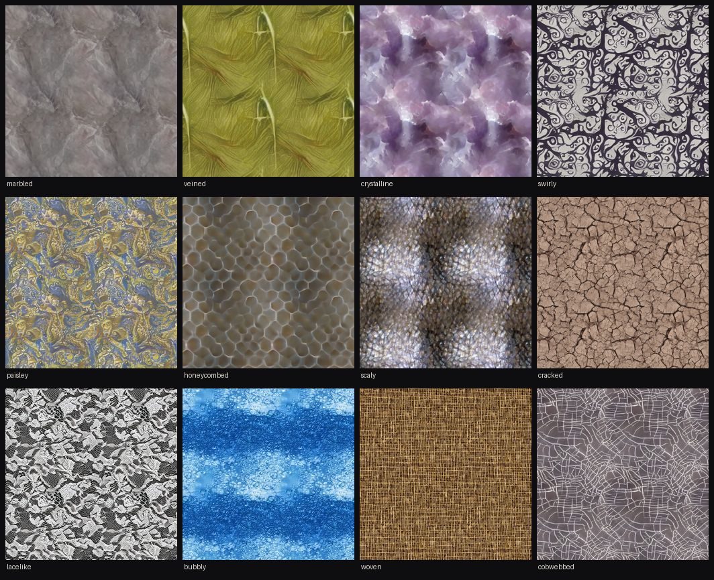

# wgsl-diffusion — a texture diffusion model in hand-written WGSL

A diffusion model that generates seamless textures in the browser, with every layer in WGSL compute
shaders that Muninn (Claude Code) wrote for it and no ML library on the page. Pick one of 47 texture
classes and it denoises a square tile in about 20 steps, showing its current estimate of the clean
image at each step, then repeats the tile across the screen.

Live page: [austegard.com/experiments/wgsl-diffusion/web/](https://austegard.com/experiments/wgsl-diffusion/web/)
(`web/index.html`). It needs WebGPU: Chrome or Edge 113+, Safari 26+ or Firefox 141+. Size (64 to
512 px), steps, guidance strength and zoom are sliders. Seamless toggles circular padding, Auto-dream
cycles random classes, and Save PNG downloads the tile.



## Answer

Oskar Austegard, who runs this repo, asked whether diffusion can be implemented in WGSL after reading
the SKILD paper. It can, and it is fast enough to use. An
8.38M-parameter conv U-Net, trained with rectified flow on the Describable Textures Dataset (DTD),
runs entirely in hand-written compute shaders. On a Mac (WebGPU reports only "apple metal-3", so the
chip is not known; Chrome 156), 20 sampling steps
with classifier-free guidance take 436 ms at 128×128 <!-- @evidence[[results/bench_mac.json#runs.2.total_ms]] -->
and 3690 ms at 512×512. <!-- @evidence[[results/bench_mac.json#runs.7.total_ms]] -->
A 128×128 sample from fixed noise matches PyTorch at 85.8 dB PSNR on that GPU; the difference is far
below anything visible. <!-- @evidence[[results/bench_mac.json#correctness_128_vs_torch_f32.psnr_db]] -->
Sampling with circular padding makes every tile wrap without a seam.

Two changes made it fast and small enough: a conv kernel that computes several pixels and channels per
thread, about twice as fast as a one-pixel-per-thread first version, and activations stored as f16,
which halves GPU memory. No phone was tested: both the speed and whether 512×512 (574 MB of GPU
buffers) fits could differ there.

## Findings

1. Twenty guided steps take 436 ms at 128×128 and 3690 ms at 512×512 on the Mac, with the final weights and f16 storage (Round 5, `results/bench_mac.json`). <!-- @evidence[[results/bench_mac.json#runs.7.total_ms]] -->
2. The WGSL output matches PyTorch at 85.8 dB PSNR on the Apple GPU for a 20-step guided 128×128 sample from fixed noise (Round 5, `results/bench_mac.json`). <!-- @evidence[[results/bench_mac.json#correctness_128_vs_torch_f32.psnr_db]] -->
3. Circular padding at sampling time makes tiles seamless, though training used zero padding: the jump across the tile edge is 1.00 times the jump between neighbouring interior pixels, against 3.93 with zero padding (Round 5, `run/seam_check.py`, median of 12 classes). <!-- @evidence[[results/seam.json#median_circular]] --> <!-- @evidence[[results/seam.json#median_zeros]] -->
4. The second conv kernel, which computes 4 pixels × 8 channels per thread and splits small layers across workgroups, halved the 256×256 time, from 2260 ms with the first (one pixel per thread) to 1044 ms (Round 2). <!-- @evidence[[results/kernel_bench.json#by.v1_256.total_ms]] --> <!-- @evidence[[results/kernel_bench.json#by.v2-s256_256.total_ms]] -->
5. Storing activations as f16 costs nothing visible: PSNR of the f16 sample against the f32 sample is 84.1 dB median in a PyTorch simulation over 8 classes, and the Mac's f16 output against PyTorch f32 is 86.7 dB (Round 4). It halves memory and costs 3 to 7% speed across sizes (3689 ms at 512×512, against 3551 ms in f32). <!-- @evidence[[results/quant_sim.json#median_psnr_db.w16_a16]] --> <!-- @evidence[[results/f16_bench.json#by.f16_512.total_ms]] -->
6. int8 weights (symmetric per output row) reach only 34.4 dB median against f32 on the final 60k-step weights, though they reached 42.3 dB on an intermediate 15k-step checkpoint, so the page ships f16 weights (Rounds 4 and 5). <!-- @evidence[[results/quant_sim.json#median_psnr_db.w8_a32]] -->
7. Removing CPU work between steps (computing every step's conditioning vectors up front, and submitting the next step before waiting on the last) changed 64×64 sampling from 484 to 491 ms, so the time at small sizes is spent on the GPU (Round 1).
8. A conv-only U-Net trained on 64×64 crops generates at any multiple of 16 up to 512×512. Its features stay at the trained scale, so a larger tile repeats less often but its cracks or cells are no bigger (Round 3).

## Method

**Model** (`train/model.py`). A conv-only U-Net with channels 64/128/192/256 at four resolutions:
one GroupNorm + FiLM ResBlock per level going down, one per level going up after a nearest upsample
and skip concat, and one middle block. Time (sinusoidal embedding into an MLP) and class (an
embedding, plus a null class for guidance) are summed into one 256-d vector that sets every block's
FiLM scale and shift. There is no attention, so the network is translation-equivariant.

**Training** (`train/train.py`). Rectified flow: x_t = (1 − t)·x₀ + t·ε, the model predicts
v = ε − x₀, and t is drawn logit-normal(0, 1). The class is dropped to the null class 10% of the time.
The data is all 5,640 DTD images (`tanganke/dtd`, train and test). Each is resized so its short side
is 96, 128 or 176 and centre-cropped square, and each example is a random 64×64 crop with random flips
and transposes. The run was 60,000 steps at batch 128, AdamW at 2e-4 with 1k warmup and cosine decay
to 2e-5, EMA 0.9995 and bf16 autocast, on a Colab A100 in 87 minutes. The final logged loss is
0.11. <!-- @evidence[[results/train_log.jsonl#299.loss]] -->
The EMA weights ship as f16 (16.8 MB).

**Sampling.** Euler steps from t = 1 to 0 with classifier-free guidance at scale 3 by default. The
network runs on a batch of two (the chosen class and the null class), and the step combines them.

**Runtime** (`web/diffusion.js`). A planner turns the layer list into dispatches and GPU buffers for
one image size. A liveness pass reuses buffers once their last reader has run. One sampling step is about 80 dispatches in one compute
pass:
- **conv (v2):** a workgroup of 64 threads covers an 8×8 pixel tile × 32 output channels, and each
  thread keeps 4 adjacent pixels × 8 channels in vec4 accumulators. Input tiles and weights pass
  through workgroup memory 4 input channels at a time. The previous GroupNorm affine, FiLM and SiLU
  are applied as each input value is loaded. Weights are re-laid out to [Cin][K·K][Cout] at load
  time, and K and stride are pipeline constants. A conv with fewer than 256 workgroups splits its
  input channels across up to 16 of them (split-K), and a second pass adds the partials, bias and
  residual. v1, kept for comparison, computes one pixel × 16 channels per thread.
- **gnorm:** one workgroup per (item, group) computes a two-pass mean and variance and writes the
  per-channel (a, b) that the next conv applies as silu(a·x + b).
- **upcat:** a nearest 2× upsample of one tensor, concatenated with another along channels.
- **step:** guidance, the Euler update of the f32 state, the x₀ estimate for display, and the next
  network input.

The embedding MLP and every block's FiLM projection run in JS for all steps before sampling starts.
Activations are stored as f16 pairs packed into u32 with `pack2x16float`, which needs no
`shader-f16` feature, while arithmetic and the sampler state stay f32.

**Checks.**
- **SwiftShader:** `run/test_gpu.mjs` runs `web/_test.html` in headless Chromium on SwiftShader
  against fixtures from `train/export.py fixture`, which use random weights. It covers forward passes
  at 64×64 zero-padded and at 48×80 and 64×64 circular, plus a 3-step guided sample, for every kernel
  and storage variant.
- **Apple GPU:** `bridge/*.js` jobs run on Oskar's Mac through the GPU bridge, a page there that runs
  WebGPU jobs pushed to a repo and commits the results back. They return timings and a 128×128 sample
  from fixed noise.
- **PyTorch references:** `run/ref_from_bin.py` builds them from the exact exported weights.
- **Measurements:** `run/seam_check.py` gives the seam ratio, and `run/quant_sim.py` the precision.
  The latter simulates storage formats and compares 20-step guided samples over 8 classes with the
  f32 run.

**Prior art.**
- **Searches:** two searches found [favicon-diffusion](https://awesome.ecosyste.ms/projects/github.com%2Fneelr%2Ffavicon-diffusion)
  and [web-stable-diffusion](https://github.com/cnye36/web-stable-diffusion). The first is a
  diffusion transformer in hand-written WGSL. The second runs Stable Diffusion in the browser from
  TVM-generated shaders.
- **Circular padding:** using it for tileable textures is established
  ([arXiv 2410.07128](https://arxiv.org/pdf/2410.07128), [DreamPBR](https://arxiv.org/html/2404.14676v1)).
- **SKILD:** the paper that prompted this ([arXiv 2605.26032](https://arxiv.org/abs/2605.26032)) uses a
  121M-parameter NCSN++ U-Net sampled in 1,000 steps, about 103 s per image on a Titan RTX by its
  Table E.12.
- **Gap:** those searches found no hand-written conv U-Net for class-conditional seamless textures at
  arbitrary size.

**Not done.**
- **Phones:** none was tested.
- **Lower-precision maths:** f16 arithmetic (`shader-f16`) and int8 activations were not tried.
- **Better int8 weights:** per input-channel groups and quantization-aware fine-tuning were not tried.
- **SKILD's forward process:** its frequency-ordered (DCT) noising was not tried.

**Reproducing.** `train.py` downloads DTD itself from Hugging Face (`tanganke/dtd`, 630 MB). The
SwiftShader test needs Node and Playwright with Chromium. The page needs a WebGPU browser; 512×512
needs about 600 MB of GPU buffers.

```bash
python3 train/train.py --out run1 --steps 60000          # on a CUDA GPU (87 min on an A100)
python3 train/export.py weights run1/ema.pt web/model     # f16 and int8 weight files
python3 train/export.py fixture web/test && node run/test_gpu.mjs   # WGSL against PyTorch
cd web && python3 -m http.server 8000                     # open http://127.0.0.1:8000/
```

**Files.**
- `train/`: the model, training and export code.
- `run/`: the Colab launcher and keepalive, the SwiftShader test, the measurements and the screenshot
  script.
- `bridge/`: the GPU-bridge jobs.
- `web/`: the page, the runtime and the weights.
- `results/`: logs, timings, measurements and the gallery.
- `ERRORS.md`: one wrong turn.

## Log

### Round 1 — build, train, first timings (2026-11-07)

Oskar: "Can we implement diffusion in wgsl? We sorta kinda achieved the _effect_ with the image to
shaders experiment - but that used a real image as the target". That is
[`image-to-wgsl/`](../image-to-wgsl/RESULTS.md), which fits one photo. He had been reading SKILD, a
diffusion model that trains on CIFAR-10, ImageNet and critical Ising spin fields. Offered Ising
fields or textures, he picked textures: "Go for purtty".

- **Kernels:** the v1 conv, GroupNorm, upcat and step kernels matched PyTorch on SwiftShader the
  first time, within 9e-6 relative.
- **First Mac comparison:** it gave 28 dB. The cause was a newer checkpoint in the reference
  (`ERRORS.md`). Rebuilt from the exported weights, the Mac's 128×128 sample matched PyTorch at 142 dB
  (f32 storage).
- **v1 timings (`results/bench_v1_mac.json`, 10k-step weights):** 64² 484 ms, 128² 756 ms, 256²
  2286 ms. The 64² cost is about 25 ms per step for roughly 10 GFLOP.
- **Pipelining:** computing all conditioning vectors up front and keeping one step queued changed
  nothing (64² 491 ms), so the floor is on the GPU.

### Round 2 — a faster conv kernel

Oskar, the same day: "There's room for a faster kernel; we'll, build that while you wait for the training data".
The v2 kernel and split-K were added. Times are for 20 guided steps on the Mac
(`results/kernel_bench.json`):

| variant | 64² | 128² | 256² |
|---|---|---|---|
| v1 | 488 ms | 779 ms | 2260 ms |
| v2, no split-K | 392 ms | 524 ms | 1121 ms |
| v2, split-K below 256 workgroups | 267 ms | 443 ms | 1044 ms |
| v2, split-K below 2048 workgroups | 261 ms | 432 ms | 1077 ms |

Split targets from 256 to 2048 were within 5% of each other, and 256 became the default. Every
variant matched PyTorch to under 1e-6 on the Mac. Throughput at 256² went from 1.5 to 3.2 TFLOP/s.

### Round 3 — 384 and 512 tiles

Oskar: "Can we afford a 512 pattern now?" With f32 storage (`results/big_bench.json`), 20 guided
steps took 2.2 s at 384² and 3.7 s at 512². 512² allocated 1147 MB, with a largest buffer of 403 MB
under the adapter's 4 GB binding limit. The page gained 384 and 512, and disables a size when its
largest buffer would exceed `maxStorageBufferBindingSize`.

### Round 4 — quantization

Oskar: "Well, can we also quantize it? Do we need 4 bytes worth of signal?" `run/quant_sim.py` on the
15k-step checkpoint gave these medians against f32: f16 activations 84.9 dB, bf16 67.1 dB, int8
weights 42.3 dB. Packed f16 storage was implemented, and SwiftShader has no `shader-f16`, hence the
u32 packing. On the Mac (`results/f16_bench.json`):

| size | f32 storage | f16 storage |
|---|---|---|
| 64² | 255 ms, 21 MB | 271 ms, 13 MB |
| 256² | 1094 ms, 287 MB | 1121 ms, 143 MB |
| 512² | 3551 ms, 1147 MB | 3689 ms, 574 MB |

The f16 sample matched PyTorch f32 at 86.7 dB; the f32-storage sample gave 141.8 dB, the Round 1 test. An int8 weight file
(8.4 MB) and its loader were added, and the JS dequantizer matches numpy exactly.

### Round 5 — final weights

Training finished at 60,000 steps. With the final weights the seam ratio was 1.00 circular and 3.93
zero-padded, and the precision simulation gave f16 84.1 dB, bf16 65.4 dB and int8 weights 34.4 dB
(worst 29.9 dB). The int8 drop from 42.3 dB decided the f16 default. Final Mac timings are in
`results/bench_mac.json`:

| size | 20 guided steps | GPU buffers |
|---|---|---|
| 64² | 280 ms | 13 MB |
| 128² | 436 ms | 40 MB |
| 192² | 740 ms | 82 MB |
| 256² | 1124 ms | 143 MB |
| 384² | 2198 ms | 323 MB |
| 512² | 3690 ms | 574 MB |

Unguided 128² takes 257 ms. PyTorch on the 4 CPU cores of the cloud container takes 2.7 s for the
guided 128² run.
