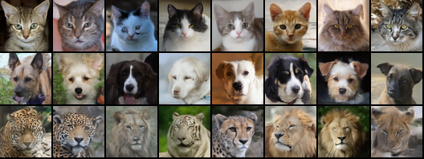

# wgsl-image-diffusion — image diffusion models in hand-written WGSL

Two small diffusion models that draw 64×64 pictures in the browser, every layer in WGSL compute shaders
written for them and no ML library on the page. One draws animal faces (cat, dog or wild animal, trained
on AFHQv2), the other human faces (four classes from CelebA's male/female and smiling labels). The page
can also start from a picture you upload or sketch, redo only a part you paint over, and blend two classes.

Live page: [austegard.com/experiments/wgsl-image-diffusion/web/](https://austegard.com/experiments/wgsl-image-diffusion/web/)
(`web/index.html`; `?m=faces` opens the face model). It needs WebGPU: Chrome or Edge 113+, Safari 26+ or
Firefox 141+. Pick an animal (or a kind of face) and press Generate to watch the picture form step by step.
"Start from: A picture" lets you upload a photo, start a sketch, or reuse the result; Strength sets how far
the result may move from that picture (low stays close, 1 keeps only the rough layout). The "Mark to redo"
brush paints the part to regenerate while the rest stays fixed, and "Blend with" mixes two classes. The
trained weights ship with the page (`web/model`, `web/model-faces`, 46.5 MB each).



## Answer

Oskar Austegard, who runs this repo, asked whether the earlier `wgsl-diffusion` experiment, a small
model that makes seamless textures in the browser, could make images instead, and what that would take.
It can. Textures repeat, so a network that sees only nearby pixels suffices; a face needs distant parts to
agree (left eye with right), which takes self-attention, more channels and 3 to 30 times its 5,640 training
images; the runtime needed little beyond an attention kernel.

A 23.2M-parameter U-Net with attention at 16×16 and 8×8, trained for 60,000 steps (about 4 hours and 27
Colab compute units per model), draws a 64×64 animal face in 401 ms for 24 guided denoising steps on a Mac. <!-- @evidence[[results/mac_afhq.json#outputs.runs.1.total_ms]] -->
A fixed-noise sample there matches PyTorch's at 77.5 dB PSNR. <!-- @evidence[[results/mac_vs_torch_afhq.json#psnr_db]] -->
FID-5k (how far 5,000 samples sit from the training set in an image classifier's feature space; lower is
better) is 7.66 for the animals <!-- @evidence[[results/afhq_eval.jsonl#5.fid]] -->
and 8.85 for the faces at 48 steps, <!-- @evidence[[results/celeba_eval.jsonl#4.fid]] -->
against floors of 1.45 and 2.55 (5,000 real images: the best possible), <!-- @evidence[[results/afhq_floor.json#fid]] --> <!-- @evidence[[results/celeba_floor.json#fid]] -->
and neither model copies training photos. The page steers without retraining: start from a
picture, redo a painted-over part, blend classes.

## Findings

1. **The animal model runs at 401 ms for 24 guided steps on a Mac and matches PyTorch at 77.5 dB PSNR** from fixed noise with the final weights (Round 3, `results/mac_afhq.json`, `results/mac_vs_torch_afhq.json`). <!-- @evidence[[results/mac_afhq.json#outputs.runs.1.total_ms]] --> <!-- @evidence[[results/mac_vs_torch_afhq.json#psnr_db]] -->
2. **The face model is as fast (387 ms) and matches PyTorch at 84.4 dB** (Round 4, `results/mac_celeba.json`, `results/mac_vs_torch_celeba.json`). <!-- @evidence[[results/mac_celeba.json#outputs.runs.1.total_ms]] --> <!-- @evidence[[results/mac_vs_torch_celeba.json#psnr_db]] -->
3. **Computing the conditioning vectors on the CPU cost more than the network.** Each step needs every res block's FiLM projection (26 blocks, 2.0M multiply-adds per call), about 12 ms per call in JavaScript, and a guided step makes two calls (the chosen class and the unconditional one); moving them to one WGSL kernel for all steps took 24 guided steps from 937 ms to 402 ms with the same weights (Round 2, `results/mac_fixture.json`, `results/mac_fixture_gpufilm.json`). <!-- @evidence[[results/mac_fixture.json#outputs.runs.1.total_ms]] --> <!-- @evidence[[results/mac_fixture_gpufilm.json#outputs.runs.1.total_ms]] -->
4. **Attention is cheap at this size**: a guided 64×64 forward pass takes 15.3 ms on the Mac and 13.8 ms with the attention dispatches skipped (Round 3, `results/mac_afhq.json`). <!-- @evidence[[results/mac_afhq.json#outputs.fwd_ms]] --> <!-- @evidence[[results/mac_afhq.json#outputs.fwd_no_attn_ms]] -->
5. **Animal quality, FID-5k against all 15,803 training images:** 7.66 at guidance 2 with 48 steps; with 24 steps 8.10 at guidance 1.5, 8.50 at 2, 8.55 without guidance and 10.15 at 3; with 12 steps 10.97 (Round 3, `results/afhq_eval.jsonl`). The floor, 5,000 real images against all of them, is 1.45. <!-- @evidence[[results/afhq_eval.jsonl#5.fid]] --> <!-- @evidence[[results/afhq_eval.jsonl#1.fid]] --> <!-- @evidence[[results/afhq_eval.jsonl#4.fid]] --> <!-- @evidence[[results/afhq_floor.json#fid]] -->
6. **The animal model does not copy training photos.** In Inception feature space the median sample is 7.13 from its nearest training image, against 6.41 between a training image and its nearest other one, and none of 1,000 samples is closer to a training image than the closest 1% of real pairs (Round 3, `results/afhq_copy_check.json`; the 24 closest pairs are in `results/afhq_copy_check.png`). <!-- @evidence[[results/afhq_copy_check.json#gen_nn_median]] --> <!-- @evidence[[results/afhq_copy_check.json#real_nn_median]] -->
7. **Face quality, FID-5k against all 162,770 training images:** 8.85 at guidance 2 with 48 steps, against 13.36 with 24 steps (no 12-step run); 13.19 at guidance 1.5 and 14.47 at 3 with 24 steps (Round 4, `results/celeba_eval.jsonl`). The floor is 2.55. Doubling the steps helps the faces far more than the animals (13.36 to 8.85 against 8.50 to 7.66), so the page's default went from 24 to 40 steps (about 0.67 s on the Mac, by the measured 16.7 ms per step). No copying either: median nearest-training distance 8.55 against 8.32 for real pairs, and no sample nearer than the closest 1% of real pairs (`results/celeba_copy_check.json`). <!-- @evidence[[results/celeba_eval.jsonl#4.fid]] --> <!-- @evidence[[results/celeba_eval.jsonl#2.fid]] --> <!-- @evidence[[results/celeba_floor.json#fid]] --> <!-- @evidence[[results/celeba_copy_check.json#gen_nn_median]] -->
8. **Steering needs no retraining.** Three changes to the sampler alone: start part-way through denoising from your picture with noise added (how far is the strength); after every step, put the unmarked pixels back to your picture with the matching amount of noise, so only the marked part is generated; and average two classes' embeddings. The network is untouched; a case with all three matches PyTorch at 2e-6 relative error in f32 (Round 5, `web/_test.html`, `run/test_gpu.mjs`).

## Method

**Data.** AFHQv2 (`huggan/AFHQv2` on Hugging Face): 15,803 512×512 animal-face photos in three classes,
resized to 64×64 with Lanczos. CelebA (`flwrlabs/celeba`, train split): 162,770 aligned 178×218 celebrity
photos, centre-cropped to 140×140 around the face and resized to 64×64; the class is
2 × Male + Smiling (woman, woman smiling, man, man smiling). Training flips images horizontally only.
AFHQ is CC BY-NC 4.0 and CelebA is for non-commercial research.

**Model** (`train/model.py`). The texture model's U-Net, scaled for images: channels 128/192/256/256 at
64, 32, 16 and 8 pixels, two GroupNorm + FiLM ResBlocks per level on the way down and up, and after every
block at 16×16 and 8×8 a multi-head self-attention block (head dimension 64; GroupNorm, a 1×1 conv to
q, k, v, attention, a 1×1 output projection initialised to zero, residual). The skip from each level is
concatenated once, at the first up block. Time and class embeddings (plus a null class for guidance) are
summed into one 256-d vector that sets every block's FiLM (a per-channel scale and shift after its
normalisation, which is how the time and class reach the network). Guidance (classifier-free) runs each step
on the chosen class and on a null class and pushes the result away from the null one by the guidance factor;
1 turns it off. 23.2M parameters, 46.5 MB as f16.
`layout()` lists the forward pass as ops, and the exporter writes that list into `manifest.json`, so the
runtime builds the network from the same list.

**Training** (`train/train.py`). Rectified flow as in `wgsl-diffusion`: x_t = (1 − t)·x₀ + t·ε, the
model predicts ε − x₀, t is logit-normal, and the class is dropped 10% of the time. 60,000 steps at batch
128, AdamW 2e-4 with 1k warmup and cosine decay to 2e-5, EMA 0.9998, bf16 autocast, on a Colab A100 at
23.3 s per 100 steps. The final logged losses are 0.105 (animals) and 0.078 (faces). <!-- @evidence[[results/train_log_afhq.jsonl#299.loss]] --> <!-- @evidence[[results/train_log_celeba.jsonl#299.loss]] -->

**Runtime** (`web/diffusion.js`). The `wgsl-diffusion` kernels (register-tiled conv with GroupNorm +
FiLM + SiLU applied on load, split-K, fused GroupNorm statistics, upsample-concat, Euler + guidance step,
packed-f16 activations, liveness-based buffer reuse) plus:
- **attention:** one thread per query keeps q and its output accumulator in registers and streams keys
  and values through workgroup memory 16 at a time, with a softmax computed in one pass (running maximum
  and sum). It writes f32, since packed f16 pairs would have two threads writing one word.
- **conv modes:** GroupNorm without SiLU before attention, and an f32 input for the projection after it.
- **FiLM on the GPU:** one kernel computes every block's FiLM vector for every step before sampling.
- **steering in the step kernel:** with a picture and a mask, pixels outside the mask are reset after
  each step to the picture noised to the new time with the starting noise, so the last step lands on the
  picture exactly. Image to image starts at t = strength from the picture noised to that time and takes
  round(steps × strength) steps. A class blend is a weighted sum of class embeddings.

**Checks.**
- **SwiftShader:** `run/test_gpu.mjs` runs `web/_test.html` in headless Chromium against fixtures from
  `train/export.py fixture` (random weights): forward passes at 64×64, 48×80 (attention over 240
  positions, not a multiple of the 64-query workgroup or 16-key tile) and 32×32, a 3-step guided sample,
  and a 5-step sample with a picture, a mask and a class blend, for f32 and f16 storage with and without
  split-K.
- **Apple GPU:** `bridge/bench_job.js` runs on Oskar's Mac (Chrome 156; WebGPU names the GPU only "apple metal-3") through the GPU bridge, a page there that runs WebGPU jobs pushed to a repo, and returns the same
  checks, timings and a sample from fixed noise; `run/compare_mac.py` builds the PyTorch reference from
  the exported `weights.bin` itself.
- **Quality:** `train/eval.py` draws 5,000 class-balanced samples per setting and computes FID with
  clean-fid's Inception features against every training image, plus the copy check: each sample's
  distance to its nearest training image against real-to-real nearest distances. FID-5k reads higher
  than the FID-50k papers report; compare it with the floor here, not with published numbers.
- **The page:** `run/ui_check.mjs` drives the steering controls in headless Chromium.

**Prior art.** Three searches found [web-stable-diffusion](https://github.com/mlc-ai/web-stable-diffusion)
(Stable Diffusion in the browser from TVM-generated shaders) and a
[CIFAR-10 DDPM](https://huggingface.co/PeterRabbit/cifar10-ddpm) run through ONNX on WebGPU. They did not
find a hand-written WGSL image diffusion model. Published AFHQ 64×64 models reach FID 2–4 with larger
networks trained on hundreds of millions of images ([VCDM](https://arxiv.org/pdf/2303.16187),
[GDD](https://arxiv.org/pdf/2405.20750)). Image to image is SDEdit, and the masked step is the usual
replacement method of diffusion inpainting.

**Not done.** No phone timing (the animal page was reported working on an iPhone), no 128×128 model,
no text prompts (that needs a text encoder and captioned data), and no ablation without attention.

**Cost.** About 4.1 A100 hours per model at 6.73 compute units per hour, plus about an hour for
evaluation, restarts and 19 minutes when a forgotten first training run shared the GPU (ERRORS.md #1):
about 63 units in all.

**Reproducing.**

```bash
python3 train/train.py --out run_afhq --steps 60000                    # downloads AFHQv2 (7 GB)
python3 train/train.py --out run_celeba --steps 60000 --dataset celeba # downloads CelebA (9 GB)
python3 train/export.py weights run_afhq/ema.pt web/model afhq
python3 train/export.py weights run_celeba/ema.pt web/model-faces celeba
python3 train/export.py fixture web/test && node run/test_gpu.mjs     # WGSL against PyTorch
cd web && python3 -m http.server 8000                                  # open http://127.0.0.1:8000/
```

## Log

### Round 1 — model, runtime, attention kernel (2026-11-07)

Oskar: "Ok, so we know we can generate textures with diffusion on wgsl; can we generate _images_? What
would that take?" Three options were offered (class-conditional 64² with attention; a latent model over a
pretrained VAE; a port of SD-Turbo or SDXS). He picked the first. Built the model, trainer, exporter and
runtime; f32 and f16 storage, each with and without split-K, matched PyTorch on SwiftShader (f32 about 3e-6 relative, packed f16
about 1e-3 with random weights). Training started on a Colab A100 at 80k steps, was cut to 60k after the
first speed reading (23.3 s per 100 steps), and the restart left the first run alive for 19 minutes
(ERRORS.md #1).

### Round 2 — Mac timing and GPU FiLM (2026-11-07)

On the Mac with random weights, 24 guided 64×64 steps took 937 ms while one forward pass took 15.3 ms:
the FiLM projections in JavaScript cost about 12 ms per call. A WGSL kernel for them brought the 24 steps
to 402 ms.

### Round 3 — animals trained and evaluated (2026-11-07)

60,000 steps in 4.07 hours. Samples at 10k steps already had both eyes and ears in place; later
checkpoints sharpened fur and eyes. FID-5k over guidance and steps as in Finding 5; guidance above 2 got
worse. The copy check found no copies. Published the page.

### Round 4 — faces (2026-11-07 to 08)

Oskar asked for other subjects; faces were picked for the strongest demonstration. CelebA's two labels
give four classes. The account allowed two A100s at a time and the other one was busy, so the face run
waited for the animal evaluation on the same VM; launched beside it, it ran out of GPU memory. 60,000
steps in 3.9 hours. FID-5k as in Finding 7; 48 steps gave the largest gain of any setting.

### Round 5 — steering (2026-11-08)

Oskar: the page is "interesting for two seconds" but "not very compelling when there's no way to steer the
generation". Added start-from-a-picture (upload, sketch or reuse a result, with a strength), a paint-over
mask that redoes only the marked area, and class blending, all in the sampler. In the UI check, redoing a
marked strip of fur changed it by 3.4 levels per pixel on average and the unmarked part by 0.15: the
surrounding fur leaves the model little choice, so the redone strip looks much like the old one;
marking the eyes or a whole head gives visibly different results.
