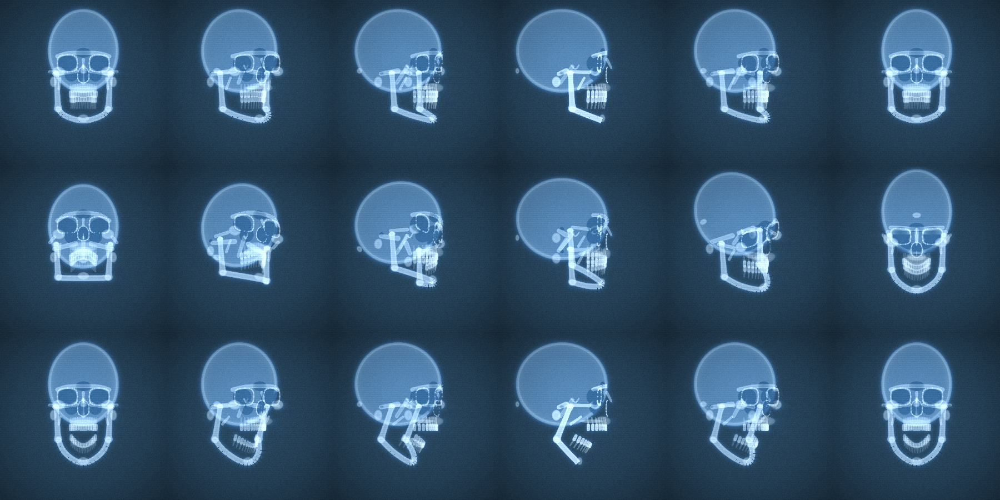

# X-ray glasses

[austegard.com/fun-and-games/xray-glasses](https://austegard.com/fun-and-games/xray-glasses/) turns your
camera feed into a live fluoroscope. Point it at a person, a cat or a dog and a skeleton appears over
them and follows them as they move. Everything runs in the browser; the video never leaves the device.

The skeleton is a drawing, not a scan. The page finds where the joints are and draws a stock skeleton
to fit them. It shows how you are standing; your actual bones do not show.


## Person tracking: Pose Landmarker and Face Landmarker

Google's MediaPipe Pose Landmarker looks at each frame and returns 33 points: nose, eyes, ears,
shoulders, elbows, wrists, hands, hips, knees, ankles and feet. Besides each point's position in the
picture it returns a rough 3D position in metres, and an outline of the body that the page uses for the
faint soft-tissue glow. A small detector (EfficientDet-Lite0) runs every 8 to 20 frames in Auto mode to
decide whether the camera sees a person, a cat or a dog.

When your face is close enough to the camera, a second model, MediaPipe Face Landmarker, also runs. It
returns 478 points on the face, the head's rotation, and scores for expressions, including how far the
mouth is open. That is what turns the skull with your head and opens its jaw when you open your mouth.
From across a room the face is too small for it, and the skull follows your nose and ears instead, which
is less exact: about 8 degrees off in how far the head is turned, against the face model.

Each point is smoothed over time (a One-Euro filter) so the skeleton does not jitter when you stand
still and does not lag much when you move.

## Cat and dog tracking: EfficientDet and RTMPose

The detector draws a box around the animal, and RTMPose, an animal pose model trained on the AP-10K
dataset, finds 17 points in it: eyes, nose, neck, the root of the tail, shoulders, elbows, hips, knees
and paws. The next frame's box follows those points, and the detector checks again every 6 to 8 frames.
The animal model is 27.5 MB, so the page downloads it only the first time it sees a cat or dog.

The cat and dog skeletons are the same template with different skulls, orbits, bone thickness, chest
depth and tail. AP-10K has no point for the tip of the tail, so the page invents the tail and lets it
sway. The detector sometimes calls a dog a cat; the Cat and Dog buttons override it.

## Rendering: bone shapes and two WebGPU passes

Bone sizes come from your proportions: for a person, the distance from shoulders to hips, or 1.35 times
the shoulder width when your hips are out of frame. Every bone is a simple shape (a tapered tube, an
ellipse or a rounded box), a few hundred of them per frame: the spine vertebra by vertebra, 12 pairs of
ribs, the pelvis, both forearm bones, the carpals and finger bones, the foot bones.

Two WebGPU passes draw the frame. The first adds up how much bone each pixel looks through.
A long bone is a hollow tube, so its walls show brighter than its middle, as the cortex does on a real
radiograph. The second pass turns the camera image into film: brightness inverted, edges traced in
cyan, the soft-tissue glow, then the bone brightness on top, with grain, scan lines and a vignette.

## The 3D skull

The skull is a 3D model of about 150 parts, built in centimetres around MediaPipe's standard face: the
cranium, brow ridges, sinuses, eye sockets, the nose opening, cheekbones, the upper jaw and palate, 32
teeth with roots, the mandible, and the dense bone at the base of the skull. Each frame it is turned to
match your head and flattened onto the screen, the way an X-ray beam projects it. The jaw hinges at the
joints in front of the ears, up to 26 degrees open.



## AP, PA and the R marker

The label under "Human" reads AP when you face the camera, PA when you face away and lateral when your
head is turned side-on, the way radiographs are labelled. The page decides AP or PA from the pose
model's depth estimate: when you face the camera your nose is closer than your shoulders, and when you
turn away it is farther. The pose model's other cues do not help: it reports your eyes and nose as fully
visible even from behind.

The R marker always sits on your right side, so it moves across the screen when you turn around. The
skeleton itself does not change: on a radiograph, front and back views of the same body look almost
the same, mirrored.

## Limitations

- It draws a standard skeleton stretched to your joints. Your real bones, injuries and implants do not
  show, and bone thickness comes from the template, not from you.
- It tracks one person or one animal at a time.
- Two people standing side by side with their backs to the camera can be read as one person facing it.
- The page needs WebGPU: Chrome or Edge 121+, Safari 26+, or Firefox 141+ on Windows.

## Measured accuracy

Measured on test images, in [`RESULTS.md`](RESULTS.md), with the scripts in `test/`:

- On the two AP-10K photos that ship with mmpose's tests (an antelope and a jaguar), the animal
  model's joints land a mean 4.1 px and 15.3 px from where people marked them. The
  jaguar fills a crop 1,365 px across, so 15.3 px is about 1% of it.
- Facing toward or away was called right on 20 of 20 photos of people facing the camera, and 6 of the 7
  photos from behind in which a person was found.
- The face model places the skull a median 0.4 cm from where the face is.
- On iOS 26 the camera background first showed rotated a quarter turn, because WebKit's fast path for
  feeding video to WebGPU ignores the phone's rotation (every iOS browser uses WebKit). The page now copies each frame through a canvas,
  which gets it right; confirmed on an iPhone.

Frame rate and battery use on phones have not been measured.

## Pipeline

```
camera (getUserMedia, 960x540 ideal)
  ├─ Auto mode: EfficientDet-Lite0 (COCO, allowlist person/cat/dog, CPU delegate), every 8-20 frames
  ├─ person ─> MediaPipe Pose Landmarker lite ─> 33 landmarks + world landmarks + segmentation mask
  │          ─> Face Landmarker (when the head is > 30 px) ─> head rotation, 478 landmarks, jawOpen
  │          ─> head pose: face-model rotation fitted to 24 face landmarks, else nose + ears of the pose
  └─ cat/dog ─> square crop from the box (x1.25) ─> RTMPose-m AP-10K ─> 17 keypoints
                (each crop is centred on the previous frame's keypoints; the detector re-runs every 6-8 frames)
  ─> One-Euro filter per coordinate (min cutoff 1.2 Hz, beta 0.02)
  ─> JS template builder: keypoints -> ~370-720 bone primitives (capsule / ellipse / rounded box);
     the human skull is a 3D model projected through the head pose
  ─> WebGPU pass 1: one instanced quad per primitive, SDF fragment shader,
     additive "density" + max "glow" into two r16float targets
  ─> WebGPU pass 2: full-screen composite: inverted luminance + Sobel edges in a cyan
     tint, soft tissue from the pose mask, bone density as 1-exp(-1.4 D), glow, grain,
     scanlines, vignette. The video frame is drawn into a 2D canvas (at most 640 px)
     and copied into a texture each frame; importExternalTexture rotates it wrongly on iOS 26 (RESULTS.md, finding 2).
```


## Models

| Stage | Model | Size | Licence | Served from |
|---|---|---|---|---|
| Human pose | MediaPipe Pose Landmarker lite, float16 v1 | 5.8 MB | Apache-2.0 | storage.googleapis.com/mediapipe-models (CORS `*`) |
| Detector (Auto, cat/dog box) | EfficientDet-Lite0 int8 v1, COCO | 4.6 MB | Apache-2.0 | storage.googleapis.com/mediapipe-models |
| Head pose and jaw | MediaPipe Face Landmarker, float16 v1 (BlazeFace short-range + 478-point mesh + blendshapes) | 3.8 MB | Apache-2.0 | storage.googleapis.com/mediapipe-models; optional, the page runs without it |
| Animal pose | RTMPose-m trained on AP-10K, LiteRT fp16 (`litert-community/RTMPose-Animal-AP10K-LiteRT` at commit `1daee634`) | 27.5 MB | Apache-2.0 (mmpose); AP-10K dataset | `./rtm_animal_fp16.bin` beside the page (self-hosted copy, sha256 `7fbfc03239cebc1f657efab722849bc9b30d36d3d4371118aed2aaf4041e742f`, equal to the LFS oid at that commit); Hugging Face as fallback |
| Runtimes | `@mediapipe/tasks-vision@1.1.0`, `@litertjs/core@2.5.3` (+ `@litertjs/wasm-utils@2.5.3`) | ~13 MB wasm each | Apache-2.0 | cdn.jsdelivr.net |

Library versions are pinned to releases at least two weeks old. The animal model is the smallest
quadruped pose model found that runs in a browser. Its model card reports it running fully on WebGPU in
LiteRT.js at 6.2 ms on an M4 Max. The alternatives were larger or not browser-ready: ViTPose++-s APT-36K as
ONNX is 97 MB, DeepLabCut's SuperAnimal-Quadruped ships PyTorch weights only, and the YOLOv8-pose AP-10K
repositories found have no weights. Searches turned up many MediaPipe demos that draw stick figures; none
found draws an X-ray skeleton, and none handles animals.

## Hosting

The live page is a copy in the site repo (`oaustegard.github.io`, `fun-and-games/xray-glasses/`), with
the model file beside it. This directory is the source and holds the tests: edit `web/index.html` here
and copy `web/index.html` and `web/rtm_animal_fp16.bin` there. The link-preview image is `test/pose.jpg`
blended into its own X-ray, rendered by the page's shaders (`test/render-gpu.js`).

## Files

- `web/index.html`: the page. Inline JS and WGSL, no build step.
- `web/rtm_animal_fp16.bin`: the RTMPose-m AP-10K LiteRT model (27.5 MB).
- `test/extract.js`: pulls the inline JS and WGSL blocks out of the page.
- `test/wgsl-check.js`: Dawn compile plus pipeline validation (`VK_ICD_FILENAMES=/usr/share/vulkan/icd.d/lvp_icd.json node wgsl-check.js`; needs `mesa-vulkan-drivers`).
- `test/render-cpu.js`: CPU port of the shaders; writes `test-frame.png`.
- `test/render-gpu.js`: runs the page's shaders in headless Chromium on SwiftShader; writes `test-frame-gpu.png` and the CPU/GPU difference.
- `test/run-rtmpose.py`, `test/verify-rtmpose.js`: run RTMPose with the page's preprocessing, decode with the page's decoder, score against ground truth; write `test/rtm_keypoints.json`.
- `test/render-skull.js`: the 3D skull alone at a grid of head poses; writes `skull-sheet.png`.
- `test/head-pose-check.py`: how closely the face model and the nose-and-ears fallback pose the skull; writes `results/head_pose.json`.
- `test/delegate-timing.js`: MediaPipe start-up per CPU/GPU delegate; writes `results/delegate_timing.json`.
- `test/facing-signals.py`: front/back signals on a labelled image set (downloads into `test/facing-cache/`); writes `results/facing.json`.
- `test/run-page.js`: drives the page in headless Chromium with a fake camera; prints the readout, saves a screenshot.
- `test/make-fixtures.py`: downloads the test images and regenerates the landmark, mask and ground-truth fixtures.
- `test/pose_landmarks.json`, `test/pose_mask.json` (16-level run-length text), `test/ap10k_gt.json`, `test/rtm_keypoints.json`: fixtures.
- `test-frame.png`: CPU-rendered test frame. `test-frame-gpu.png`: the same frame from the WGSL on SwiftShader. `skull-sheet.png`: the skull at yaw 0, 30, 60, 90, 135 and 180 degrees; rows level, pitched 20 degrees, jaw open.

To reproduce: `cd test && npm i && pip install mediapipe==0.10.32 ai-edge-litert pillow && python3 make-fixtures.py && python3 run-rtmpose.py && node verify-rtmpose.js && node render-cpu.js && node render-gpu.js`.

Test images: `pose.jpg` from MediaPipe's test assets
(storage.googleapis.com/mediapipe-assets); `ap10k.jpg` and `ap10k_37516.jpg` from
mmpose `tests/data/ap10k` (Apache-2.0 repository, AP-10K images).
